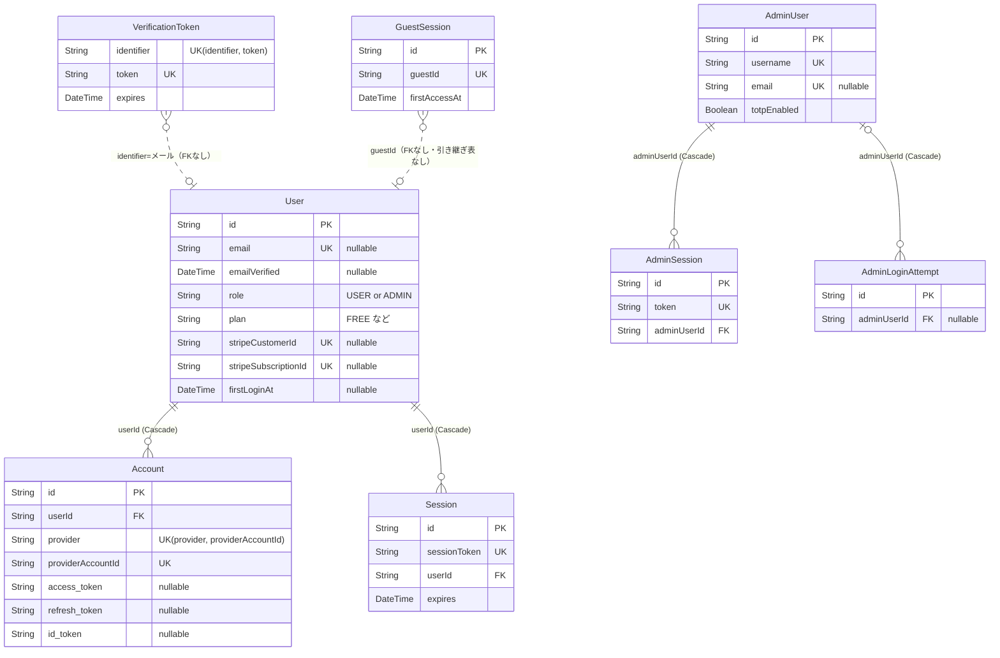
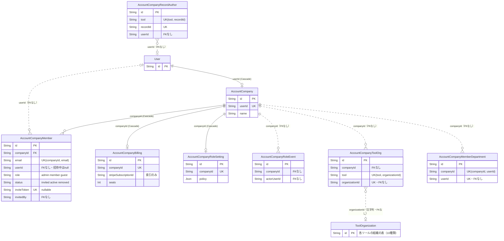
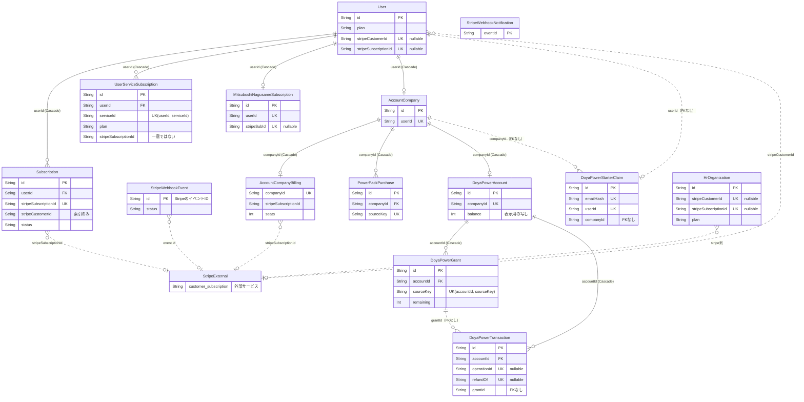
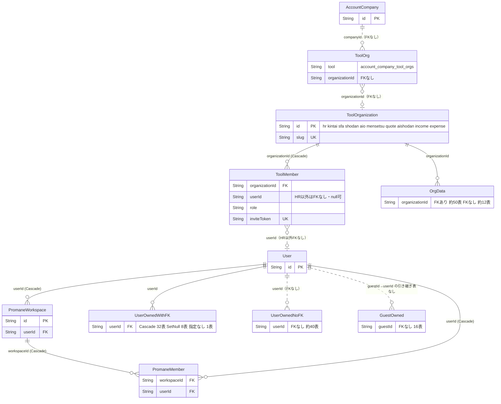

# アカウントまわりの ER 図（Web とアプリで同じアカウントを使うための基礎資料）

作成日：2026-11-18 ｜ 対象：`prisma/schema.prisma`（6,367 行・266 モデル。枝 `docs/doya-app-design-20261118` の `cf09146ad` 時点）

この資料は、ドヤバディ（ドヤAI）をアプリにするときに、Web とアプリでログインアカウントが食い違わないようにするための、アカウントまわりの ER 図です。正本は Prisma スキーマです。接続先の本番 DB の実データや、本番に反映済みかどうかは、この資料からは分かりません（本番の DB・Stripe・環境変数は読んでいません）。

2026-10-06 の ER（`docs/architecture/2026-10-06-er/`）は全サービスを対象にした資料で、アカウント・会社・ドヤパワーは「共通基盤の要約」に数表あるだけでした。その後に増えた会社（`account_companies` 系）、ドヤパワー、役割の表は、この資料で初めて図にしています。2026-10-06 版の件数（190 モデル）は古く、現在は 266 モデルです。

色分けして見たいときは、同じ内容の `account-er.html` をブラウザで開いてください。

## 読み方

- エンティティ名は Prisma のモデル名です。実際のテーブル名は、各表の「テーブル名」列に書きます。`@@map` が無いモデルは、テーブル名もモデル名と同じです（例：`Account`、`Session`、`User`）。
- 実線は、スキーマに外部キー（`@relation(fields: …, references: …)`）がある関係です。点線は、列に User や会社の ID が入る約束はあるものの、外部キーが無い関係です（「FKなし」と書きます）。
- 消したときの動きは `onDelete` の指定です。指定が無いとき、Prisma は必須の関係を Restrict（親を消せない）、任意の関係を SetNull として扱います。ここでは「指定なし」と書き、その意味を添えます。
- 「（推測）」と書いた所は、スキーマだけでは断定できない所です。

## 1. 認証（NextAuth）

NextAuth（`src/lib/auth.ts`）は `PrismaAdapter` を使い、ログイン方法は Google OAuth だけです。`session.strategy` を指定していないため、NextAuth v4 の既定どおり Session 表を使うデータベース方式になっていると考えられます（推測。実際に Session 表へ行が入っているかは未確認）。管理画面の認証（`AdminUser` など）は、`User` と無関係の別の仕組みです。

### 認証の表

| モデル | テーブル名 | 主キー | 外部キー | 一意制約 | 消したときの動き | 備考 |
|---|---|---|---|---|---|---|
| User（L57） | `User` | `id`（cuid） | なし（親） | `email`、`stripeCustomerId`、`stripeSubscriptionId` | 下の「User を消したとき」を参照 | `plan` と `role` は文字列（列挙型ではない）。`email` は null 可 |
| Account（L18） | `Account` | `id` | `userId` → `User.id` | `(provider, providerAccountId)` | User を消すと Cascade で消える | OAuth のトークン（`access_token`・`refresh_token`・`id_token`）を Text で持つ。`userId` の索引なし |
| Session（L37） | `Session` | `id` | `userId` → `User.id` | `sessionToken` | User を消すと Cascade で消える | `userId` の索引なし |
| VerificationToken（L45） | `VerificationToken` | なし（`@id` なし） | なし | `token`、`(identifier, token)` | 親が無い（期限切れの掃除のしくみはスキーマに無い） | メールリンク用の NextAuth 標準の形。現在の設定は Google だけで、使う場面は未確認 |
| GuestSession（L921） | `guest_session` | `id` | なし | `guestId` | 親が無い | 未ログインの利用者の識別（Cookie の guestId）。`User` との関係の列は無い |
| AdminUser（L370） | `AdminUser` | `id` | なし | `username`、`email` | `AdminSession`・`AdminLoginAttempt` は Cascade | `passwordHash`・`totpSecret` を持つ。`User` とは別 |
| AdminSession（L402） | `AdminSession` | `id` | `adminUserId` → `AdminUser.id` | `token` | Cascade | |
| AdminLoginAttempt（L386） | `AdminLoginAttempt` | `id` | `adminUserId`（null 可）→ `AdminUser.id` | なし | Cascade | |

## 2. 会社（チーム）とメンバーと役割

「1 つのアカウントに会社は 1 つ」（スキーマのコメント L5942）です。`AccountCompany.userId` が一意で、会社を作った人（持ち主）を表します。持ち主はメンバー表に行を持たず、1 人目として数えます（L5978 のコメント）。メンバー表の `userId` は、招待中は null で、外部キーはありません。

### 会社の表

| モデル | テーブル名 | 主キー | 外部キー | 一意制約 | 消したときの動き | 備考 |
|---|---|---|---|---|---|---|
| AccountCompany（L5947） | `account_companies` | `id` | `userId` → `User.id` | `userId` | User を消すと Cascade。会社を消すと、メンバー・課金の控え・役割の設定・ドヤパワーの口座・追加購入の控えが Cascade | 1 ユーザー 1 会社。`name` が必須 |
| AccountCompanyMember（L5980） | `account_company_members` | `id` | `companyId` → `account_companies.id`。`userId`、`invitedBy` は外部キーなし | `inviteToken`、`(companyId, email)` | 会社を消すと Cascade | `email` は小文字にそろえて入れる（コメント）。`role` と `status` は文字列。`userId` の索引あり（`@@index`） |
| AccountCompanyBilling（L6004） | `account_company_billing` | `id` | `companyId` → `account_companies.id` | `companyId` | 会社を消すと Cascade | 買った人数 `seats` と `stripeSubscriptionId` の控え。Stripe の顧客 ID の列は無い。`stripeSubscriptionId` は索引のみで一意ではない |
| AccountCompanyRoleEvent（L6028） | `account_company_role_events` | `id` | なし（`companyId`・`actorUserId`・`targetMemberId` はただの文字列） | なし | 会社を消しても残る（設計。DB のトリガーで UPDATE と DELETE を止める、とコメントにある） | 役割変更の記録 |
| AccountCompanyRoleSetting（L6046） | `account_company_role_settings` | `id` | `companyId` → `account_companies.id` | `companyId` | 会社を消すと Cascade | |
| AccountCompanyRecordAuthor（L6060） | `account_company_record_authors` | `id` | なし | `(tool, recordId)` | 残る | 「自分で作った見積を自分で確定しない」の判定用 |
| AccountCompanyToolOrg（L6074） | `account_company_tool_orgs` | `id` | なし | `(tool, organizationId)` | 残る（コメントで「つながりは消えない」） | 1 つのツール組織は 1 つの会社にだけつながる（一意制約で保証） |
| AccountCompanyMemberDepartment（L6089） | `account_company_member_departments` | `id` | なし | `(companyId, userId)` | 残る | 部署は文字列の配列 |

スキーマのコメント（L5976・L6023）には、これらの表について「本番 DB にはまだ無い。流す SQL は別資料」と書かれています。現在の本番の状態は未確認です。

## 3. 課金とドヤパワー

契約の状態は 4 か所に分かれて持たれます。①`User` の列（`plan`・`stripeCustomerId`・`stripeSubscriptionId`）、②`Subscription`（Stripe の契約 1 件につき 1 行）、③`UserServiceSubscription`（サービスごとの行。統一プランでは同じ契約 ID が全サービスの行に入る）、④会社単位の `account_company_billing`（新しい料金。人数の控え）です。ほかに、ドヤHR の組織（`hr_organizations`）とナグサメ（`mitsuboshi_nagusame_subscriptions`）が、それぞれ別に Stripe の列を持ちます。課金の正本は `reference/11-billing-spec.md` で、料金判定は `User.plan` を単一の参照先とする方針です。

### 課金・ドヤパワーの表

| モデル | テーブル名 | 主キー | 外部キー | 一意制約 | 消したときの動き | 備考 |
|---|---|---|---|---|---|---|
| Subscription（L205） | `Subscription` | `id` | `userId` → `User.id` | `stripeSubscriptionId` | User を消すと Cascade | `userId` は一意ではない（1 人に複数行を持てる）。`stripeCustomerId` は索引のみ |
| UserServiceSubscription（L171） | `UserServiceSubscription` | `id` | `userId` → `User.id` | `(userId, serviceId)` | User を消すと Cascade | `stripeSubscriptionId` の一意制約は意図して外してある（L180〜184 のコメント）。`serviceId` は文字列で、`Service` への外部キーではない |
| StripeWebhookEvent（L334） | `StripeWebhookEvent` | `id`（Stripe のイベント ID） | なし | 主キー | 親が無い | 再送の二重処理を防ぐ |
| StripeWebhookNotification（L350） | `StripeWebhookNotification` | `eventId` | なし | 主キー | 親が無い | 運営への通知の再送用 |
| DoyaPowerAccount（L6125） | `doya_power_accounts` | `id` | `companyId` → `account_companies.id` | `companyId` | 会社を消すと Cascade | `balance` は写しで、正は `grant.remaining` の合計（コメント） |
| DoyaPowerGrant（L6141） | `doya_power_grants` | `id` | `accountId` → `doya_power_accounts.id` | `(accountId, sourceKey)` | 口座を消すと Cascade | `sourceKey` が null の行は一意制約の対象外（PostgreSQL の既定。推測だが一般的な挙動） |
| DoyaPowerTransaction（L6161） | `doya_power_transactions` | `id` | `accountId` → `doya_power_accounts.id`。`grantId` は外部キーなし | `operationId`、`refundOf` | 口座を消すと Cascade | 「消さない・書き換えない」はアプリの約束で、スキーマでは守られていない |
| DoyaPowerStarterClaim（L6105） | `doya_power_starter_claims` | `id` | なし | `emailHash`、`userId` | 残る（設計。同じメールに二度付与しないため） | メールは SHA-256 のハッシュだけ持つ |
| PowerPackPurchase（L6352） | `power_pack_purchases` | `id` | `companyId` → `account_companies.id` | `sourceKey` | 会社を消すと Cascade | 追加購入（現金）の控え。会社を消すと購入の記録も消える |
| MitsuboshiNagusameSubscription（L2078） | `mitsuboshi_nagusame_subscriptions` | `id` | `userId` → `User.id` | `userId`、`stripeSubId` | Cascade | ナグサメは別シリーズ |
| HrOrganization（L2097） | `hr_organizations` | `id` | なし | `slug`、`stripeCustomerId`、`stripeSubscriptionId` | メンバー・部署・社員などは Cascade | 組織単位で独自に Stripe の列と `plan` を持つ |

## 4. ツールのデータの持ち主

各ツールのデータは、持ち主が 3 種類に分かれます。①ユーザー（`userId`）、②ツールごとの組織（`organizationId`。組織表が 10 種類ある）、③プロマネのワークスペース。さらに、未ログインでも使えるツールは `guestId` も持ちます。会社（`AccountCompany`）と各ツールの組織は、`account_company_tool_orgs` の文字列でつながるだけで、外部キーはありません。

### ツールごとの持ち主の一覧

「FK」は `User.id` への外部キーの有無です。「デ」はドヤ、「組」は組織です。

| ツール（サービス） | 持ち主の主な表（モデル／テーブル名） | 持ち主の種類 | User への FK と消したときの動き | 備考 |
|---|---|---|---|---|
| banner（ドヤバナー） | `Generation`（`serviceId='banner'`）、`BannerTemplate`（`banner_template`） | userId | `Generation` は Cascade。`BannerTemplate` は持ち主なし（共通のひな形） | バナー専用の持ち主表は無く、全サービス共通の `Generation` に入る |
| seo（ドヤ記事作成） | `SeoArticle`、`SwipeSession`、`SeoKnowledgeItem` | userId（null 可）と guestId | SetNull | 子（`SeoJob` など）は `articleId` で付く |
| interview（ドヤインタビュー） | `InterviewProject`（`interview_project`）、`InterviewRecipe`（`interview_recipe`） | userId（null 可）と guestId | SetNull | |
| strategy | `StrategyProject`（`strategy_project`） | userId（null 可）と guestId | SetNull | |
| tenkai（ドヤ展開） | `TenkaiProject` ほか 5 表（`tenkai_*`） | userId | Cascade | |
| opening / movie | `OpeningProject`、`MovieProject`（`movie_projects`） | userId（null 可）と guestId | SetNull | |
| copy / voice / lp / adsim | `CopyProject`・`CopyBrandVoice`、`VoiceProject`、`LpProject`（`lp_projects`）、`AdSimProject`（`ad_sim_projects`） | userId（`Copy`・`Voice`・`Lp` の一部は null 可）と guestId | Cascade | `CopyProject` と `AdSimProject` は userId が null 可だが Cascade |
| interviewx | `InterviewXProject`（`interviewx_projects`）、`InterviewXTemplate` | userId | `InterviewXProject` は onDelete 指定なし（Restrict 扱い）。`InterviewXTemplate` は FK なし | User の削除を止める可能性（気づいた点 1） |
| persona | `PersonaProject`（`persona_projects`）、`PersonaImageUsageDay`、`PersonaUsageDay` | userId | Cascade | |
| adbanner / adimage | `AdBannerCampaign`（`adbanner_campaign`）、`AdImageBrand`・`AdImageCampaign`（`adimage_*`） | userId（null 可）と guestId | FK なし | |
| hr（ドヤHR） | `HrOrganization`／`HrOrganizationMember`（`hr_organization_members`）、`HrInvitation`、`HrAuditLog` | 組 | `HrOrganizationMember` は FK あり・Cascade。`HrAuditLog.userId` は FK なし | 組織単位で Stripe の列を持つ |
| kintai（ドヤ勤怠） | `KintaiOrganization`／`KintaiMember`（`kintai_members`） | 組 | FK なし（`userId` は必須） | `KintaiEmployee.organizationId` は FK なし（`memberId` 経由の FK はある） |
| promane（ドヤプロマネ） | `PromaneWorkspace`（`promane_workspaces`）、`PromaneMember`、`PromaneInvitation` | ワークスペース（作成者は userId） | Cascade | `PromaneInvitation.invitedById` も `User` への Cascade |
| sfa（ドヤ営業管理） | `SfaOrganization`／`SfaMember`（`sfa_members`） | 組 | FK なし（null 可） | 取引先・商談など 7 表は `organizationId` に FK なし |
| shodan・aio・mensetsu・quote・aishodan | 各 `*Organization`／`*Member`（`shodan_members`、`aio_members`、`mensetsu_members`、`quote_members`、`aishodan_members`） | 組 | FK なし（null 可） | 各組織の子の表は `organizationId` に FK あり（Cascade） |
| income / expense（ドヤ収入管理・支出管理） | `IncomeOrganization`／`IncomeMember`、`ExpenseOrganization`／`ExpenseMember` | 組 | FK なし（null 可） | `IncomeOrganization.companyId`・`ExpenseOrganization.companyId` は会社への FK なし |
| doyalist / doyaslide | `DoyalistProject`・`DoyalistTemplate`、`DoyaSlideProject` | userId | FK なし | |
| cunning（ドヤカンニング） | `CunningSession` ほか 5 表（`cunning_*`） | userId | FK なし | |
| shanai | `ShanaiCompany`（`userId` 一意）ほか | userId | FK なし | `ShanaiCompany` は「ユーザー 1 人につき 1 社」 |
| tenjikai | `TenjikaiProject`（`tenjikai_project`）、`TenjikaiGenerationJob` | userId | `TenjikaiProject` は Cascade。ジョブは FK なし | |
| popup・asklink・doyamana | `PopupSite`・`Popup`、`AskLinkRun`、`DoyamanaUsageLog` | userId（`DoyamanaUsageLog` は null 可と guestId） | FK なし | |
| 共通 | `Generation`、`Drip*`、`ServiceFeedback`、`SupportTicket`、`StoredFile`（`stored_file`）、`DirectUploadSession`、`HomeAgentRun`・`HomeAgentTask` | userId | `Generation`・`Drip*`・`ServiceFeedback`・`SupportTicket` は Cascade。`StoredFile`・`DirectUploadSession`・`HomeAgent*` は FK なし | `HomeAgentRun` は「User の表を変えないため FK なし」（コメント L6184 付近） |

数の目安（スキーマから数えた値）：`User` への外部キーを持つモデルは 41、外部キーの本数も 41（`PromaneInvitation.invitedById` を含む。内訳は Cascade 32、SetNull 8、指定なし 1）。`userId` 系の列（`createdByUserId` 2 表を含む）を持ち、外部キーが無いモデルは 43 です（会社・ドヤパワーの 4 表を含む）。`guestId` を持つモデルは、`GuestSession` を除いて 16 です。

## 5. User を消したとき

`User` を 1 行消したときの、直接の子の動きです（子の子は、各モデルの `onDelete` に従います。全部は追い切れていません）。

| 動き | 該当する表 |
|---|---|
| Restrict 扱い（消せない） | `InterviewXProject`（`interviewx_projects`）。`onDelete` の指定が無い必須の関係のため、この行があると User の削除が失敗する（Prisma の既定の挙動。実際の DB の制約は未確認） |
| Cascade（一緒に消える。32 本） | `Account`、`Session`、`UserServiceSubscription`、`Subscription`、`Generation`、`tenkai_projects`・`tenkai_brand_voices`・`tenkai_templates`・`tenkai_usage`・`tenkai_api_keys`、`CopyBrandVoice`、`CopyProject`、`lp_projects`、`VoiceProject`、`drip_enrollments`・`drip_email_logs`・`drip_unsubscribes`、`ad_sim_projects`、`mitsuboshi_nagusame_posts`・`mitsuboshi_nagusame_subscriptions`、`hr_organization_members`、`promane_workspaces`・`promane_members`・`promane_invitations`（招待した人として）、`service_feedback`、`feedback_prompt_state`、`persona_projects`・`persona_image_usage_days`・`persona_usage_days`、`tenjikai_project`、`account_companies`、`support_ticket` |
| SetNull（行は残り、持ち主が空になる。8 本） | `SeoArticle`、`SwipeSession`、`SeoKnowledgeItem`、`interview_project`、`interview_recipe`、`strategy_project`、`OpeningProject`、`movie_projects` |
| 何も起きない（行が残り、存在しない userId を指したままになる） | FK なしの約 40 表（例：`kintai_members`、`sfa_members` など各ツールのメンバー表、`cunning_*`、`doyalist_*`、`doyaslide_projects`、`shanai_*`、`stored_file`、`home_agent_*`、`account_company_members`、`account_company_member_departments`、`account_company_record_authors`、`doya_power_starter_claims`） |

`account_companies` が Cascade で消えると、その先で次のものも消えます：`account_company_members`、`account_company_billing`、`account_company_role_settings`、`doya_power_accounts`（その先の `doya_power_grants`・`doya_power_transactions`）、`power_pack_purchases`。残るのは、`account_company_role_events`、`account_company_tool_orgs`、`account_company_member_departments`、`doya_power_starter_claims`、`account_company_record_authors` です。各ツールの組織（`SfaOrganization` など）は消えません。つまり、会社の持ち主が消えると、組織とそのデータだけが持ち主のいない形で残ります（推測：アプリ側に退会時の後始末があるかは未確認）。Stripe の顧客や契約は DB の外にあり、DB の削除では止まりません。

## 6. 気づいた点

重大なものを上に並べます。行番号は `prisma/schema.prisma` のものです。

### 重大（アプリ化の前に決めたい）

1. **User の削除が止まる可能性がある。** `InterviewXProject.user` だけ `onDelete` の指定が無い（L1613）。必須の関係なので Restrict 扱いとなり、この行を持つユーザーは削除できない（推測：本番 DB の実際の制約は未確認）。退会機能やアプリのストア審査が求めるアカウント削除に直結する。
2. **User を消すと、ツールの組織とメンバーの行が持ち主を失って残る。** 8 つのメンバー表（`KintaiMember` L2417、`SfaMember` L3131、`ShodanMember` L3388、`AioMember` L3521、`MensetsuMember` L3656、`QuoteMember` L3908、`AishodanMember` L4068、`IncomeMember` L5296、`ExpenseMember` L5676）の `userId` に外部キーが無い。ヒト（User）が消えても行は残り、参加状態のまま存在しない ID を指す。`HrOrganizationMember`（L2139）だけは外部キーがある。
3. **「同じ人」を表す列が、場所ごとに別の持ち方をしている。** `AccountCompanyMember.userId`（L5985）、`AccountCompanyMemberDepartment.userId`（L6092）、`AccountCompanyRecordAuthor.userId`（L6064）、`DoyaPowerStarterClaim.userId`（L6108）は、どれも外部キーが無い文字列。Web とアプリで同じ User ID を使う前提を、DB が守ってくれない。

### 重要

4. **会社のメンバーは、メールで招待し、`userId` を後から入れる作り。** 一意制約は `(companyId, email)` だけで（L5996）、`(companyId, userId)` の一意制約は無い（L5985）。同じ User が別メールの行で同じ会社に 2 回入る可能性がある（推測：アプリ側の検査で防いでいるかは未確認）。メールは「小文字にそろえて入れる」とコメントにあるが（L5983）、`User.email`（L60）は DB 側で小文字にそろえる制約が無い。招待メールと Google のメールの大文字小文字が違うと、一致しない可能性がある（推測）。
5. **契約の状態が 4 か所にある。** `User` の列（L140〜144）、`Subscription`（L205）、`UserServiceSubscription`（L171）、`account_company_billing`（L6004）。ほかに `HrOrganization`（L2114〜2118）と `MitsuboshiNagusameSubscription`（L2082〜2084）も別の Stripe の列を持つ。`plan` は文字列で、取りうる値の表記が表ごとに違う（`FREE | STARTER | PRO …`（L144）、`FREE | PRO | ENTERPRISE`（L178）、`free | pro`（L2083））。アプリ内課金（App Store・Google Play）を足すと、5 か所目が増える。
6. **Stripe との結び付きが一意でない所がある。** `Subscription.stripeCustomerId`（L212）は索引のみで一意でなく、`User.stripeCustomerId`（L140）は一意。`account_company_billing.stripeSubscriptionId`（L6008）は索引のみで一意でない（同じ契約が複数の会社に付く可能性が、スキーマ上は排除されていない）。`account_company_billing` には Stripe の顧客 ID の列が無い。
7. **持ち主が 3 種類（userId・organizationId・companyId）で混在している。** 会社（`AccountCompany`）と各ツールの組織（10 種類）は外部キーでつながらず、`account_company_tool_orgs`（L6074。`organizationId` は文字列）でつなぐ。`IncomeOrganization.companyId`（L5271）と `ExpenseOrganization.companyId`（L5651）も外部キーなし。ドヤパワーの持ち主は会社（`doya_power_accounts.companyId`）、旧プランの持ち主は User（`User.plan`）で、アプリが「どの単位で課金し、どの単位で見せるか」を決める必要がある。
8. **未ログインの `guestId` から User へ引き継ぐための表・列が無い。** 16 モデルが `guestId` を持つ（例：`SeoArticle` L421 付近、`CopyProject`、`VoiceProject`、`LpProject`）。ログイン後に引き継ぐ処理はアプリのコード側の話で、スキーマには痕跡が無い（推測：アプリ側の実装は未確認）。アプリで未ログイン利用を許すなら、引き継ぎの設計が要る。
9. **モバイルアプリ用のトークンや端末の表が無い。** スキーマには、端末の登録、リフレッシュトークン、プッシュ通知トークンの表が見当たらない（`TenkaiApiKey`（L1230 付近）は展開 AI の API キーで別物）。ログイン方法は Google OAuth だけで、Cookie のセッション（Session 表）を前提にした作りに見える（推測）。アプリで Apple でログインを足す場合、同じメールの `Account` を結び付ける方針が要る（NextAuth の既定は、別のプロバイダーで同じメールだとエラーにする。`allowDangerousEmailAccountLinking` は `src/lib/auth.ts` に無い。推測を含む）。

### 軽微

10. **FK なしの子の表。** `SfaAccount` L3182・`SfaContact` L3209・`SfaLead` L3232・`SfaPipeline` L3256・`SfaDeal` L3284・`SfaActivity` L3329・`SfaTask` L3351 の `organizationId` は `SfaOrganization` への外部キーが無い。組織を消すとこれらが残る。`IncomeInvoiceSequence`（L5535）も同様。
11. **索引が足りない可能性。** `Account`（L18）と `Session`（L37）に `userId` の索引が無い（外部キー列で、検索や User 削除時の確認に使われる。推測：行数が少ないうちは影響しない）。
12. **トークンの保管。** `Account.access_token`・`refresh_token`・`id_token`（L24〜27）は Text で、列の暗号化の指定は見当たらない（推測：アプリ側で暗号化しているかは未確認）。
13. **役割と状態の語がツールごとに違う。** `KintaiMember.role` は `system_admin` など（L2422）、`HrOrganizationMember.role` は `MEMBER`（L2146）、`AccountCompanyMember.role` は `admin | member | guest`（L5986）。`status` も `ACTIVE`（大文字）と `active`（小文字）が混在する。すべて文字列で、列挙型ではない。
14. **「消さない」を DB が守っていない。** `DoyaPowerTransaction`（L6161）の「消さない・書き換えない」はコメントのみ。`DoyaPowerTransaction.grantId`（L6170）は外部キーなしで、付与の行が消えると指す先が無くなる。`AccountCompanyRoleEvent` は DB のトリガーで守るとコメントにあるが（L6024）、トリガーはスキーマに現れない（未確認）。
15. **本番に無い表が混在している可能性。** `account_company_members`・`account_company_billing`（L5976）、役割の 3 表（L6023）、ドヤパワーの表（L6121）、`HomeAgentRun`・`HomeAgentTask`（L6183）には「本番 DB にはまだ無い」とのコメントがある。現在の本番の状態は確認できていないため、アプリが依存する表は、反映状況の確認が先。

## 7. 確かめきれなかった点

- 本番 DB・Stripe・環境変数は読んでいない（指示による）。本番に表があるか、実データの件数、外部キーの実際の制約は未確認。
- `session.strategy` を明示していないため、Session 表に実際に行が入るかは、コードの実行を見ていない（NextAuth v4 の既定の挙動からの推測）。
- User 削除の「子の子」までの全経路は追っていない（直接の子のみ）。
- 各ツールの持ち主の分類は、`userId`・`organizationId`・`workspaceId`・`companyId`・`guestId` の列と `@relation` から機械的に数えた。FK なしの 43 モデルの内訳の一部（`HrAuditLog` など組織が主で userId が補助のもの）は、持ち主の分類を人手で補った。
- 退会・アカウント削除の処理、ゲストからの引き継ぎ処理が、アプリのコード側にあるかは確認していない（スキーマだけを正本とした）。
