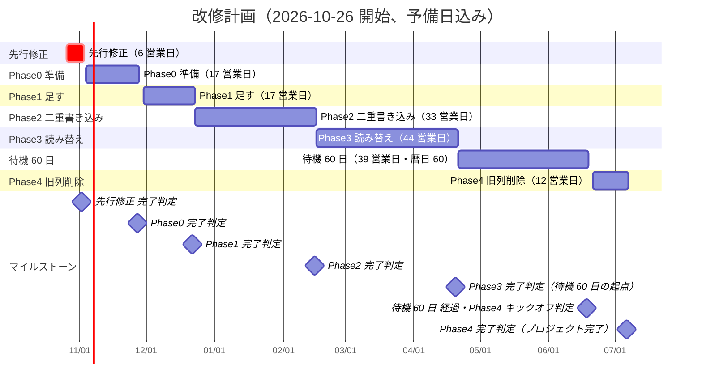

# 改修計画 全日程スケジュール（1 日単位）

- 対象: [README.md](./README.md) §12 の段階的移行計画（先行修正 1 週間 → Phase0 3 週間 → Phase1 2 週間＋観察 1 週間 → Phase2 6 週間 → Phase3 8 週間 → 待機 60 日 → Phase4 2 週間）
- 体制: 実装 A・実装 B・リード L の 3 名。既存機能の改修と並行しない（README §12 の見積りの前提）
- 開始日: **2026-10-26（月）**（仮置き）。土日と日本の祝日・年末年始（2026-12-29〜2027-01-03）は作業日にしない
- **終了予定日（予備日込み）: 2027-07-06（火）**。総作業日数（営業日、予備日を含む）: **168 日**。行数: **504 行**（担当ごとに 1 行）
- 予備日: 先行修正 1 日、Phase0 2 日、Phase1 2 日、Phase2 3 日、Phase3 4 日、Phase4 2 日（各フェーズの完了判定会の直後。判定に落ちた項目の修正と再判定に使う。使わなかった予備日は次フェーズの前倒しに使わず、そのまま吸収する）

## 全体ガント

## マイルストーン一覧

| 日付 | マイルストーン | 判定基準 |
|---|---|---|
| 2026-11-02（月） | 先行修正 完了判定 | §15 の 16 件が本番で確認済み（CHECKLIST AUTH-17/34/35、EXT-03、IO-14/15/16、EXT-22/23、BIL 無し） |
| 2026-11-27（金） | Phase0 完了判定 | ビルド通過・ドライラン反映・マニフェスト 32 件・要実機確認 4 点の記録（CHECKLIST MIG-01/22、TEN-35、RUN-02） |
| 2026-12-22（火） | Phase1 完了判定 | 全アクティブ組織に CompanyServiceLink、reconcile 不一致 0、Session 拡張とアダプタが稼働、挙動変化なし（MIG-17/20、SCH-12、AUTH-04/21） |
| 2027-02-15（月） | Phase2 完了判定 | shadow 差分 0×7 日（直列）、UsageLedger 残高差 0、report-only 誤分類 0（MIG-07/08/09、BIL-07、AUTHZ-01） |
| 2027-04-20（火） | Phase3 完了判定（待機 60 日の起点） | legacy_access 7 日 0、回帰全通過、運営利用 2 週間 critical 0、乖離 0、unknown_outcome < 1%（AGT 章、RUN-17/18） |
| 2027-06-18（金） | 待機 60 日 経過・Phase4 キックオフ判定 | 60 暦日経過、critical 0 継続、SLO 達成、HrOrganization.plan 読み手 0、復元リハーサル準備完了（MIG-11/12、BIL-11） |
| 2027-07-06（火） | Phase4 完了判定（プロジェクト完了） | 旧列削除・ER 再生成・legacy 0・回帰全通過（SCH 章、MIG-11、RUN 章） |

## フェーズ別の期間

| フェーズ | 開始 | 終了 | 営業日 |
|---|---|---|---|
| 先行修正 | 2026-10-26（月） | 2026-11-02（月） | 6 |
| Phase0 準備 | 2026-11-04（水） | 2026-11-27（金） | 17 |
| Phase1 足す | 2026-11-30（月） | 2026-12-22（火） | 17 |
| Phase2 二重書き込み | 2026-12-23（水） | 2027-02-15（月） | 33 |
| Phase3 読み替え | 2027-02-16（火） | 2027-04-20（火） | 44 |
| 待機 60 日 | 2027-04-21（水） | 2027-06-18（金） | 39（暦日 60） |
| Phase4 旧列削除 | 2027-06-21（月） | 2027-07-06（火） | 12 |

## 祝日・休み一覧（期間内）

| 日付 | 名称 |
|---|---|
| 2026-11-03（火） | 文化の日 |
| 2026-11-23（月） | 勤労感謝の日 |
| 2026-12-29（火） | 年末年始休み |
| 2026-12-30（水） | 年末年始休み |
| 2026-12-31（木） | 年末年始休み |
| 2027-01-01（金） | 元日（年末年始休み） |
| 2027-01-02（土） | 年末年始休み |
| 2027-01-03（日） | 年末年始休み |
| 2027-01-11（月） | 成人の日 |
| 2027-02-11（木） | 建国記念の日 |
| 2027-02-23（火） | 天皇誕生日 |
| 2027-03-21（日） | 春分の日（日） |
| 2027-03-22（月） | 振替休日（春分の日） |
| 2027-04-29（木） | 昭和の日 |
| 2027-05-03（月） | 憲法記念日 |
| 2027-05-04（火） | みどりの日 |
| 2027-05-05（水） | こどもの日 |

## 前提とクリティカルパス

- **前提**: README §12 の見積り（期間・人員）と同じ。本番 DB への変更は `doya-db-push` 手順で**デプロイ前**に手動反映する（P2022 対策）。本番作業は深夜帯（23:00〜01:00 JST）または業務時間外（20:00）に立会い 2 名で行い、3 営業日前に告知する（Cookie 切替＝全員再ログインは 1 週間前）。
- **クリティカルパス**（遅れるとそのまま終了日が後ろにずれる直列の区間）:
  1. 先行修正 → Phase0 の要実機確認 ①〜④（結果で Phase1 の必須項目と Phase4 の RLS 採否が決まる）
  2. Phase1 の本番作業①（db push＋Session index）→ 本番作業②（名寄せ）→ 本番作業③（Cookie 切替）。②は①の後、③は②の後にしか実施できない。Phase2 の④（dual_write ON）⑤（report-only 開始）、Phase3 の⑥（読み替えフラグ ON）⑦（セッション・step-up 強制）、Phase4 の⑧（復元リハーサル）⑨（旧列削除）も同様に直列
  3. Phase2 の **report-only 2 週間（本番 10 営業日）→ shadow 差分 0 が 7 日**。直列で最短 3 週間強。report-only の誤分類が 3 日連続 0 にならない限り shadow のカウントを始めない
  4. Phase3 の 3a → 3b → 3c → 3d。各サブフェーズは gateway 移行（§8.3 の順 (1)〜(6)）がツール登録の前提なので入れ替え不可
  5. **待機 60 日（暦日）は Phase3 の完了判定日が起点**。Phase3 が 1 日遅れると Phase4 も 1 日遅れる
  6. Phase4 の本番作業⑧（復元リハーサル）→ ⑨（旧列削除）。⑧が通らなければ⑨は実施しない
- **並列で吸収できる作業**: Phase0 の core/llm/agent 骨格（A/B）と要実機確認（L）、Phase2 の課金移行スクリプト（B）と分類修正（A）、Phase3 の各サブフェーズ内の A/B 作業、待機期間の全作業
- **要実機確認 4 点の分岐**（Phase0 第 1〜2 週、担当 L）: ① 拡張と対話型 tx → Phase1 の lint 強制レベル、② `after()` の時間上限 → Phase3 の Cron 起動方式（HTTP 起動 or K スロット）、③ `db push` と RLS ポリシー → Phase4 の RLS 採否と `doya-db-push` 手順、④ pooler の接続固定 → 方式 B の前提（不成立なら D21 に代替案）。いずれも設計は両方に耐えるため、分岐で日程は変わらない（Phase4 の RLS 作業が「実施しない」になる可能性のみ）

## 日次スケジュール

凡例: 担当 A＝実装 A、B＝実装 B、L＝リード。「完了の確認」の `verify-*.cjs` は `scripts/security-regression/`、CHECKLIST の ID は [CHECKLIST.md](./CHECKLIST.md)。本番作業は **太字**。

| 日付（曜日） | フェーズ・週 | 担当 | 作業 | 成果物 | 完了の確認 | 戻し方／リスク |
|---|---|---|---|---|---|---|
| 2026-10-26（月） | 先行修正・第1週 | A | §15 #1 D-1＋SEC-28: `src/lib/admin-auth.ts` の `JWT_SECRET` フォールバック削除・未設定で throw、`jwt.verify(..., {algorithms:["HS256"]})`、`type==="admin"` 検査。Vercel に `ADMIN_JWT_SECRET` を別値で設定（L が投入） | PR `fix(admin): JWT 秘密鍵のフォールバック削除と type/algorithms 検査` | `verify-admin-secret-required.cjs`（新規）通過、`npm run build` 通過、デプロイ後に admin ログイン可 | PR revert。env 未設定だと起動失敗するので env 投入を先に |
| 2026-10-26（月） | 先行修正・第1週 | B | §15 #2 SEC-30＋D-6: `src/lib/core/cron-auth.ts` `requireCron`（`timingSafeEqual`）新設、`banner-admin-guard.ts` の CRON 代替と `verifyToken` 直呼びを `verifyAdminSession` に置換 | PR `fix(auth): requireCron と banner admin guard の DB 照合` | `verify-cron-timing-safe.cjs`（新規）、ログアウト済み admin JWT で banner admin API が 401 | PR revert。cron 39 本の置換は Phase0 以降で順次 |
| 2026-10-26（月） | 先行修正・第1週 | L | §15 の PR レビュー体制: `scripts/security-regression/run.cjs` 末尾の配列ループに新規 verify を追加する流儀を決め、`ADMIN_JWT_SECRET` を Vercel（Production/Preview）に投入。告知: 先行修正 #9（HR webhook 410）の Stripe 側登録削除を経理に連絡 | 運用メモ `docs/ops/2026-10-26-pre-fixes.md`（任意） | env 投入済み、Stripe ダッシュボードの旧 webhook を削除 | — |
| 2026-10-27（火） | 先行修正・第1週 | A | §15 #3 SEC-29: admin ログインのロックを IP＋username の組に、breakglass は IP ロックのみ、ロック中でも正しいパスワードなら通す（`admin-auth.ts` L59-104、`admin/auth/login/route.ts`）。同じファイルなので #5 D-7（breakglass 有効時の Slack 日次通知、使用後の自動拒否 `SystemSetting("admin-breakglass-used-at")`）も同日に | PR `fix(admin): ロックアウト DoS 対策と breakglass の使用後自動拒否` | 手動: 誤パスワード 10 回後に正しいパスワードで入れる、breakglass 2 回目が拒否、Slack 通知。既存 admin 回帰 8 本通過 | PR revert |
| 2026-10-27（火） | 先行修正・第1週 | B | §15 #4 D-3: `gemini-text.ts` L95/L191 の `?key=` を `x-goog-api-key` ヘッダへ。修正後に Gemini キーをローテーション（L と同時） | PR `fix(llm): Gemini キーを URL から除去` | grep `?key=` が 0、`verify-banner-text-route-provider.cjs` 通過 | PR revert。旧キーは失効済みなので revert 時は新キーのまま |
| 2026-10-27（火） | 先行修正・第1週 | L | #4 の Gemini キーローテーション（新キー発行→env 更新→デプロイ→旧キー失効。`LlmCallLog` 未導入なので Cloud Monitoring の失敗率で確認）。#1〜#6 のレビューとマージ順の調整（#1 は env 投入後）、完了判定会の準備（§15 の確認方法を表にする） | env 更新記録 | 旧キー失効後 24h で 401 が 0 | 旧キーを一時再有効化 |
| 2026-10-28（水） | 先行修正・第1週 | A | §15 #7 D-5（`signIn` で `profile.email_verified !== true` を拒否）、#8 SEC-08（`access_type offline` を入れない方針を `auth.ts` のコメントに固定）、#9 D-2（`hr/billing/webhook` を 410） | PR `fix(auth): email_verified 検査・HR webhook 410` | `verify-core-google-claims.cjs`（新規・OAuth テストの流儀）、`curl -X POST` で 410 | PR revert |
| 2026-10-28（水） | 先行修正・第1週 | B | §15 #6 OPS-13: `image-generator.ts` の `quality` 必須型・`size` から `auto` 除外、呼び出し元 3 箇所を明示指定、size/quality/n を `console.info` に記録 | PR `fix(image): size/quality/n の必須化` | tsc 通過、`verify-llm-gateway-image-params.cjs`（新規） | PR revert。画像生成の既定が変わるので banner の見本 75 枚で目視 |
| 2026-10-28（水） | 先行修正・第1週 | L | #12 のための `clientIp(req)`（`x-vercel-forwarded-for` / `request.ip`）の置き場所を `src/lib/core/` に決め、A/B に共有。Phase0 の着手準備（`src/services/` ディレクトリ規約、マニフェスト型の雛形） | `src/lib/core/README.md`（配置規約） | — | — |
| 2026-10-29（木） | 先行修正・第1週 | A | §15 #12 SEC-34＋25: `clientIp(req)` を core に置き、`banner/generate` L82・`generate` L36・`admin-auth.ts` L13-17・`kintai/clock` L219 ほか 6 ファイルを置換 | PR `fix(net): クライアント IP の取得元を統一` | grep `x-forwarded-for` が core 以外 0 | PR revert |
| 2026-10-29（木） | 先行修正・第1週 | B | §15 #10 SEC-32（`shodan/company-profile/logo` を sharp 再エンコード＋マジックバイト）、#11 SEC-33（`seoAccess.ts` の guestId 形式検証） | PR `fix(upload): shodan ロゴの再エンコードと seo guestId 検証` | `verify-core-upload.cjs`（新規）、既存 seo 回帰通過 | PR revert |
| 2026-10-29（木） | 先行修正・第1週 | L | #15 D-4（先行はバックアップ暗号化と DB 読み取りロールの確認のみ）を Supabase 設定で確認し記録。#16 D-8 の対象ルート（6 系統の招待 POST）を grep して A に渡す | 確認記録 | Supabase のバックアップ暗号化 ON、読み取りロールが admin 以外に無い | — |
| 2026-10-30（金） | 先行修正・第1週 | A | §15 #16 D-8: 6 系統の招待 POST で `inviteEmail` の PENDING 重複を 409 | PR `fix(invite): 同一メールの重複招待を 409` | 同一メール 2 回目 POST が 409（6 系統） | PR revert |
| 2026-10-30（金） | 先行修正・第1週 | B | §15 #13 SEC-31（`tenkai/scraper.ts` L68 を `safeFetchResource` に、`verify-tenkai-private-address-rejection.cjs` を追加）、#14 SEC-23(a)（`safe-fetch.ts` のポートを 80/443 に限定）。あわせて先行修正の verify を `run.cjs` に集約し `npm run build` を通す。`doya-ai/src/app/banner/dashboard/page.tsx`（重複コピー）を削除候補として報告 | PR `fix(net): 退役 importer の safe-fetch 化とポート制限` | 新規 verify 2 本通過、既存 private-address テストにポート検査 | PR revert |
| 2026-10-30（金） | 先行修正・第1週 | L | **完了判定会（先行修正）**: §15 の 16 件が本番に出ていることを確認方法どおりに検査。落ちた項目は翌営業日の予備日で対応 | 判定記録 `docs/ops/gate-pre.md` | 16/16 が確認済み | 不合格項目は予備日で修正し再判定 |
| 2026-11-02（月） | 先行修正・第2週 | A | 予備日（先行修正）: 判定会で落ちた項目の修正。無ければ Phase0 の `src/lib/core/` 骨格の下調べ | — | — | — |
| 2026-11-02（月） | 先行修正・第2週 | B | 予備日（先行修正）: 同上。無ければ `scripts/` 直下の `$queryRawUnsafe` 3 本（FIN5-03）を `scripts/ops/` へ移す PR | PR `chore(scripts): Unsafe raw を scripts/ops へ` | grep が `scripts/ops/**` 以外 0 | — |
| 2026-11-02（月） | 先行修正・第2週 | L | 予備日（先行修正）: 再判定。Phase0 のキックオフ（§16.1 マニフェスト型の最終確認、担当割り） | — | — | — |
| 2026-11-04（水） | Phase0 準備・第1週 | A | `src/lib/core/manifest.ts`（`ServiceManifest` 型・`ServiceManifestSchema`）と `src/services/<id>/manifest.ts` の雛形。18 サービスの**最小マニフェスト**（id/status/landing/routes.public/guestShared/cron/cronLaunch/dataModels/webhooks/storage/jobs）を quote, sfa, shodan, aio, mensetsu, aishodan から着手（1/3） | PR `feat(core): マニフェスト型と最小マニフェスト 6 件` | `verify-service-manifest-schema.cjs`（新規）通過。§16.1 の必須キーが全て埋まる | PR revert。allowlist は作らない（§12 Phase0） |
| 2026-11-04（水） | Phase0 準備・第1週 | B | `src/lib/core/tenant-prisma.ts` の骨格: DMMF 駆動の `walkData`（`prototypes/walkdata-proto.cjs` の核を移植。許可リスト 4 表・テナント relation・createMany エンベロープ）、`owned()`、`ownedScope`、`OwnedTx` 型、`selectFor`、`assertRefsOwned`（§10.2）（1/4） | PR `feat(core): tenantPrisma / owned / walkData` | `verify-core-access-cross-tenant.cjs`（新規。マトリクス 16 行 × 5 列、ext-on/off モック、case6〜12 を移植）、tsc | PR revert。この時点では誰も使わない |
| 2026-11-04（水） | Phase0 準備・第1週 | L | **要実機確認 ①（拡張と対話型 tx）**: ステージング DB で `ctx.db.$transaction(async tx => ...)` の tx に query 拡張が乗るかを実測。結果を README 付録 B と §10.2「確認済みの事実 D」に記録。**分岐**: 乗る→`owned(tx)` の二重 AND を許容したまま進む／乗らない→`OwnedTx` の Omit と lint `core/tx-tenant-where` を Phase1 の必須に格上げ（どちらでも設計は成立） | 実測記録 | 結果が記録され、分岐が §12 Phase1 に反映 | — |
| 2026-11-05（木） | Phase0 準備・第1週 | A | `src/lib/core/manifest.ts`（`ServiceManifest` 型・`ServiceManifestSchema`）と `src/services/<id>/manifest.ts` の雛形。18 サービスの**最小マニフェスト**（id/status/landing/routes.public/guestShared/cron/cronLaunch/dataModels/webhooks/storage/jobs）を quote, sfa, shodan, aio, mensetsu, aishodan から着手（2/3） | PR `feat(core): マニフェスト型と最小マニフェスト 6 件` | `verify-service-manifest-schema.cjs`（新規）通過。§16.1 の必須キーが全て埋まる | PR revert。allowlist は作らない（§12 Phase0） |
| 2026-11-05（木） | Phase0 準備・第1週 | B | `src/lib/core/tenant-prisma.ts` の骨格: DMMF 駆動の `walkData`（`prototypes/walkdata-proto.cjs` の核を移植。許可リスト 4 表・テナント relation・createMany エンベロープ）、`owned()`、`ownedScope`、`OwnedTx` 型、`selectFor`、`assertRefsOwned`（§10.2）（2/4） | PR `feat(core): tenantPrisma / owned / walkData` | `verify-core-access-cross-tenant.cjs`（新規。マトリクス 16 行 × 5 列、ext-on/off モック、case6〜12 を移植）、tsc | PR revert。この時点では誰も使わない |
| 2026-11-05（木） | Phase0 準備・第1週 | L | **要実機確認 ②（`after()` の時間上限）**: ステージングで `?detached=1` の advance が 202 後に `after()` で 240s 走るかを `getDeadline()` で計測。**分岐**: 300s まで延長される→HTTP 起動方式のまま／切れる→`agent-runs?slot=0..K-1`（K=7）の代替に切替（§8.4、Cron 本数 41+K−1） | 実測記録 | `after()` 内の処理が 240s 完走したログ | 代替案は vercel.json の追加だけで切替可 |
| 2026-11-06（金） | Phase0 準備・第1週 | A | `src/lib/core/manifest.ts`（`ServiceManifest` 型・`ServiceManifestSchema`）と `src/services/<id>/manifest.ts` の雛形。18 サービスの**最小マニフェスト**（id/status/landing/routes.public/guestShared/cron/cronLaunch/dataModels/webhooks/storage/jobs）を quote, sfa, shodan, aio, mensetsu, aishodan から着手（3/3） | PR `feat(core): マニフェスト型と最小マニフェスト 6 件` | `verify-service-manifest-schema.cjs`（新規）通過。§16.1 の必須キーが全て埋まる | PR revert。allowlist は作らない（§12 Phase0） |
| 2026-11-06（金） | Phase0 準備・第1週 | B | `src/lib/core/tenant-prisma.ts` の骨格: DMMF 駆動の `walkData`（`prototypes/walkdata-proto.cjs` の核を移植。許可リスト 4 表・テナント relation・createMany エンベロープ）、`owned()`、`ownedScope`、`OwnedTx` 型、`selectFor`、`assertRefsOwned`（§10.2）（3/4） | PR `feat(core): tenantPrisma / owned / walkData` | `verify-core-access-cross-tenant.cjs`（新規。マトリクス 16 行 × 5 列、ext-on/off モック、case6〜12 を移植）、tsc | PR revert。この時点では誰も使わない |
| 2026-11-06（金） | Phase0 準備・第1週 | L | **要実機確認 ③（`db push` と RLS ポリシー）**: ステージングに `pii` 表 1 つで `CREATE POLICY ... FOR ALL TO app_rw` と `ENABLE ROW LEVEL SECURITY` を張り、`prisma db push` の差分が空か・ポリシーが残るかを確認。**分岐**: 残る→Phase4 で RLS 段階採用／落ちる→`doya-db-push` 手順に「push 後にポリシー再作成」を追加し Phase4 の判断材料に | 実測記録、`doya-db-push` 手順の追記案 | `db push` 後に `pg_policies` にポリシーが残る | — |
| 2026-11-09（月） | Phase0 準備・第1週 | A | 最小マニフェスト残り 12 件（hr, kintai, promane, banner, seo, interview, doyalist, doyaslide, cunning, persona, adimage, asklink）＋退役 14 件（`status:"retired"`）。`scripts/build/route-classes.cjs`（5 分類を生成）と `verify-core-route-classes.cjs`（**report-only**）（1/4） | PR `feat(core): 最小マニフェスト 32 件と route-classes 生成` | M-1/M-2 通過、`route-classes.json` に全 577 route が分類される、無認証 route が `routes.public` に全て載る | PR revert |
| 2026-11-09（月） | Phase0 準備・第1週 | B | `src/lib/core/tenant-prisma.ts` の骨格: DMMF 駆動の `walkData`（`prototypes/walkdata-proto.cjs` の核を移植。許可リスト 4 表・テナント relation・createMany エンベロープ）、`owned()`、`ownedScope`、`OwnedTx` 型、`selectFor`、`assertRefsOwned`（§10.2）（4/4） | PR `feat(core): tenantPrisma / owned / walkData` | `verify-core-access-cross-tenant.cjs`（新規。マトリクス 16 行 × 5 列、ext-on/off モック、case6〜12 を移植）、tsc | PR revert。この時点では誰も使わない |
| 2026-11-09（月） | Phase0 準備・第1週 | L | **要実機確認 ④（pooler の接続固定）**: Supabase pooler（transaction mode）経由で対話型 tx の冒頭に `set_config(..., true)` を張り、後続クエリが同じ接続で値を読めるか、tx 終了後に別接続へ漏れないかを計測。**分岐**: 固定される→方式 B の前提成立／されない→RLS は `DIRECT_URL`（session mode）専用の接続に限定し、機微テーブルの API だけ別クライアントを使う案を D21 に追加 | 実測記録 | tx 内で `current_setting` が一致、tx 外で NULL | — |
| 2026-11-10（火） | Phase0 準備・第1週 | A | 最小マニフェスト残り 12 件（hr, kintai, promane, banner, seo, interview, doyalist, doyaslide, cunning, persona, adimage, asklink）＋退役 14 件（`status:"retired"`）。`scripts/build/route-classes.cjs`（5 分類を生成）と `verify-core-route-classes.cjs`（**report-only**）（2/4） | PR `feat(core): 最小マニフェスト 32 件と route-classes 生成` | M-1/M-2 通過、`route-classes.json` に全 577 route が分類される、無認証 route が `routes.public` に全て載る | PR revert |
| 2026-11-10（火） | Phase0 準備・第1週 | B | `src/lib/core/service-roles.ts`（9 系統の `ROLE_HIERARCHY` 集約、各 `types.ts` は re-export）、`evaluateCompanyAccess` / `requireCompanyAccess`（§6.2。未使用）、HOF `withCompanyAccess / withCompanyAccessOrCron / withGuestToken / withCron / withAdmin / withPublic`（1/3） | PR `feat(core): access 層と HOF` | `verify-membership-known-roles.cjs`（既存）通過、`verify-core-access-sessionless.cjs`（新規） | PR revert |
| 2026-11-10（火） | Phase0 準備・第1週 | L | 要実機確認 ①〜④ の結果を README（付録 B・§10.2・§12）に反映する PR。`verify-core-schema-draft.cjs`（付録 C の規則）を security-regression に追加 | PR `docs: 要実機確認の結果反映`＋`chore: verify-core-schema-draft` | `verify-core-schema-draft.cjs` が valid（226 モデル） | — |
| 2026-11-11（水） | Phase0 準備・第2週 | A | 最小マニフェスト残り 12 件（hr, kintai, promane, banner, seo, interview, doyalist, doyaslide, cunning, persona, adimage, asklink）＋退役 14 件（`status:"retired"`）。`scripts/build/route-classes.cjs`（5 分類を生成）と `verify-core-route-classes.cjs`（**report-only**）（3/4） | PR `feat(core): 最小マニフェスト 32 件と route-classes 生成` | M-1/M-2 通過、`route-classes.json` に全 577 route が分類される、無認証 route が `routes.public` に全て載る | PR revert |
| 2026-11-11（水） | Phase0 準備・第2週 | B | `src/lib/core/service-roles.ts`（9 系統の `ROLE_HIERARCHY` 集約、各 `types.ts` は re-export）、`evaluateCompanyAccess` / `requireCompanyAccess`（§6.2。未使用）、HOF `withCompanyAccess / withCompanyAccessOrCron / withGuestToken / withCron / withAdmin / withPublic`（2/3） | PR `feat(core): access 層と HOF` | `verify-membership-known-roles.cjs`（既存）通過、`verify-core-access-sessionless.cjs`（新規） | PR revert |
| 2026-11-11（水） | Phase0 準備・第2週 | L | `DATABASE_URL`（`app_rw`）と `DIRECT_URL`（owner）のロール分離: Supabase で `app_rw` ロール作成・GRANT、`core_audit_logs` の UPDATE/DELETE を GRANT しない（§10.6）。`/api/health` に起動時 DB 側検査（`pg_roles` 属性・`pii` 表 owner。§10.2 方式 B）を実装（1/2） | Supabase SQL 記録、PR `feat(health): 起動時 DB 側検査` | ステージングで `app_rw` 接続時に health が OK、owner 接続で fail-fast | ロール変更は `DATABASE_URL` を戻せば即復旧 |
| 2026-11-12（木） | Phase0 準備・第2週 | A | 最小マニフェスト残り 12 件（hr, kintai, promane, banner, seo, interview, doyalist, doyaslide, cunning, persona, adimage, asklink）＋退役 14 件（`status:"retired"`）。`scripts/build/route-classes.cjs`（5 分類を生成）と `verify-core-route-classes.cjs`（**report-only**）（4/4） | PR `feat(core): 最小マニフェスト 32 件と route-classes 生成` | M-1/M-2 通過、`route-classes.json` に全 577 route が分類される、無認証 route が `routes.public` に全て載る | PR revert |
| 2026-11-12（木） | Phase0 準備・第2週 | B | `src/lib/core/service-roles.ts`（9 系統の `ROLE_HIERARCHY` 集約、各 `types.ts` は re-export）、`evaluateCompanyAccess` / `requireCompanyAccess`（§6.2。未使用）、HOF `withCompanyAccess / withCompanyAccessOrCron / withGuestToken / withCron / withAdmin / withPublic`（3/3） | PR `feat(core): access 層と HOF` | `verify-membership-known-roles.cjs`（既存）通過、`verify-core-access-sessionless.cjs`（新規） | PR revert |
| 2026-11-12（木） | Phase0 準備・第2週 | L | `DATABASE_URL`（`app_rw`）と `DIRECT_URL`（owner）のロール分離: Supabase で `app_rw` ロール作成・GRANT、`core_audit_logs` の UPDATE/DELETE を GRANT しない（§10.6）。`/api/health` に起動時 DB 側検査（`pg_roles` 属性・`pii` 表 owner。§10.2 方式 B）を実装（2/2） | Supabase SQL 記録、PR `feat(health): 起動時 DB 側検査` | ステージングで `app_rw` 接続時に health が OK、owner 接続で fail-fast | ロール変更は `DATABASE_URL` を戻せば即復旧 |
| 2026-11-13（金） | Phase0 準備・第2週 | A | 本番ドライラン `scripts/ops/tenant-dryrun.ts`（**Prisma 経由・読み取り専用**）: 組織数・空組織・FK 孤児（`pending_` 除外後）・slug 衝突・同 owner 複数組織・owner 複数の組織・同一メール複数系統 PENDING・`HrOrganization.stripe*` 非 null・`HrOrganization.plan` 読み手・Session 総行数と直近 30 日ログイン数・各系統 Member 行数（§12 Phase0）（1/2） | PR `feat(ops): tenant-dryrun`＋結果 `docs/ops/dryrun-2026-11.md` | 結果が README §13 の該当項目に数値で反映（L が更新） | 読み取り専用。本番 DB への影響なし |
| 2026-11-13（金） | Phase0 準備・第2週 | B | `src/lib/core/feature-flags.ts`（`requires` 依存表、kill switch はキャッシュ無し）、`RuntimeCounter` 書き込み API、`verify-core-dmmf-matrix.cjs`（Delegate 16 操作・NestedInput キー・クライアント操作の整合）（1/2） | PR `feat(core): feature flags / RuntimeCounter / DMMF 整合検査` | `verify-core-feature-flag-scope.cjs`、`verify-core-dmmf-matrix.cjs` 通過 | PR revert |
| 2026-11-13（金） | Phase0 準備・第2週 | L | A/B の PR レビュー（tenantPrisma・access 層・マニフェスト・gateway・agent 骨格）と security-regression への verify 登録（`run.cjs` 末尾の配列ループ）（1/4） | レビューコメント、`run.cjs` 更新 | 新規 verify が全て `npm run test:security` で走る | — |
| 2026-11-16（月） | Phase0 準備・第2週 | A | 本番ドライラン `scripts/ops/tenant-dryrun.ts`（**Prisma 経由・読み取り専用**）: 組織数・空組織・FK 孤児（`pending_` 除外後）・slug 衝突・同 owner 複数組織・owner 複数の組織・同一メール複数系統 PENDING・`HrOrganization.stripe*` 非 null・`HrOrganization.plan` 読み手・Session 総行数と直近 30 日ログイン数・各系統 Member 行数（§12 Phase0）（2/2） | PR `feat(ops): tenant-dryrun`＋結果 `docs/ops/dryrun-2026-11.md` | 結果が README §13 の該当項目に数値で反映（L が更新） | 読み取り専用。本番 DB への影響なし |
| 2026-11-16（月） | Phase0 準備・第2週 | B | `src/lib/core/feature-flags.ts`（`requires` 依存表、kill switch はキャッシュ無し）、`RuntimeCounter` 書き込み API、`verify-core-dmmf-matrix.cjs`（Delegate 16 操作・NestedInput キー・クライアント操作の整合）（2/2） | PR `feat(core): feature flags / RuntimeCounter / DMMF 整合検査` | `verify-core-feature-flag-scope.cjs`、`verify-core-dmmf-matrix.cjs` 通過 | PR revert |
| 2026-11-16（月） | Phase0 準備・第2週 | L | A/B の PR レビュー（tenantPrisma・access 層・マニフェスト・gateway・agent 骨格）と security-regression への verify 登録（`run.cjs` 末尾の配列ループ）（2/4） | レビューコメント、`run.cjs` 更新 | 新規 verify が全て `npm run test:security` で走る | — |
| 2026-11-17（火） | Phase0 準備・第2週 | A | `src/lib/agent/` 骨格（`registry.ts`、`run-execution.ts`＝`acquireSeoJobExecution` の複製と `withAgentRunExecution`、`executor.ts` のスライス・deadline）。`verify-agent-run-lease.cjs` / `verify-agent-write-fence.cjs`（モデル無しでモック）（1/3） | PR `feat(agent): 実行基盤の骨格` | 両 verify 通過 | PR revert |
| 2026-11-17（火） | Phase0 準備・第2週 | B | `src/lib/llm/gateway.ts` 骨格（`LlmRequest` 型、provider 抽象、`providerName` 往復変換、provider 別 schema 変換器、`LlmCallLog` 書き込み、`budget` 事前検査）。`verify-llm-gateway-tool-schema.cjs` / `verify-llm-gateway-budget.cjs`（1/3） | PR `feat(llm): gateway 骨格` | 両 verify 通過（ツール 0 件でも schema 変換器の単体） | PR revert |
| 2026-11-17（火） | Phase0 準備・第2週 | L | A/B の PR レビュー（tenantPrisma・access 層・マニフェスト・gateway・agent 骨格）と security-regression への verify 登録（`run.cjs` 末尾の配列ループ）（3/4） | レビューコメント、`run.cjs` 更新 | 新規 verify が全て `npm run test:security` で走る | — |
| 2026-11-18（水） | Phase0 準備・第3週 | A | `src/lib/agent/` 骨格（`registry.ts`、`run-execution.ts`＝`acquireSeoJobExecution` の複製と `withAgentRunExecution`、`executor.ts` のスライス・deadline）。`verify-agent-run-lease.cjs` / `verify-agent-write-fence.cjs`（モデル無しでモック）（2/3） | PR `feat(agent): 実行基盤の骨格` | 両 verify 通過 | PR revert |
| 2026-11-18（水） | Phase0 準備・第3週 | B | `src/lib/llm/gateway.ts` 骨格（`LlmRequest` 型、provider 抽象、`providerName` 往復変換、provider 別 schema 変換器、`LlmCallLog` 書き込み、`budget` 事前検査）。`verify-llm-gateway-tool-schema.cjs` / `verify-llm-gateway-budget.cjs`（2/3） | PR `feat(llm): gateway 骨格` | 両 verify 通過（ツール 0 件でも schema 変換器の単体） | PR revert |
| 2026-11-18（水） | Phase0 準備・第3週 | L | A/B の PR レビュー（tenantPrisma・access 層・マニフェスト・gateway・agent 骨格）と security-regression への verify 登録（`run.cjs` 末尾の配列ループ）（4/4） | レビューコメント、`run.cjs` 更新 | 新規 verify が全て `npm run test:security` で走る | — |
| 2026-11-19（木） | Phase0 準備・第3週 | A | `src/lib/agent/` 骨格（`registry.ts`、`run-execution.ts`＝`acquireSeoJobExecution` の複製と `withAgentRunExecution`、`executor.ts` のスライス・deadline）。`verify-agent-run-lease.cjs` / `verify-agent-write-fence.cjs`（モデル無しでモック）（3/3） | PR `feat(agent): 実行基盤の骨格` | 両 verify 通過 | PR revert |
| 2026-11-19（木） | Phase0 準備・第3週 | B | `src/lib/llm/gateway.ts` 骨格（`LlmRequest` 型、provider 抽象、`providerName` 往復変換、provider 別 schema 変換器、`LlmCallLog` 書き込み、`budget` 事前検査）。`verify-llm-gateway-tool-schema.cjs` / `verify-llm-gateway-budget.cjs`（3/3） | PR `feat(llm): gateway 骨格` | 両 verify 通過（ツール 0 件でも schema 変換器の単体） | PR revert |
| 2026-11-19（木） | Phase0 準備・第3週 | L | Phase1 の本番作業の手順書ドラフト（`doya-db-push` に Phase1 手順を追記: `SET lock_timeout`、`CREATE INDEX CONCURRENTLY` 実名 2 本、FK `NOT VALID`→`VALIDATE`、その後 `db push`、ロールバック手順）と告知文（db push は 3 営業日前、Cookie 切替は 1 週間前）（1/2） | 手順書・告知文のドラフト | ドラフトが A/B レビュー済み | — |
| 2026-11-20（金） | Phase0 準備・第3週 | A | `verify-core-tenant-columns.cjs`（マニフェストの `dataModels` に無いモデル・テナント列も via も無いモデルを失敗に）を実装し、指摘された「列も via も無い」モデルの `companyId` 非正規化案を schema-draft に追記（Phase1 の db push に同梱）（1/3） | PR `chore: verify-core-tenant-columns`＋draft 追記 | マニフェスト 32 件で通過（未分類モデル 0） | — |
| 2026-11-20（金） | Phase0 準備・第3週 | B | `verify-core-route-smoke.cjs`（`next build` 後の `next start` に対し全 route を未認証で叩き、public 以外で 2xx なら失敗。Phase0 は report-only）と `verify-core-route-guard.cjs`（HOF export 形の検査、未変換は `legacy:true`）（1/3） | PR `chore: route smoke / route guard` | 両 verify が report-only で結果を出す | — |
| 2026-11-20（金） | Phase0 準備・第3週 | L | Phase1 の本番作業の手順書ドラフト（`doya-db-push` に Phase1 手順を追記: `SET lock_timeout`、`CREATE INDEX CONCURRENTLY` 実名 2 本、FK `NOT VALID`→`VALIDATE`、その後 `db push`、ロールバック手順）と告知文（db push は 3 営業日前、Cookie 切替は 1 週間前）（2/2） | 手順書・告知文のドラフト | ドラフトが A/B レビュー済み | — |
| 2026-11-24（火） | Phase0 準備・第3週 | A | `verify-core-tenant-columns.cjs`（マニフェストの `dataModels` に無いモデル・テナント列も via も無いモデルを失敗に）を実装し、指摘された「列も via も無い」モデルの `companyId` 非正規化案を schema-draft に追記（Phase1 の db push に同梱）（2/3） | PR `chore: verify-core-tenant-columns`＋draft 追記 | マニフェスト 32 件で通過（未分類モデル 0） | — |
| 2026-11-24（火） | Phase0 準備・第3週 | B | `verify-core-route-smoke.cjs`（`next build` 後の `next start` に対し全 route を未認証で叩き、public 以外で 2xx なら失敗。Phase0 は report-only）と `verify-core-route-guard.cjs`（HOF export 形の検査、未変換は `legacy:true`）（2/3） | PR `chore: route smoke / route guard` | 両 verify が report-only で結果を出す | — |
| 2026-11-24（火） | Phase0 準備・第3週 | L | ドライラン結果を README §13 に反映し、名寄せの自動 3 条件に該当する件数と「人が決める」件数を確定 | README 更新 PR | §13 #1〜#4 に実数 | — |
| 2026-11-25（水） | Phase0 準備・第3週 | A | `verify-core-tenant-columns.cjs`（マニフェストの `dataModels` に無いモデル・テナント列も via も無いモデルを失敗に）を実装し、指摘された「列も via も無い」モデルの `companyId` 非正規化案を schema-draft に追記（Phase1 の db push に同梱）（3/3） | PR `chore: verify-core-tenant-columns`＋draft 追記 | マニフェスト 32 件で通過（未分類モデル 0） | — |
| 2026-11-25（水） | Phase0 準備・第3週 | B | `verify-core-route-smoke.cjs`（`next build` 後の `next start` に対し全 route を未認証で叩き、public 以外で 2xx なら失敗。Phase0 は report-only）と `verify-core-route-guard.cjs`（HOF export 形の検査、未変換は `legacy:true`）（3/3） | PR `chore: route smoke / route guard` | 両 verify が report-only で結果を出す | — |
| 2026-11-25（水） | Phase0 準備・第3週 | L | **完了判定会（Phase0）**: `npm run build` 通過（674＋新規 verify）、ドライラン結果反映、マニフェスト 32 件で `verify-core-tenant-columns.cjs` が通る、要実機確認 ①〜④ の記録と分岐の反映 | 判定記録 `docs/ops/gate-p0.md` | §12 Phase0 の完了条件 3 点 | 不合格項目は予備日 |
| 2026-11-26（木） | Phase0 準備・第4週 | A | 予備日（Phase0）: 判定会の不合格項目。無ければ Phase1 の schema 移植 PR の下調べ（断片 28 件の挿入位置）（1/2） | — | — | — |
| 2026-11-26（木） | Phase0 準備・第4週 | B | 予備日（Phase0）: 判定会の不合格項目。無ければ `src/lib/core/audit.ts` の下調べ（`redact()` の対象列）（1/2） | — | — | — |
| 2026-11-26（木） | Phase0 準備・第4週 | L | 予備日（Phase0）: 再判定、Phase1 のキックオフ。本番作業の立会い者（L＋A）と深夜帯（23:00〜01:00 JST）を確定（1/2） | — | — | — |
| 2026-11-27（金） | Phase0 準備・第4週 | A | 予備日（Phase0）: 判定会の不合格項目。無ければ Phase1 の schema 移植 PR の下調べ（断片 28 件の挿入位置）（2/2） | — | — | — |
| 2026-11-27（金） | Phase0 準備・第4週 | B | 予備日（Phase0）: 判定会の不合格項目。無ければ `src/lib/core/audit.ts` の下調べ（`redact()` の対象列）（2/2） | — | — | — |
| 2026-11-27（金） | Phase0 準備・第4週 | L | 予備日（Phase0）: 再判定、Phase1 のキックオフ。本番作業の立会い者（L＋A）と深夜帯（23:00〜01:00 JST）を確定（2/2） | — | — | — |
| 2026-11-30（月） | Phase1 足す・第1週 | A | `schema-draft.prisma` を本番 schema に移植する PR（新規 34 モデル・merge-into 28 断片・Phase0 で決めた非正規化列。`AuditLog @@id([id, createdAt])`、`ReauthChallenge.sessionId?`）。`prisma validate`・`verify-core-schema-draft.cjs`（1/2） | PR `feat(schema): 共通テナント・課金・エージェントのモデル追加` | validate 通過（226 モデル）、`tsc --noEmit` | マージ前なら revert。**db push 前にデプロイしない**（P2022 で 500） |
| 2026-11-30（月） | Phase1 足す・第1週 | B | 名寄せバッチ `scripts/ops/tenant-migrate.ts`（§5.1: 3 条件の自動名寄せ、代表 owner、招待統合、`pending_` 除外、`CompanyServiceLink` を正本に派生列を同一 tx で書く、`--undo`）と `scripts/ops/tenant-reconcile.ts`（Link↔派生列・旧↔新 Member の対応表）。ステージングでドライラン結果と同じ件数（1/3） | PR `feat(ops): tenant-migrate / tenant-reconcile` | ステージングで未分類 0・Link 件数がドライランと一致 | バッチは冪等（再実行で差分 0） |
| 2026-11-30（月） | Phase1 足す・第1週 | L | **告知（本番作業①の 3 営業日前、本番作業③の 1 週間前）**: 「db push＋Session index/FK 作成」（木曜深夜）と「Cookie 切替＝全員再ログイン」（翌週月曜 06:00）を利用者・運営に告知。手順書を最終版に | 告知メール/Slack、手順書 | 告知済み | — |
| 2026-12-01（火） | Phase1 足す・第1週 | A | `schema-draft.prisma` を本番 schema に移植する PR（新規 34 モデル・merge-into 28 断片・Phase0 で決めた非正規化列。`AuditLog @@id([id, createdAt])`、`ReauthChallenge.sessionId?`）。`prisma validate`・`verify-core-schema-draft.cjs`（2/2） | PR `feat(schema): 共通テナント・課金・エージェントのモデル追加` | validate 通過（226 モデル）、`tsc --noEmit` | マージ前なら revert。**db push 前にデプロイしない**（P2022 で 500） |
| 2026-12-01（火） | Phase1 足す・第1週 | B | 名寄せバッチ `scripts/ops/tenant-migrate.ts`（§5.1: 3 条件の自動名寄せ、代表 owner、招待統合、`pending_` 除外、`CompanyServiceLink` を正本に派生列を同一 tx で書く、`--undo`）と `scripts/ops/tenant-reconcile.ts`（Link↔派生列・旧↔新 Member の対応表）。ステージングでドライラン結果と同じ件数（2/3） | PR `feat(ops): tenant-migrate / tenant-reconcile` | ステージングで未分類 0・Link 件数がドライランと一致 | バッチは冪等（再実行で差分 0） |
| 2026-12-01（火） | Phase1 足す・第1週 | L | ステージングで手順書どおりに実施（`CREATE INDEX CONCURRENTLY "Session_userId_revokedAt_lastSeenAt_idx"` / `"Session_deviceId_idx"`、FK `Session_deviceId_fkey NOT VALID`→`VALIDATE`、`db push`）。所要時間を計測 | ステージング記録 | `db push` の差分が「index 既存」で空、Session の UPDATE がブロックされない | — |
| 2026-12-02（水） | Phase1 足す・第1週 | A | adapter ラップ `src/lib/core/session-adapter.ts`（`getSessionAndUser` で失効 null、`doya_device` 束縛、sessionToken ハッシュ、`createSession` の advisory lock、`linkAccount` でトークン null）、Cookie 名 `__Host-`（本番のみ）。`core.session_tracking` フラグで新旧切替。本番作業③（Cookie 切替）までにマージ（1/3） | PR `feat(core): session adapter` | `verify-core-session-revocation.cjs` / `verify-core-session-limit.cjs` / `verify-core-session-binding.cjs`（新規）通過 | フラグ OFF で素の PrismaAdapter |
| 2026-12-02（水） | Phase1 足す・第1週 | B | 名寄せバッチ `scripts/ops/tenant-migrate.ts`（§5.1: 3 条件の自動名寄せ、代表 owner、招待統合、`pending_` 除外、`CompanyServiceLink` を正本に派生列を同一 tx で書く、`--undo`）と `scripts/ops/tenant-reconcile.ts`（Link↔派生列・旧↔新 Member の対応表）。ステージングでドライラン結果と同じ件数（3/3） | PR `feat(ops): tenant-migrate / tenant-reconcile` | ステージングで未分類 0・Link 件数がドライランと一致 | バッチは冪等（再実行で差分 0） |
| 2026-12-02（水） | Phase1 足す・第1週 | L | 本番作業①の go/no-go（A の schema PR がマージ済み・`verify-core-schema-draft` 通過・`pg_dump` 取得）。深夜帯に備えて当日の作業分担を確定 | go/no-go 記録 | 3 条件すべて | — |
| 2026-12-03（木） | Phase1 足す・第1週 | A | adapter ラップ `src/lib/core/session-adapter.ts`（`getSessionAndUser` で失効 null、`doya_device` 束縛、sessionToken ハッシュ、`createSession` の advisory lock、`linkAccount` でトークン null）、Cookie 名 `__Host-`（本番のみ）。`core.session_tracking` フラグで新旧切替。本番作業③（Cookie 切替）までにマージ（2/3） | PR `feat(core): session adapter` | `verify-core-session-revocation.cjs` / `verify-core-session-limit.cjs` / `verify-core-session-binding.cjs`（新規）通過 | フラグ OFF で素の PrismaAdapter |
| 2026-12-03（木） | Phase1 足す・第1週 | B | 本番作業①の立会い補助はせず、本番作業②（名寄せ）の本番実行準備: ドライラン再実行で件数一致、`--undo` のステージング確認 | 準備記録 | 件数一致 | — |
| 2026-12-03（木） | Phase1 足す・第1週 | L | **本番作業①（木曜深夜 23:00〜01:00 JST、立会い L＋A）**: 手順書どおり Session index 2 本を CONCURRENTLY 作成 → FK `NOT VALID`→`VALIDATE` → `prisma db push`（新規 34 テーブル・断片列）→ `/api/health` でテーブル存在確認 → schema PR をデプロイ | 本番作業記録 `docs/ops/prod-dbpush.md` | `db push` の差分が空で終了、health OK、エラー率が作業前と同じ | 失敗時: index は `DROP INDEX CONCURRENTLY`、FK は `DROP CONSTRAINT`、テーブル追加は残してもよい（参照されない）。デプロイは直前のビルドへ Instant Rollback |
| 2026-12-04（金） | Phase1 足す・第1週 | A | adapter ラップ `src/lib/core/session-adapter.ts`（`getSessionAndUser` で失効 null、`doya_device` 束縛、sessionToken ハッシュ、`createSession` の advisory lock、`linkAccount` でトークン null）、Cookie 名 `__Host-`（本番のみ）。`core.session_tracking` フラグで新旧切替。本番作業③（Cookie 切替）までにマージ（3/3） | PR `feat(core): session adapter` | `verify-core-session-revocation.cjs` / `verify-core-session-limit.cjs` / `verify-core-session-binding.cjs`（新規）通過 | フラグ OFF で素の PrismaAdapter |
| 2026-12-04（金） | Phase1 足す・第1週 | B | **本番作業②（業務時間外 20:00〜21:00 JST、立会い B＋L）**: `tenant-migrate.ts` を本番で実行（旧データへの唯一の書き込み＝派生列）。直後に `tenant-reconcile.ts` で Link↔派生列の不一致 0 を確認 | 本番実行記録 `docs/ops/prod-tenant-migrate.md` | 未分類 0、Link 件数がドライランと一致、reconcile 不一致 0 | `tenant-migrate.ts --undo`（派生列は nullable） |
| 2026-12-04（金） | Phase1 足す・第1週 | L | 本番作業②（20:00）の立会い（B と）。翌週月曜の本番作業③に向けて A の adapter PR をレビュー・マージ、告知の再送 | 本番実行記録（共同） | reconcile 不一致 0、adapter PR マージ済み | — |
| 2026-12-07（月） | Phase1 足す・第2週 | A | 本番作業①（前夜）の翌朝確認: エラー率・Session 更新のレイテンシ・`pg_stat_activity` のロック待ち。`/api/health` の新テーブル存在確認 | 確認記録 | ロック待ち 0、エラー率に変化なし | — |
| 2026-12-07（月） | Phase1 足す・第2週 | B | `src/lib/core/audit.ts`（追記専用、`redact()`、未宣言 action の拒否）と `audit-verify` cron（日次バッチ後埋め＋外部アンカー）、`cron/core-retention`（Session 90 日ほか §17.1）。`verify-core-audit-append-only.cjs` / `verify-core-redact.cjs` / `verify-core-retention.cjs`（1/3） | PR `feat(core): AuditLog / retention / audit-verify` | 3 本の verify 通過、`vercel.json` に 2 本追加 | PR revert（cron は vercel.json から外す） |
| 2026-12-07（月） | Phase1 足す・第2週 | L | **本番作業③（月曜 06:00 JST、立会い L。告知 1 週間前に済）**: `core.session_tracking` ON と `__Host-` Cookie 名の切替を同時デプロイ＝全員再ログイン。朝の問い合わせ対応体制 | 本番作業記録 `docs/ops/prod-cookie-switch.md` | ログイン成功率が前週と同じ、`SecurityEvent` の異常 0 | フラグ OFF＋Cookie 名を戻す（再度全員再ログイン） |
| 2026-12-08（火） | Phase1 足す・第2週 | A | Cookie 切替（本番作業③）翌日の問い合わせ対応と指標（ログイン成功率・`SecurityEvent`・`SessionDevice` 増加）。問題があればフラグ OFF の判断を L に上げる | 確認記録 | ログイン成功率が前週と同じ | フラグ OFF＋Cookie 名を戻す |
| 2026-12-08（火） | Phase1 足す・第2週 | B | `src/lib/core/audit.ts`（追記専用、`redact()`、未宣言 action の拒否）と `audit-verify` cron（日次バッチ後埋め＋外部アンカー）、`cron/core-retention`（Session 90 日ほか §17.1）。`verify-core-audit-append-only.cjs` / `verify-core-redact.cjs` / `verify-core-retention.cjs`（2/3） | PR `feat(core): AuditLog / retention / audit-verify` | 3 本の verify 通過、`vercel.json` に 2 本追加 | PR revert（cron は vercel.json から外す） |
| 2026-12-08（火） | Phase1 足す・第2週 | L | 本番作業③の翌日以降の指標確認（A と）。B の AuditLog PR レビュー。Phase2 の report-only 期間（本番 10 営業日）の開始日を仮決め（1/4） | 確認記録 | — | — |
| 2026-12-09（水） | Phase1 足す・第2週 | A | Phase2 の両方向二重書き込み `src/lib/core/compat/<svc>.ts` の実装に着手（sfa / quote から）（1/3） | PR 下書き | — | — |
| 2026-12-09（水） | Phase1 足す・第2週 | B | `src/lib/core/audit.ts`（追記専用、`redact()`、未宣言 action の拒否）と `audit-verify` cron（日次バッチ後埋め＋外部アンカー）、`cron/core-retention`（Session 90 日ほか §17.1）。`verify-core-audit-append-only.cjs` / `verify-core-redact.cjs` / `verify-core-retention.cjs`（3/3） | PR `feat(core): AuditLog / retention / audit-verify` | 3 本の verify 通過、`vercel.json` に 2 本追加 | PR revert（cron は vercel.json から外す） |
| 2026-12-09（水） | Phase1 足す・第2週 | L | 本番作業③の翌日以降の指標確認（A と）。B の AuditLog PR レビュー。Phase2 の report-only 期間（本番 10 営業日）の開始日を仮決め（2/4） | 確認記録 | — | — |
| 2026-12-10（木） | Phase1 足す・第2週 | A | Phase2 の両方向二重書き込み `src/lib/core/compat/<svc>.ts` の実装に着手（sfa / quote から）（2/3） | PR 下書き | — | — |
| 2026-12-10（木） | Phase1 足す・第2週 | B | `ensureLegacyOrganizationForCompany`（§6.4 手順 6）と `CompanyInvitation`（`tokenHash`、`activeKey`）の実装に着手（1/2） | PR 下書き | — | — |
| 2026-12-10（木） | Phase1 足す・第2週 | L | 本番作業③の翌日以降の指標確認（A と）。B の AuditLog PR レビュー。Phase2 の report-only 期間（本番 10 営業日）の開始日を仮決め（3/4） | 確認記録 | — | — |
| 2026-12-11（金） | Phase1 足す・第2週 | A | Phase2 の両方向二重書き込み `src/lib/core/compat/<svc>.ts` の実装に着手（sfa / quote から）（3/3） | PR 下書き | — | — |
| 2026-12-11（金） | Phase1 足す・第2週 | B | `ensureLegacyOrganizationForCompany`（§6.4 手順 6）と `CompanyInvitation`（`tokenHash`、`activeKey`）の実装に着手（2/2） | PR 下書き | — | — |
| 2026-12-11（金） | Phase1 足す・第2週 | L | 本番作業③の翌日以降の指標確認（A と）。B の AuditLog PR レビュー。Phase2 の report-only 期間（本番 10 営業日）の開始日を仮決め（4/4） | 確認記録 | — | — |
| 2026-12-14（月） | Phase1 足す・第3週 | A | 観察週（Phase1）: `RuntimeCounter("session.revoked_by_limit")` が 0（未強制）、`SessionDevice` の増加率、`AuditLog` の件数/日を毎日記録。並行して compat の実装を継続（1/5） | 観察記録 | 観察 5 日分の記録 | — |
| 2026-12-14（月） | Phase1 足す・第3週 | B | 観察週（Phase1）: `audit-verify` と `core-retention` の初回実行結果を確認（アンカーが Slack に出る）。並行して `ensureLegacyOrganizationForCompany` を継続（1/5） | 観察記録 | cron の初回実行が成功 | — |
| 2026-12-14（月） | Phase1 足す・第3週 | L | 観察週（Phase1）: 毎日の指標確認（既存機能の挙動変化なし＝エラー率・主要画面スモーク）。最終日に **完了判定会（Phase1）**（1/5） | 判定記録 `docs/ops/gate-p1.md` | §12 Phase1 の完了条件（全アクティブ組織に Link、reconcile 不一致 0、`session.revoked_by_limit` 0、挙動変化なし） | 不合格は予備日 |
| 2026-12-15（火） | Phase1 足す・第3週 | A | 観察週（Phase1）: `RuntimeCounter("session.revoked_by_limit")` が 0（未強制）、`SessionDevice` の増加率、`AuditLog` の件数/日を毎日記録。並行して compat の実装を継続（2/5） | 観察記録 | 観察 5 日分の記録 | — |
| 2026-12-15（火） | Phase1 足す・第3週 | B | 観察週（Phase1）: `audit-verify` と `core-retention` の初回実行結果を確認（アンカーが Slack に出る）。並行して `ensureLegacyOrganizationForCompany` を継続（2/5） | 観察記録 | cron の初回実行が成功 | — |
| 2026-12-15（火） | Phase1 足す・第3週 | L | 観察週（Phase1）: 毎日の指標確認（既存機能の挙動変化なし＝エラー率・主要画面スモーク）。最終日に **完了判定会（Phase1）**（2/5） | 判定記録 `docs/ops/gate-p1.md` | §12 Phase1 の完了条件（全アクティブ組織に Link、reconcile 不一致 0、`session.revoked_by_limit` 0、挙動変化なし） | 不合格は予備日 |
| 2026-12-16（水） | Phase1 足す・第3週 | A | 観察週（Phase1）: `RuntimeCounter("session.revoked_by_limit")` が 0（未強制）、`SessionDevice` の増加率、`AuditLog` の件数/日を毎日記録。並行して compat の実装を継続（3/5） | 観察記録 | 観察 5 日分の記録 | — |
| 2026-12-16（水） | Phase1 足す・第3週 | B | 観察週（Phase1）: `audit-verify` と `core-retention` の初回実行結果を確認（アンカーが Slack に出る）。並行して `ensureLegacyOrganizationForCompany` を継続（3/5） | 観察記録 | cron の初回実行が成功 | — |
| 2026-12-16（水） | Phase1 足す・第3週 | L | 観察週（Phase1）: 毎日の指標確認（既存機能の挙動変化なし＝エラー率・主要画面スモーク）。最終日に **完了判定会（Phase1）**（3/5） | 判定記録 `docs/ops/gate-p1.md` | §12 Phase1 の完了条件（全アクティブ組織に Link、reconcile 不一致 0、`session.revoked_by_limit` 0、挙動変化なし） | 不合格は予備日 |
| 2026-12-17（木） | Phase1 足す・第3週 | A | 観察週（Phase1）: `RuntimeCounter("session.revoked_by_limit")` が 0（未強制）、`SessionDevice` の増加率、`AuditLog` の件数/日を毎日記録。並行して compat の実装を継続（4/5） | 観察記録 | 観察 5 日分の記録 | — |
| 2026-12-17（木） | Phase1 足す・第3週 | B | 観察週（Phase1）: `audit-verify` と `core-retention` の初回実行結果を確認（アンカーが Slack に出る）。並行して `ensureLegacyOrganizationForCompany` を継続（4/5） | 観察記録 | cron の初回実行が成功 | — |
| 2026-12-17（木） | Phase1 足す・第3週 | L | 観察週（Phase1）: 毎日の指標確認（既存機能の挙動変化なし＝エラー率・主要画面スモーク）。最終日に **完了判定会（Phase1）**（4/5） | 判定記録 `docs/ops/gate-p1.md` | §12 Phase1 の完了条件（全アクティブ組織に Link、reconcile 不一致 0、`session.revoked_by_limit` 0、挙動変化なし） | 不合格は予備日 |
| 2026-12-18（金） | Phase1 足す・第3週 | A | 観察週（Phase1）: `RuntimeCounter("session.revoked_by_limit")` が 0（未強制）、`SessionDevice` の増加率、`AuditLog` の件数/日を毎日記録。並行して compat の実装を継続（5/5） | 観察記録 | 観察 5 日分の記録 | — |
| 2026-12-18（金） | Phase1 足す・第3週 | B | 観察週（Phase1）: `audit-verify` と `core-retention` の初回実行結果を確認（アンカーが Slack に出る）。並行して `ensureLegacyOrganizationForCompany` を継続（5/5） | 観察記録 | cron の初回実行が成功 | — |
| 2026-12-18（金） | Phase1 足す・第3週 | L | 観察週（Phase1）: 毎日の指標確認（既存機能の挙動変化なし＝エラー率・主要画面スモーク）。最終日に **完了判定会（Phase1）**（5/5） | 判定記録 `docs/ops/gate-p1.md` | §12 Phase1 の完了条件（全アクティブ組織に Link、reconcile 不一致 0、`session.revoked_by_limit` 0、挙動変化なし） | 不合格は予備日 |
| 2026-12-21（月） | Phase1 足す・第4週 | A | 予備日（Phase1）: 不合格項目の修正。無ければ Phase2 の PR 作業を継続（1/2） | — | — | — |
| 2026-12-21（月） | Phase1 足す・第4週 | B | 予備日（Phase1）: 同上（1/2） | — | — | — |
| 2026-12-21（月） | Phase1 足す・第4週 | L | 予備日（Phase1）: 再判定、Phase2 キックオフ（report-only の開始日を確定）（1/2） | — | — | — |
| 2026-12-22（火） | Phase1 足す・第4週 | A | 予備日（Phase1）: 不合格項目の修正。無ければ Phase2 の PR 作業を継続（2/2） | — | — | — |
| 2026-12-22（火） | Phase1 足す・第4週 | B | 予備日（Phase1）: 同上（2/2） | — | — | — |
| 2026-12-22（火） | Phase1 足す・第4週 | L | 予備日（Phase1）: 再判定、Phase2 キックオフ（report-only の開始日を確定）（2/2） | — | — | — |
| 2026-12-23（水） | Phase2 二重書き込み・第1週 | A | 両方向二重書き込み `src/lib/core/compat/<svc>.ts`（旧 `*Member` ↔ `CompanyMember`。除籍は旧行を物理削除、再入社は removed 行の upsert）を sfa / quote / shodan / aio / mensetsu / aishodan の 6 系統（1/4） | PR `feat(compat): 6 系統の二重書き込み` | `verify-core-invitation-token-hash.cjs`（再入社・activeKey）、既存 `verify-<svc>-*` 全通過 | `core.dual_write` OFF |
| 2026-12-23（水） | Phase2 二重書き込み・第1週 | B | `ensureLegacyOrganizationForCompany`（§6.4 手順 6）と `/api/company/*` の骨格（`POST /api/company`、`switch`、`services/[serviceId]`、members、invitations、`invite/[token]/accept`）。HR/kintai/promane の二重書き込み（1/4） | PR `feat(company): 会社 API と残り 3 系統の二重書き込み` | `verify-core-legacy-org-backfill.cjs`、`verify-billing-seat-limit.cjs` | `core.dual_write` OFF |
| 2026-12-23（水） | Phase2 二重書き込み・第1週 | L | A/B の二重書き込み PR のレビュー、`tenant-reconcile.ts` の本番実行（dual_write ON の直前）。Phase2 の告知（report-only は利用者に影響なし）（1/4） | レビュー、reconcile 記録 | reconcile 不一致 0 | — |
| 2026-12-24（木） | Phase2 二重書き込み・第1週 | A | 両方向二重書き込み `src/lib/core/compat/<svc>.ts`（旧 `*Member` ↔ `CompanyMember`。除籍は旧行を物理削除、再入社は removed 行の upsert）を sfa / quote / shodan / aio / mensetsu / aishodan の 6 系統（2/4） | PR `feat(compat): 6 系統の二重書き込み` | `verify-core-invitation-token-hash.cjs`（再入社・activeKey）、既存 `verify-<svc>-*` 全通過 | `core.dual_write` OFF |
| 2026-12-24（木） | Phase2 二重書き込み・第1週 | B | `ensureLegacyOrganizationForCompany`（§6.4 手順 6）と `/api/company/*` の骨格（`POST /api/company`、`switch`、`services/[serviceId]`、members、invitations、`invite/[token]/accept`）。HR/kintai/promane の二重書き込み（2/4） | PR `feat(company): 会社 API と残り 3 系統の二重書き込み` | `verify-core-legacy-org-backfill.cjs`、`verify-billing-seat-limit.cjs` | `core.dual_write` OFF |
| 2026-12-24（木） | Phase2 二重書き込み・第1週 | L | A/B の二重書き込み PR のレビュー、`tenant-reconcile.ts` の本番実行（dual_write ON の直前）。Phase2 の告知（report-only は利用者に影響なし）（2/4） | レビュー、reconcile 記録 | reconcile 不一致 0 | — |
| 2026-12-25（金） | Phase2 二重書き込み・第1週 | A | 両方向二重書き込み `src/lib/core/compat/<svc>.ts`（旧 `*Member` ↔ `CompanyMember`。除籍は旧行を物理削除、再入社は removed 行の upsert）を sfa / quote / shodan / aio / mensetsu / aishodan の 6 系統（3/4） | PR `feat(compat): 6 系統の二重書き込み` | `verify-core-invitation-token-hash.cjs`（再入社・activeKey）、既存 `verify-<svc>-*` 全通過 | `core.dual_write` OFF |
| 2026-12-25（金） | Phase2 二重書き込み・第1週 | B | `ensureLegacyOrganizationForCompany`（§6.4 手順 6）と `/api/company/*` の骨格（`POST /api/company`、`switch`、`services/[serviceId]`、members、invitations、`invite/[token]/accept`）。HR/kintai/promane の二重書き込み（3/4） | PR `feat(company): 会社 API と残り 3 系統の二重書き込み` | `verify-core-legacy-org-backfill.cjs`、`verify-billing-seat-limit.cjs` | `core.dual_write` OFF |
| 2026-12-25（金） | Phase2 二重書き込み・第1週 | L | A/B の二重書き込み PR のレビュー、`tenant-reconcile.ts` の本番実行（dual_write ON の直前）。Phase2 の告知（report-only は利用者に影響なし）（3/4） | レビュー、reconcile 記録 | reconcile 不一致 0 | — |
| 2026-12-28（月） | Phase2 二重書き込み・第1週 | A | 両方向二重書き込み `src/lib/core/compat/<svc>.ts`（旧 `*Member` ↔ `CompanyMember`。除籍は旧行を物理削除、再入社は removed 行の upsert）を sfa / quote / shodan / aio / mensetsu / aishodan の 6 系統（4/4） | PR `feat(compat): 6 系統の二重書き込み` | `verify-core-invitation-token-hash.cjs`（再入社・activeKey）、既存 `verify-<svc>-*` 全通過 | `core.dual_write` OFF |
| 2026-12-28（月） | Phase2 二重書き込み・第1週 | B | `ensureLegacyOrganizationForCompany`（§6.4 手順 6）と `/api/company/*` の骨格（`POST /api/company`、`switch`、`services/[serviceId]`、members、invitations、`invite/[token]/accept`）。HR/kintai/promane の二重書き込み（4/4） | PR `feat(company): 会社 API と残り 3 系統の二重書き込み` | `verify-core-legacy-org-backfill.cjs`、`verify-billing-seat-limit.cjs` | `core.dual_write` OFF |
| 2026-12-28（月） | Phase2 二重書き込み・第1週 | L | A/B の二重書き込み PR のレビュー、`tenant-reconcile.ts` の本番実行（dual_write ON の直前）。Phase2 の告知（report-only は利用者に影響なし）（4/4） | レビュー、reconcile 記録 | reconcile 不一致 0 | — |
| 2027-01-04（月） | Phase2 二重書き込み・第1週 | A | 会社情報の二重書き込み（`CompanyProfile`＋旧 7 系統、`fieldSources.origin`）、`company-profile-view.ts`（優先＋フォールバック）、`/api/company/[id]/profile` と `import`（1/3） | PR `feat(company): CompanyProfile 二重書き込み` | `verify-core-profile-merge.cjs`（新規） | `core.dual_write` OFF |
| 2027-01-04（月） | Phase2 二重書き込み・第1週 | B | 課金: webhook の所有者 3 段判定（常時 ON）、`syncCompanyBilling`、`syncUserPlan`（max 規則の単一の書き手）、`UsageLedger` の記録のみ（reserve/consume/release の符号と period、`reservationId`）、`billing-audit` の会社契約突合（1/4） | PR `feat(billing): 会社経路 webhook と UsageLedger 記録` | `verify-billing-company-webhook-idempotent.cjs` / `verify-billing-grant-period.cjs` / `verify-billing-usage-reserve-release.cjs` / `verify-billing-seats-sync.cjs`（§7.4 の数値例を再現） | PR revert（webhook は既存経路に戻る） |
| 2027-01-04（月） | Phase2 二重書き込み・第1週 | L | **本番作業④（平日 20:00、立会い L＋A）**: `core.dual_write` ON（直前に reconcile 実行済み） | 本番作業記録 | 翌朝のエラー率に変化なし | OFF→再 ON 前に reconcile 必須 |
| 2027-01-05（火） | Phase2 二重書き込み・第2週 | A | 会社情報の二重書き込み（`CompanyProfile`＋旧 7 系統、`fieldSources.origin`）、`company-profile-view.ts`（優先＋フォールバック）、`/api/company/[id]/profile` と `import`（2/3） | PR `feat(company): CompanyProfile 二重書き込み` | `verify-core-profile-merge.cjs`（新規） | `core.dual_write` OFF |
| 2027-01-05（火） | Phase2 二重書き込み・第2週 | B | 課金: webhook の所有者 3 段判定（常時 ON）、`syncCompanyBilling`、`syncUserPlan`（max 規則の単一の書き手）、`UsageLedger` の記録のみ（reserve/consume/release の符号と period、`reservationId`）、`billing-audit` の会社契約突合（2/4） | PR `feat(billing): 会社経路 webhook と UsageLedger 記録` | `verify-billing-company-webhook-idempotent.cjs` / `verify-billing-grant-period.cjs` / `verify-billing-usage-reserve-release.cjs` / `verify-billing-seats-sync.cjs`（§7.4 の数値例を再現） | PR revert（webhook は既存経路に戻る） |
| 2027-01-05（火） | Phase2 二重書き込み・第2週 | L | `requireCompanyAccess` の shadow mode（`core.access_shadow`。新旧両方計算し差分を Slack）を ON。差分レポートの読み方を A/B に共有 | 本番作業記録 | 差分レポートが毎日届く | OFF |
| 2027-01-06（水） | Phase2 二重書き込み・第2週 | A | 会社情報の二重書き込み（`CompanyProfile`＋旧 7 系統、`fieldSources.origin`）、`company-profile-view.ts`（優先＋フォールバック）、`/api/company/[id]/profile` と `import`（3/3） | PR `feat(company): CompanyProfile 二重書き込み` | `verify-core-profile-merge.cjs`（新規） | `core.dual_write` OFF |
| 2027-01-06（水） | Phase2 二重書き込み・第2週 | B | 課金: webhook の所有者 3 段判定（常時 ON）、`syncCompanyBilling`、`syncUserPlan`（max 規則の単一の書き手）、`UsageLedger` の記録のみ（reserve/consume/release の符号と period、`reservationId`）、`billing-audit` の会社契約突合（3/4） | PR `feat(billing): 会社経路 webhook と UsageLedger 記録` | `verify-billing-company-webhook-idempotent.cjs` / `verify-billing-grant-period.cjs` / `verify-billing-usage-reserve-release.cjs` / `verify-billing-seats-sync.cjs`（§7.4 の数値例を再現） | PR revert（webhook は既存経路に戻る） |
| 2027-01-06（水） | Phase2 二重書き込み・第2週 | L | **本番作業⑤（report-only 開始、平日 20:00、立会い L）**: `core.middleware_report_only` ON。ここから**本番 10 営業日**のカウント開始 | 本番作業記録 | 初日の誤分類候補を列挙し翌日に分類修正 PR | OFF |
| 2027-01-07（木） | Phase2 二重書き込み・第2週 | A | report-only 1 週目: 誤分類（メール計測 `/api/t/*`、配信停止、`inbound-email`、`service-activity`、`operational-error`、interviewx public、HR 招待 GET、guest-shared 54 本）の修正 PR を毎日。`verify-core-route-classes.cjs` のスナップショット更新（1/5） | PR `fix(routes): 分類修正` ×n | `route_class.report_only_denied` が日ごとに減る | — |
| 2027-01-07（木） | Phase2 二重書き込み・第2週 | B | 課金: webhook の所有者 3 段判定（常時 ON）、`syncCompanyBilling`、`syncUserPlan`（max 規則の単一の書き手）、`UsageLedger` の記録のみ（reserve/consume/release の符号と period、`reservationId`）、`billing-audit` の会社契約突合（4/4） | PR `feat(billing): 会社経路 webhook と UsageLedger 記録` | `verify-billing-company-webhook-idempotent.cjs` / `verify-billing-grant-period.cjs` / `verify-billing-usage-reserve-release.cjs` / `verify-billing-seats-sync.cjs`（§7.4 の数値例を再現） | PR revert（webhook は既存経路に戻る） |
| 2027-01-07（木） | Phase2 二重書き込み・第2週 | L | report-only 期間（10 営業日）の毎日の集計: `RuntimeCounter("route_class.report_only_denied")` を分類別に確認し A の修正 PR を承認。並行して shadow 差分の分析（1/9） | 集計記録 | 日ごとの誤分類件数 | — |
| 2027-01-08（金） | Phase2 二重書き込み・第2週 | A | report-only 1 週目: 誤分類（メール計測 `/api/t/*`、配信停止、`inbound-email`、`service-activity`、`operational-error`、interviewx public、HR 招待 GET、guest-shared 54 本）の修正 PR を毎日。`verify-core-route-classes.cjs` のスナップショット更新（2/5） | PR `fix(routes): 分類修正` ×n | `route_class.report_only_denied` が日ごとに減る | — |
| 2027-01-08（金） | Phase2 二重書き込み・第2週 | B | 課金: 既存契約の移行 `scripts/ops/billing-migrate.ts`（§7.2 手順 2〜4: Subscription の `metadata.companyId` 書き込み、`BillingAccount`/`CompanySubscription` 作成。Stripe テストモードで検証）、`checkout-reservation` の 2 キー化（1/3） | PR `feat(billing): 既存契約の移行スクリプト` | テストモードで移行後に `customer.subscription.updated` が会社経路に届く | 移行は Stripe metadata を戻せば旧経路に戻る |
| 2027-01-08（金） | Phase2 二重書き込み・第2週 | L | report-only 期間（10 営業日）の毎日の集計: `RuntimeCounter("route_class.report_only_denied")` を分類別に確認し A の修正 PR を承認。並行して shadow 差分の分析（2/9） | 集計記録 | 日ごとの誤分類件数 | — |
| 2027-01-12（火） | Phase2 二重書き込み・第2週 | A | report-only 1 週目: 誤分類（メール計測 `/api/t/*`、配信停止、`inbound-email`、`service-activity`、`operational-error`、interviewx public、HR 招待 GET、guest-shared 54 本）の修正 PR を毎日。`verify-core-route-classes.cjs` のスナップショット更新（3/5） | PR `fix(routes): 分類修正` ×n | `route_class.report_only_denied` が日ごとに減る | — |
| 2027-01-12（火） | Phase2 二重書き込み・第2週 | B | 課金: 既存契約の移行 `scripts/ops/billing-migrate.ts`（§7.2 手順 2〜4: Subscription の `metadata.companyId` 書き込み、`BillingAccount`/`CompanySubscription` 作成。Stripe テストモードで検証）、`checkout-reservation` の 2 キー化（2/3） | PR `feat(billing): 既存契約の移行スクリプト` | テストモードで移行後に `customer.subscription.updated` が会社経路に届く | 移行は Stripe metadata を戻せば旧経路に戻る |
| 2027-01-12（火） | Phase2 二重書き込み・第2週 | L | report-only 期間（10 営業日）の毎日の集計: `RuntimeCounter("route_class.report_only_denied")` を分類別に確認し A の修正 PR を承認。並行して shadow 差分の分析（3/9） | 集計記録 | 日ごとの誤分類件数 | — |
| 2027-01-13（水） | Phase2 二重書き込み・第3週 | A | report-only 1 週目: 誤分類（メール計測 `/api/t/*`、配信停止、`inbound-email`、`service-activity`、`operational-error`、interviewx public、HR 招待 GET、guest-shared 54 本）の修正 PR を毎日。`verify-core-route-classes.cjs` のスナップショット更新（4/5） | PR `fix(routes): 分類修正` ×n | `route_class.report_only_denied` が日ごとに減る | — |
| 2027-01-13（水） | Phase2 二重書き込み・第3週 | B | 課金: 既存契約の移行 `scripts/ops/billing-migrate.ts`（§7.2 手順 2〜4: Subscription の `metadata.companyId` 書き込み、`BillingAccount`/`CompanySubscription` 作成。Stripe テストモードで検証）、`checkout-reservation` の 2 キー化（3/3） | PR `feat(billing): 既存契約の移行スクリプト` | テストモードで移行後に `customer.subscription.updated` が会社経路に届く | 移行は Stripe metadata を戻せば旧経路に戻る |
| 2027-01-13（水） | Phase2 二重書き込み・第3週 | L | report-only 期間（10 営業日）の毎日の集計: `RuntimeCounter("route_class.report_only_denied")` を分類別に確認し A の修正 PR を承認。並行して shadow 差分の分析（4/9） | 集計記録 | 日ごとの誤分類件数 | — |
| 2027-01-14（木） | Phase2 二重書き込み・第3週 | A | report-only 1 週目: 誤分類（メール計測 `/api/t/*`、配信停止、`inbound-email`、`service-activity`、`operational-error`、interviewx public、HR 招待 GET、guest-shared 54 本）の修正 PR を毎日。`verify-core-route-classes.cjs` のスナップショット更新（5/5） | PR `fix(routes): 分類修正` ×n | `route_class.report_only_denied` が日ごとに減る | — |
| 2027-01-14（木） | Phase2 二重書き込み・第3週 | B | 同時セッション上限の**通知のみ**モード（`core.session_limit_notify_only`）、共有検知（`SessionObservation`、`share.*` ルール）の検知のみ、`Notification` モデルとアプリ内通知 API（1/2） | PR `feat(security): セッション上限・共有検知（通知のみ）` | `verify-core-share-detection.cjs`（新規） | フラグ OFF |
| 2027-01-14（木） | Phase2 二重書き込み・第3週 | L | report-only 期間（10 営業日）の毎日の集計: `RuntimeCounter("route_class.report_only_denied")` を分類別に確認し A の修正 PR を承認。並行して shadow 差分の分析（5/9） | 集計記録 | 日ごとの誤分類件数 | — |
| 2027-01-15（金） | Phase2 二重書き込み・第3週 | A | report-only 2 週目: 残りの誤分類修正、`verify-core-route-smoke.cjs` を本番ビルドに対して実行（public 以外で 2xx 0）。HOF 化を sfa/quote の route から着手（§10.2 末尾。未変換は `legacy:true`）（1/5） | PR `refactor(routes): HOF 化（sfa, quote）` | smoke 通過、`legacy:true` の件数が減る | — |
| 2027-01-15（金） | Phase2 二重書き込み・第3週 | B | 同時セッション上限の**通知のみ**モード（`core.session_limit_notify_only`）、共有検知（`SessionObservation`、`share.*` ルール）の検知のみ、`Notification` モデルとアプリ内通知 API（2/2） | PR `feat(security): セッション上限・共有検知（通知のみ）` | `verify-core-share-detection.cjs`（新規） | フラグ OFF |
| 2027-01-15（金） | Phase2 二重書き込み・第3週 | L | report-only 期間（10 営業日）の毎日の集計: `RuntimeCounter("route_class.report_only_denied")` を分類別に確認し A の修正 PR を承認。並行して shadow 差分の分析（6/9） | 集計記録 | 日ごとの誤分類件数 | — |
| 2027-01-18（月） | Phase2 二重書き込み・第3週 | A | report-only 2 週目: 残りの誤分類修正、`verify-core-route-smoke.cjs` を本番ビルドに対して実行（public 以外で 2xx 0）。HOF 化を sfa/quote の route から着手（§10.2 末尾。未変換は `legacy:true`）（2/5） | PR `refactor(routes): HOF 化（sfa, quote）` | smoke 通過、`legacy:true` の件数が減る | — |
| 2027-01-18（月） | Phase2 二重書き込み・第3週 | B | パスキー: `WebAuthnCredential`、`/api/me/passkeys/*`、`/api/auth/step-up`（passkey 本線・google 補助）、`strictSharing` の pending 文脈（`__Host-doya_pending`）。依存 `@simplewebauthn/*` 追加（版固定、依存床に登録）（1/5） | PR `feat(auth): パスキー step-up` | `verify-core-step-up-passkey.cjs` / `verify-core-step-up-google.cjs` / `verify-core-passkey-management.cjs` | PR revert（強制は Phase3） |
| 2027-01-18（月） | Phase2 二重書き込み・第3週 | L | report-only 期間（10 営業日）の毎日の集計: `RuntimeCounter("route_class.report_only_denied")` を分類別に確認し A の修正 PR を承認。並行して shadow 差分の分析（7/9） | 集計記録 | 日ごとの誤分類件数 | — |
| 2027-01-19（火） | Phase2 二重書き込み・第3週 | A | report-only 2 週目: 残りの誤分類修正、`verify-core-route-smoke.cjs` を本番ビルドに対して実行（public 以外で 2xx 0）。HOF 化を sfa/quote の route から着手（§10.2 末尾。未変換は `legacy:true`）（3/5） | PR `refactor(routes): HOF 化（sfa, quote）` | smoke 通過、`legacy:true` の件数が減る | — |
| 2027-01-19（火） | Phase2 二重書き込み・第3週 | B | パスキー: `WebAuthnCredential`、`/api/me/passkeys/*`、`/api/auth/step-up`（passkey 本線・google 補助）、`strictSharing` の pending 文脈（`__Host-doya_pending`）。依存 `@simplewebauthn/*` 追加（版固定、依存床に登録）（2/5） | PR `feat(auth): パスキー step-up` | `verify-core-step-up-passkey.cjs` / `verify-core-step-up-google.cjs` / `verify-core-passkey-management.cjs` | PR revert（強制は Phase3） |
| 2027-01-19（火） | Phase2 二重書き込み・第3週 | L | report-only 期間（10 営業日）の毎日の集計: `RuntimeCounter("route_class.report_only_denied")` を分類別に確認し A の修正 PR を承認。並行して shadow 差分の分析（8/9） | 集計記録 | 日ごとの誤分類件数 | — |
| 2027-01-20（水） | Phase2 二重書き込み・第4週 | A | report-only 2 週目: 残りの誤分類修正、`verify-core-route-smoke.cjs` を本番ビルドに対して実行（public 以外で 2xx 0）。HOF 化を sfa/quote の route から着手（§10.2 末尾。未変換は `legacy:true`）（4/5） | PR `refactor(routes): HOF 化（sfa, quote）` | smoke 通過、`legacy:true` の件数が減る | — |
| 2027-01-20（水） | Phase2 二重書き込み・第4週 | B | パスキー: `WebAuthnCredential`、`/api/me/passkeys/*`、`/api/auth/step-up`（passkey 本線・google 補助）、`strictSharing` の pending 文脈（`__Host-doya_pending`）。依存 `@simplewebauthn/*` 追加（版固定、依存床に登録）（3/5） | PR `feat(auth): パスキー step-up` | `verify-core-step-up-passkey.cjs` / `verify-core-step-up-google.cjs` / `verify-core-passkey-management.cjs` | PR revert（強制は Phase3） |
| 2027-01-20（水） | Phase2 二重書き込み・第4週 | L | report-only 期間（10 営業日）の毎日の集計: `RuntimeCounter("route_class.report_only_denied")` を分類別に確認し A の修正 PR を承認。並行して shadow 差分の分析（9/9） | 集計記録 | 日ごとの誤分類件数 | — |
| 2027-01-21（木） | Phase2 二重書き込み・第4週 | A | report-only 2 週目: 残りの誤分類修正、`verify-core-route-smoke.cjs` を本番ビルドに対して実行（public 以外で 2xx 0）。HOF 化を sfa/quote の route から着手（§10.2 末尾。未変換は `legacy:true`）（5/5） | PR `refactor(routes): HOF 化（sfa, quote）` | smoke 通過、`legacy:true` の件数が減る | — |
| 2027-01-21（木） | Phase2 二重書き込み・第4週 | B | パスキー: `WebAuthnCredential`、`/api/me/passkeys/*`、`/api/auth/step-up`（passkey 本線・google 補助）、`strictSharing` の pending 文脈（`__Host-doya_pending`）。依存 `@simplewebauthn/*` 追加（版固定、依存床に登録）（4/5） | PR `feat(auth): パスキー step-up` | `verify-core-step-up-passkey.cjs` / `verify-core-step-up-google.cjs` / `verify-core-passkey-management.cjs` | PR revert（強制は Phase3） |
| 2027-01-21（木） | Phase2 二重書き込み・第4週 | L | **report-only の完了判定**（誤分類 0 が 3 日連続）。達成なら翌日から shadow 差分 0×7 日のカウント開始（直列） | 記録 | 3 日連続 0 | 未達なら report-only を延長（予備日を消費） |
| 2027-01-22（金） | Phase2 二重書き込み・第4週 | A | shadow 差分の収束作業（差分が出た route の `compat` 修正）、HOF 化を shodan/aio/mensetsu/aishodan へ（1/5） | PR `refactor(routes): HOF 化（4 系統）` | shadow 差分の件数/日 | — |
| 2027-01-22（金） | Phase2 二重書き込み・第4週 | B | パスキー: `WebAuthnCredential`、`/api/me/passkeys/*`、`/api/auth/step-up`（passkey 本線・google 補助）、`strictSharing` の pending 文脈（`__Host-doya_pending`）。依存 `@simplewebauthn/*` 追加（版固定、依存床に登録）（5/5） | PR `feat(auth): パスキー step-up` | `verify-core-step-up-passkey.cjs` / `verify-core-step-up-google.cjs` / `verify-core-passkey-management.cjs` | PR revert（強制は Phase3） |
| 2027-01-22（金） | Phase2 二重書き込み・第4週 | L | shadow 差分 0 の 7 日連続カウント（毎日確認。差分が出たら A の `compat` 修正後にカウントをやり直す）（1/7） | 記録 | 7 日連続 0 | やり直し |
| 2027-01-25（月） | Phase2 二重書き込み・第4週 | A | shadow 差分の収束作業（差分が出た route の `compat` 修正）、HOF 化を shodan/aio/mensetsu/aishodan へ（2/5） | PR `refactor(routes): HOF 化（4 系統）` | shadow 差分の件数/日 | — |
| 2027-01-25（月） | Phase2 二重書き込み・第4週 | B | 招待トークンの `tokenHash` 併設（6 系統の `inviteToken`、`HrInvitation`、`MensetsuSession.token`、`AishodanRoom.token`。二重保持）、`requireGuestToken` の共通化（§6.5）（1/5） | PR `feat(core): ゲストトークンのハッシュ併設` | `verify-core-invitation-token-hash.cjs`（平文が DB に無い＝新規行） | 旧平文列は Phase4 まで残るので戻せる |
| 2027-01-25（月） | Phase2 二重書き込み・第4週 | L | shadow 差分 0 の 7 日連続カウント（毎日確認。差分が出たら A の `compat` 修正後にカウントをやり直す）（2/7） | 記録 | 7 日連続 0 | やり直し |
| 2027-01-26（火） | Phase2 二重書き込み・第4週 | A | shadow 差分の収束作業（差分が出た route の `compat` 修正）、HOF 化を shodan/aio/mensetsu/aishodan へ（3/5） | PR `refactor(routes): HOF 化（4 系統）` | shadow 差分の件数/日 | — |
| 2027-01-26（火） | Phase2 二重書き込み・第4週 | B | 招待トークンの `tokenHash` 併設（6 系統の `inviteToken`、`HrInvitation`、`MensetsuSession.token`、`AishodanRoom.token`。二重保持）、`requireGuestToken` の共通化（§6.5）（2/5） | PR `feat(core): ゲストトークンのハッシュ併設` | `verify-core-invitation-token-hash.cjs`（平文が DB に無い＝新規行） | 旧平文列は Phase4 まで残るので戻せる |
| 2027-01-26（火） | Phase2 二重書き込み・第4週 | L | shadow 差分 0 の 7 日連続カウント（毎日確認。差分が出たら A の `compat` 修正後にカウントをやり直す）（3/7） | 記録 | 7 日連続 0 | やり直し |
| 2027-01-27（水） | Phase2 二重書き込み・第5週 | A | shadow 差分の収束作業（差分が出た route の `compat` 修正）、HOF 化を shodan/aio/mensetsu/aishodan へ（4/5） | PR `refactor(routes): HOF 化（4 系統）` | shadow 差分の件数/日 | — |
| 2027-01-27（水） | Phase2 二重書き込み・第5週 | B | 招待トークンの `tokenHash` 併設（6 系統の `inviteToken`、`HrInvitation`、`MensetsuSession.token`、`AishodanRoom.token`。二重保持）、`requireGuestToken` の共通化（§6.5）（3/5） | PR `feat(core): ゲストトークンのハッシュ併設` | `verify-core-invitation-token-hash.cjs`（平文が DB に無い＝新規行） | 旧平文列は Phase4 まで残るので戻せる |
| 2027-01-27（水） | Phase2 二重書き込み・第5週 | L | shadow 差分 0 の 7 日連続カウント（毎日確認。差分が出たら A の `compat` 修正後にカウントをやり直す）（4/7） | 記録 | 7 日連続 0 | やり直し |
| 2027-01-28（木） | Phase2 二重書き込み・第5週 | A | shadow 差分の収束作業（差分が出た route の `compat` 修正）、HOF 化を shodan/aio/mensetsu/aishodan へ（5/5） | PR `refactor(routes): HOF 化（4 系統）` | shadow 差分の件数/日 | — |
| 2027-01-28（木） | Phase2 二重書き込み・第5週 | B | 招待トークンの `tokenHash` 併設（6 系統の `inviteToken`、`HrInvitation`、`MensetsuSession.token`、`AishodanRoom.token`。二重保持）、`requireGuestToken` の共通化（§6.5）（4/5） | PR `feat(core): ゲストトークンのハッシュ併設` | `verify-core-invitation-token-hash.cjs`（平文が DB に無い＝新規行） | 旧平文列は Phase4 まで残るので戻せる |
| 2027-01-28（木） | Phase2 二重書き込み・第5週 | L | shadow 差分 0 の 7 日連続カウント（毎日確認。差分が出たら A の `compat` 修正後にカウントをやり直す）（5/7） | 記録 | 7 日連続 0 | やり直し |
| 2027-01-29（金） | Phase2 二重書き込み・第5週 | A | HOF 化を hr/kintai へ（ロール名は原文維持 §6.1）、`legacy:true` の残件一覧（1/4） | PR `refactor(routes): HOF 化（hr, kintai）` | 既存 hr 49 本・kintai 30 本の回帰通過 | — |
| 2027-01-29（金） | Phase2 二重書き込み・第5週 | B | 招待トークンの `tokenHash` 併設（6 系統の `inviteToken`、`HrInvitation`、`MensetsuSession.token`、`AishodanRoom.token`。二重保持）、`requireGuestToken` の共通化（§6.5）（5/5） | PR `feat(core): ゲストトークンのハッシュ併設` | `verify-core-invitation-token-hash.cjs`（平文が DB に無い＝新規行） | 旧平文列は Phase4 まで残るので戻せる |
| 2027-01-29（金） | Phase2 二重書き込み・第5週 | L | shadow 差分 0 の 7 日連続カウント（毎日確認。差分が出たら A の `compat` 修正後にカウントをやり直す）（6/7） | 記録 | 7 日連続 0 | やり直し |
| 2027-02-01（月） | Phase2 二重書き込み・第5週 | A | HOF 化を hr/kintai へ（ロール名は原文維持 §6.1）、`legacy:true` の残件一覧（2/4） | PR `refactor(routes): HOF 化（hr, kintai）` | 既存 hr 49 本・kintai 30 本の回帰通過 | — |
| 2027-02-01（月） | Phase2 二重書き込み・第5週 | B | `AgentRun`/`ToolCall` 等のモデル付きで `verify-agent-*` を更新（Phase0 のモックを実モデルに）、承認 UI の雛形（`approvalHash` 表示）（1/3） | PR `chore(agent): verify を実モデル化` | `verify-agent-run-lease.cjs` 等が実モデルで通過 | — |
| 2027-02-01（月） | Phase2 二重書き込み・第5週 | L | shadow 差分 0 の 7 日連続カウント（毎日確認。差分が出たら A の `compat` 修正後にカウントをやり直す）（7/7） | 記録 | 7 日連続 0 | やり直し |
| 2027-02-02（火） | Phase2 二重書き込み・第5週 | A | HOF 化を hr/kintai へ（ロール名は原文維持 §6.1）、`legacy:true` の残件一覧（3/4） | PR `refactor(routes): HOF 化（hr, kintai）` | 既存 hr 49 本・kintai 30 本の回帰通過 | — |
| 2027-02-02（火） | Phase2 二重書き込み・第5週 | B | `AgentRun`/`ToolCall` 等のモデル付きで `verify-agent-*` を更新（Phase0 のモックを実モデルに）、承認 UI の雛形（`approvalHash` 表示）（2/3） | PR `chore(agent): verify を実モデル化` | `verify-agent-run-lease.cjs` 等が実モデルで通過 | — |
| 2027-02-02（火） | Phase2 二重書き込み・第5週 | L | shadow 0×7 達成後の継続確認、`usage-compare` の残高差 0 の確認、Phase3 の本番作業（フラグ ON の順序＝`requires` 依存表）の確定と告知（step-up・セッション上限の強制は利用者に影響があるので **1 週間前**に告知）（1/5） | 告知文、確認記録 | 残高差 0 | — |
| 2027-02-03（水） | Phase2 二重書き込み・第6週 | A | HOF 化を hr/kintai へ（ロール名は原文維持 §6.1）、`legacy:true` の残件一覧（4/4） | PR `refactor(routes): HOF 化（hr, kintai）` | 既存 hr 49 本・kintai 30 本の回帰通過 | — |
| 2027-02-03（水） | Phase2 二重書き込み・第6週 | B | `AgentRun`/`ToolCall` 等のモデル付きで `verify-agent-*` を更新（Phase0 のモックを実モデルに）、承認 UI の雛形（`approvalHash` 表示）（3/3） | PR `chore(agent): verify を実モデル化` | `verify-agent-run-lease.cjs` 等が実モデルで通過 | — |
| 2027-02-03（水） | Phase2 二重書き込み・第6週 | L | shadow 0×7 達成後の継続確認、`usage-compare` の残高差 0 の確認、Phase3 の本番作業（フラグ ON の順序＝`requires` 依存表）の確定と告知（step-up・セッション上限の強制は利用者に影響があるので **1 週間前**に告知）（2/5） | 告知文、確認記録 | 残高差 0 | — |
| 2027-02-04（木） | Phase2 二重書き込み・第6週 | A | `UsageLedger` 残高と旧台帳（`SystemSetting org-quota`、`UserServiceSubscription.monthlyUsage`、`HrOrganization.aiUsageCount`）の突合ツール `scripts/ops/usage-compare.ts` と日次実行。差分の原因修正（1/4） | PR `feat(ops): usage-compare` | 残高差 0 | — |
| 2027-02-04（木） | Phase2 二重書き込み・第6週 | B | 本番の `billing-migrate.ts` 実行準備（Stripe 本番の対象 Subscription 一覧、1 件ずつの dry-run）。**本番作業（金曜 20:00、立会い B＋L）**: 対象契約の metadata 書き込みと `CompanySubscription` 作成（1/4） | 本番実行記録 | 全対象契約が会社経路で webhook を受ける（`billing-audit` の突合 0 差分） | metadata を戻す（旧経路） |
| 2027-02-04（木） | Phase2 二重書き込み・第6週 | L | shadow 0×7 達成後の継続確認、`usage-compare` の残高差 0 の確認、Phase3 の本番作業（フラグ ON の順序＝`requires` 依存表）の確定と告知（step-up・セッション上限の強制は利用者に影響があるので **1 週間前**に告知）（3/5） | 告知文、確認記録 | 残高差 0 | — |
| 2027-02-05（金） | Phase2 二重書き込み・第6週 | A | `UsageLedger` 残高と旧台帳（`SystemSetting org-quota`、`UserServiceSubscription.monthlyUsage`、`HrOrganization.aiUsageCount`）の突合ツール `scripts/ops/usage-compare.ts` と日次実行。差分の原因修正（2/4） | PR `feat(ops): usage-compare` | 残高差 0 | — |
| 2027-02-05（金） | Phase2 二重書き込み・第6週 | B | 本番の `billing-migrate.ts` 実行準備（Stripe 本番の対象 Subscription 一覧、1 件ずつの dry-run）。**本番作業（金曜 20:00、立会い B＋L）**: 対象契約の metadata 書き込みと `CompanySubscription` 作成（2/4） | 本番実行記録 | 全対象契約が会社経路で webhook を受ける（`billing-audit` の突合 0 差分） | metadata を戻す（旧経路） |
| 2027-02-05（金） | Phase2 二重書き込み・第6週 | L | shadow 0×7 達成後の継続確認、`usage-compare` の残高差 0 の確認、Phase3 の本番作業（フラグ ON の順序＝`requires` 依存表）の確定と告知（step-up・セッション上限の強制は利用者に影響があるので **1 週間前**に告知）（4/5） | 告知文、確認記録 | 残高差 0 | — |
| 2027-02-08（月） | Phase2 二重書き込み・第6週 | A | `UsageLedger` 残高と旧台帳（`SystemSetting org-quota`、`UserServiceSubscription.monthlyUsage`、`HrOrganization.aiUsageCount`）の突合ツール `scripts/ops/usage-compare.ts` と日次実行。差分の原因修正（3/4） | PR `feat(ops): usage-compare` | 残高差 0 | — |
| 2027-02-08（月） | Phase2 二重書き込み・第6週 | B | 本番の `billing-migrate.ts` 実行準備（Stripe 本番の対象 Subscription 一覧、1 件ずつの dry-run）。**本番作業（金曜 20:00、立会い B＋L）**: 対象契約の metadata 書き込みと `CompanySubscription` 作成（3/4） | 本番実行記録 | 全対象契約が会社経路で webhook を受ける（`billing-audit` の突合 0 差分） | metadata を戻す（旧経路） |
| 2027-02-08（月） | Phase2 二重書き込み・第6週 | L | shadow 0×7 達成後の継続確認、`usage-compare` の残高差 0 の確認、Phase3 の本番作業（フラグ ON の順序＝`requires` 依存表）の確定と告知（step-up・セッション上限の強制は利用者に影響があるので **1 週間前**に告知）（5/5） | 告知文、確認記録 | 残高差 0 | — |
| 2027-02-09（火） | Phase2 二重書き込み・第6週 | A | `UsageLedger` 残高と旧台帳（`SystemSetting org-quota`、`UserServiceSubscription.monthlyUsage`、`HrOrganization.aiUsageCount`）の突合ツール `scripts/ops/usage-compare.ts` と日次実行。差分の原因修正（4/4） | PR `feat(ops): usage-compare` | 残高差 0 | — |
| 2027-02-09（火） | Phase2 二重書き込み・第6週 | B | 本番の `billing-migrate.ts` 実行準備（Stripe 本番の対象 Subscription 一覧、1 件ずつの dry-run）。**本番作業（金曜 20:00、立会い B＋L）**: 対象契約の metadata 書き込みと `CompanySubscription` 作成（4/4） | 本番実行記録 | 全対象契約が会社経路で webhook を受ける（`billing-audit` の突合 0 差分） | metadata を戻す（旧経路） |
| 2027-02-09（火） | Phase2 二重書き込み・第6週 | L | **完了判定会（Phase2）**: shadow 差分 0×7 日、`UsageLedger` 残高と旧台帳の差 0、report-only 誤分類 0 | 判定記録 `docs/ops/gate-p2.md` | §12 Phase2 の完了条件 3 点 | 不合格は予備日 |
| 2027-02-10（水） | Phase2 二重書き込み・第7週 | A | 予備日（Phase2）: 不合格項目。無ければ HOF 化を promane へ（1/3） | — | — | — |
| 2027-02-10（水） | Phase2 二重書き込み・第7週 | B | 予備日（Phase2）: 同上。無ければ `cron/agent-retention` の実装（1/3） | — | — | — |
| 2027-02-10（水） | Phase2 二重書き込み・第7週 | L | 予備日（Phase2）: 再判定。Phase3 キックオフ（1/3） | — | — | — |
| 2027-02-12（金） | Phase2 二重書き込み・第7週 | A | 予備日（Phase2）: 不合格項目。無ければ HOF 化を promane へ（2/3） | — | — | — |
| 2027-02-12（金） | Phase2 二重書き込み・第7週 | B | 予備日（Phase2）: 同上。無ければ `cron/agent-retention` の実装（2/3） | — | — | — |
| 2027-02-12（金） | Phase2 二重書き込み・第7週 | L | 予備日（Phase2）: 再判定。Phase3 キックオフ（2/3） | — | — | — |
| 2027-02-15（月） | Phase2 二重書き込み・第7週 | A | 予備日（Phase2）: 不合格項目。無ければ HOF 化を promane へ（3/3） | — | — | — |
| 2027-02-15（月） | Phase2 二重書き込み・第7週 | B | 予備日（Phase2）: 同上。無ければ `cron/agent-retention` の実装（3/3） | — | — | — |
| 2027-02-15（月） | Phase2 二重書き込み・第7週 | L | 予備日（Phase2）: 再判定。Phase3 キックオフ（3/3） | — | — | — |
| 2027-02-16（火） | Phase3 読み替え・第1週 | A | 3a: read ツールの登録（`sfa.listDeals / pipelineSummary`, `quote.listQuotes`, `kintai.dashboard / monthlyOvertime`, `hr.dashboard / listEmployees`, `aio.visibilityReport`, `company.getProfile`, `report.weeklyManagement`）と切り出し lib（`sfa/deals-read.ts`, `sfa/summary.ts`, `kintai/overtime-read.ts`, `promane/projects-read.ts`, `promane/pnl.ts`）（1/5） | PR `feat(agent): read ツール 14 本` | `verify-service-manifest-tools.cjs`（M-7〜M-10）、`verify-agent-tool-input-strict.cjs`、`verify-agent-sensitive-output.cjs` | `agent.tools.<key>.enabled` OFF |
| 2027-02-16（火） | Phase3 読み替え・第1週 | B | 3a: `AgentRun` 実行系の本体（planner＝OpenAI tools、`advance` の 240s スライス、`nextRunAt`、Cron `agent-runs`（claim＋HTTP 起動 `?detached=1`＋`after()`。Phase0 ②の分岐に従う）、sweep、`withCompanyAccessOrCron`、cron-launch 分類）（1/5） | PR `feat(agent): 実行系` | `verify-agent-run-lease.cjs`（detached・planning 期限切れ）/ `verify-agent-deadline.cjs` / `verify-agent-kill-switch.cjs` | `agent.enabled` OFF |
| 2027-02-16（火） | Phase3 読み替え・第1週 | L | **本番作業⑥（3a 開始、平日 20:00、立会い L＋A＋B）**: `requires` の順に `core.unified_access` → `core.middleware_enforce` → `billing.usage_ledger_enforce` → `billing.company_mode`（Checkout 入口のみ）を ON。`RuntimeCounter("legacy_access.<svc>")` の監視開始 | 本番作業記録 | ON 直後 1 時間のエラー率に変化なし、`legacy_access.*` が減少 | 各フラグ OFF で即時に旧経路（会社経路で契約済みの会社はそのまま） |
| 2027-02-17（水） | Phase3 読み替え・第1週 | A | 3a: read ツールの登録（`sfa.listDeals / pipelineSummary`, `quote.listQuotes`, `kintai.dashboard / monthlyOvertime`, `hr.dashboard / listEmployees`, `aio.visibilityReport`, `company.getProfile`, `report.weeklyManagement`）と切り出し lib（`sfa/deals-read.ts`, `sfa/summary.ts`, `kintai/overtime-read.ts`, `promane/projects-read.ts`, `promane/pnl.ts`）（2/5） | PR `feat(agent): read ツール 14 本` | `verify-service-manifest-tools.cjs`（M-7〜M-10）、`verify-agent-tool-input-strict.cjs`、`verify-agent-sensitive-output.cjs` | `agent.tools.<key>.enabled` OFF |
| 2027-02-17（水） | Phase3 読み替え・第1週 | B | 3a: `AgentRun` 実行系の本体（planner＝OpenAI tools、`advance` の 240s スライス、`nextRunAt`、Cron `agent-runs`（claim＋HTTP 起動 `?detached=1`＋`after()`。Phase0 ②の分岐に従う）、sweep、`withCompanyAccessOrCron`、cron-launch 分類）（2/5） | PR `feat(agent): 実行系` | `verify-agent-run-lease.cjs`（detached・planning 期限切れ）/ `verify-agent-deadline.cjs` / `verify-agent-kill-switch.cjs` | `agent.enabled` OFF |
| 2027-02-17（水） | Phase3 読み替え・第1週 | L | 3a 運用: `legacy_access.*` の毎日確認。**本番作業⑦（告知 1 週間後の月曜 06:00 JST、立会い L）**: `core.session_limit_enforce` / `core.step_up_enforce`（パスキー）/ 共有検知の段階対応を ON。`agent.enabled` を**運営会社のみ** ON（read ツールのみ）（1/8） | 本番作業記録 | 失効の誤検知申告 0、運営会社で run が完走 | 各フラグ OFF（失効は不可逆＝再ログインで解消） |
| 2027-02-18（木） | Phase3 読み替え・第1週 | A | 3a: read ツールの登録（`sfa.listDeals / pipelineSummary`, `quote.listQuotes`, `kintai.dashboard / monthlyOvertime`, `hr.dashboard / listEmployees`, `aio.visibilityReport`, `company.getProfile`, `report.weeklyManagement`）と切り出し lib（`sfa/deals-read.ts`, `sfa/summary.ts`, `kintai/overtime-read.ts`, `promane/projects-read.ts`, `promane/pnl.ts`）（3/5） | PR `feat(agent): read ツール 14 本` | `verify-service-manifest-tools.cjs`（M-7〜M-10）、`verify-agent-tool-input-strict.cjs`、`verify-agent-sensitive-output.cjs` | `agent.tools.<key>.enabled` OFF |
| 2027-02-18（木） | Phase3 読み替え・第1週 | B | 3a: `AgentRun` 実行系の本体（planner＝OpenAI tools、`advance` の 240s スライス、`nextRunAt`、Cron `agent-runs`（claim＋HTTP 起動 `?detached=1`＋`after()`。Phase0 ②の分岐に従う）、sweep、`withCompanyAccessOrCron`、cron-launch 分類）（3/5） | PR `feat(agent): 実行系` | `verify-agent-run-lease.cjs`（detached・planning 期限切れ）/ `verify-agent-deadline.cjs` / `verify-agent-kill-switch.cjs` | `agent.enabled` OFF |
| 2027-02-18（木） | Phase3 読み替え・第1週 | L | 3a 運用: `legacy_access.*` の毎日確認。**本番作業⑦（告知 1 週間後の月曜 06:00 JST、立会い L）**: `core.session_limit_enforce` / `core.step_up_enforce`（パスキー）/ 共有検知の段階対応を ON。`agent.enabled` を**運営会社のみ** ON（read ツールのみ）（2/8） | 本番作業記録 | 失効の誤検知申告 0、運営会社で run が完走 | 各フラグ OFF（失効は不可逆＝再ログインで解消） |
| 2027-02-19（金） | Phase3 読み替え・第1週 | A | 3a: read ツールの登録（`sfa.listDeals / pipelineSummary`, `quote.listQuotes`, `kintai.dashboard / monthlyOvertime`, `hr.dashboard / listEmployees`, `aio.visibilityReport`, `company.getProfile`, `report.weeklyManagement`）と切り出し lib（`sfa/deals-read.ts`, `sfa/summary.ts`, `kintai/overtime-read.ts`, `promane/projects-read.ts`, `promane/pnl.ts`）（4/5） | PR `feat(agent): read ツール 14 本` | `verify-service-manifest-tools.cjs`（M-7〜M-10）、`verify-agent-tool-input-strict.cjs`、`verify-agent-sensitive-output.cjs` | `agent.tools.<key>.enabled` OFF |
| 2027-02-19（金） | Phase3 読み替え・第1週 | B | 3a: `AgentRun` 実行系の本体（planner＝OpenAI tools、`advance` の 240s スライス、`nextRunAt`、Cron `agent-runs`（claim＋HTTP 起動 `?detached=1`＋`after()`。Phase0 ②の分岐に従う）、sweep、`withCompanyAccessOrCron`、cron-launch 分類）（4/5） | PR `feat(agent): 実行系` | `verify-agent-run-lease.cjs`（detached・planning 期限切れ）/ `verify-agent-deadline.cjs` / `verify-agent-kill-switch.cjs` | `agent.enabled` OFF |
| 2027-02-19（金） | Phase3 読み替え・第1週 | L | 3a 運用: `legacy_access.*` の毎日確認。**本番作業⑦（告知 1 週間後の月曜 06:00 JST、立会い L）**: `core.session_limit_enforce` / `core.step_up_enforce`（パスキー）/ 共有検知の段階対応を ON。`agent.enabled` を**運営会社のみ** ON（read ツールのみ）（3/8） | 本番作業記録 | 失効の誤検知申告 0、運営会社で run が完走 | 各フラグ OFF（失効は不可逆＝再ログインで解消） |
| 2027-02-22（月） | Phase3 読み替え・第1週 | A | 3a: read ツールの登録（`sfa.listDeals / pipelineSummary`, `quote.listQuotes`, `kintai.dashboard / monthlyOvertime`, `hr.dashboard / listEmployees`, `aio.visibilityReport`, `company.getProfile`, `report.weeklyManagement`）と切り出し lib（`sfa/deals-read.ts`, `sfa/summary.ts`, `kintai/overtime-read.ts`, `promane/projects-read.ts`, `promane/pnl.ts`）（5/5） | PR `feat(agent): read ツール 14 本` | `verify-service-manifest-tools.cjs`（M-7〜M-10）、`verify-agent-tool-input-strict.cjs`、`verify-agent-sensitive-output.cjs` | `agent.tools.<key>.enabled` OFF |
| 2027-02-22（月） | Phase3 読み替え・第1週 | B | 3a: `AgentRun` 実行系の本体（planner＝OpenAI tools、`advance` の 240s スライス、`nextRunAt`、Cron `agent-runs`（claim＋HTTP 起動 `?detached=1`＋`after()`。Phase0 ②の分岐に従う）、sweep、`withCompanyAccessOrCron`、cron-launch 分類）（5/5） | PR `feat(agent): 実行系` | `verify-agent-run-lease.cjs`（detached・planning 期限切れ）/ `verify-agent-deadline.cjs` / `verify-agent-kill-switch.cjs` | `agent.enabled` OFF |
| 2027-02-22（月） | Phase3 読み替え・第1週 | L | 3a 運用: `legacy_access.*` の毎日確認。**本番作業⑦（告知 1 週間後の月曜 06:00 JST、立会い L）**: `core.session_limit_enforce` / `core.step_up_enforce`（パスキー）/ 共有検知の段階対応を ON。`agent.enabled` を**運営会社のみ** ON（read ツールのみ）（4/8） | 本番作業記録 | 失効の誤検知申告 0、運営会社で run が完走 | 各フラグ OFF（失効は不可逆＝再ログインで解消） |
| 2027-02-24（水） | Phase3 読み替え・第2週 | A | 3a: エージェントのホーム画面（依頼入力・run 進捗・承認画面・会社切替。UI 規約 §16.7: 日本語・絵文字なし・375px）、`GET /api/agent/runs/[id]` ポーリング（1/5） | PR `feat(agent-ui): ホーム画面` | 手動: 375px で横スクロール無し、UI-01〜11 | — |
| 2027-02-24（水） | Phase3 読み替え・第2週 | B | 3a: `/api/agent/*`、承認 API（非同期、`approvalHash`、`decidedById` の advance 認可）、`GET /api/agent/usage`（BigInt）、`cron/agent-retention`（1/5） | PR `feat(agent): API` | `verify-agent-approval-matrix.cjs`、`verify-agent-usage-bigint.cjs` | — |
| 2027-02-24（水） | Phase3 読み替え・第2週 | L | 3a 運用: `legacy_access.*` の毎日確認。**本番作業⑦（告知 1 週間後の月曜 06:00 JST、立会い L）**: `core.session_limit_enforce` / `core.step_up_enforce`（パスキー）/ 共有検知の段階対応を ON。`agent.enabled` を**運営会社のみ** ON（read ツールのみ）（5/8） | 本番作業記録 | 失効の誤検知申告 0、運営会社で run が完走 | 各フラグ OFF（失効は不可逆＝再ログインで解消） |
| 2027-02-25（木） | Phase3 読み替え・第2週 | A | 3a: エージェントのホーム画面（依頼入力・run 進捗・承認画面・会社切替。UI 規約 §16.7: 日本語・絵文字なし・375px）、`GET /api/agent/runs/[id]` ポーリング（2/5） | PR `feat(agent-ui): ホーム画面` | 手動: 375px で横スクロール無し、UI-01〜11 | — |
| 2027-02-25（木） | Phase3 読み替え・第2週 | B | 3a: `/api/agent/*`、承認 API（非同期、`approvalHash`、`decidedById` の advance 認可）、`GET /api/agent/usage`（BigInt）、`cron/agent-retention`（2/5） | PR `feat(agent): API` | `verify-agent-approval-matrix.cjs`、`verify-agent-usage-bigint.cjs` | — |
| 2027-02-25（木） | Phase3 読み替え・第2週 | L | 3a 運用: `legacy_access.*` の毎日確認。**本番作業⑦（告知 1 週間後の月曜 06:00 JST、立会い L）**: `core.session_limit_enforce` / `core.step_up_enforce`（パスキー）/ 共有検知の段階対応を ON。`agent.enabled` を**運営会社のみ** ON（read ツールのみ）（6/8） | 本番作業記録 | 失効の誤検知申告 0、運営会社で run が完走 | 各フラグ OFF（失効は不可逆＝再ログインで解消） |
| 2027-02-26（金） | Phase3 読み替え・第2週 | A | 3a: エージェントのホーム画面（依頼入力・run 進捗・承認画面・会社切替。UI 規約 §16.7: 日本語・絵文字なし・375px）、`GET /api/agent/runs/[id]` ポーリング（3/5） | PR `feat(agent-ui): ホーム画面` | 手動: 375px で横スクロール無し、UI-01〜11 | — |
| 2027-02-26（金） | Phase3 読み替え・第2週 | B | 3a: `/api/agent/*`、承認 API（非同期、`approvalHash`、`decidedById` の advance 認可）、`GET /api/agent/usage`（BigInt）、`cron/agent-retention`（3/5） | PR `feat(agent): API` | `verify-agent-approval-matrix.cjs`、`verify-agent-usage-bigint.cjs` | — |
| 2027-02-26（金） | Phase3 読み替え・第2週 | L | 3a 運用: `legacy_access.*` の毎日確認。**本番作業⑦（告知 1 週間後の月曜 06:00 JST、立会い L）**: `core.session_limit_enforce` / `core.step_up_enforce`（パスキー）/ 共有検知の段階対応を ON。`agent.enabled` を**運営会社のみ** ON（read ツールのみ）（7/8） | 本番作業記録 | 失効の誤検知申告 0、運営会社で run が完走 | 各フラグ OFF（失効は不可逆＝再ログインで解消） |
| 2027-03-01（月） | Phase3 読み替え・第2週 | A | 3a: エージェントのホーム画面（依頼入力・run 進捗・承認画面・会社切替。UI 規約 §16.7: 日本語・絵文字なし・375px）、`GET /api/agent/runs/[id]` ポーリング（4/5） | PR `feat(agent-ui): ホーム画面` | 手動: 375px で横スクロール無し、UI-01〜11 | — |
| 2027-03-01（月） | Phase3 読み替え・第2週 | B | 3a: `/api/agent/*`、承認 API（非同期、`approvalHash`、`decidedById` の advance 認可）、`GET /api/agent/usage`（BigInt）、`cron/agent-retention`（4/5） | PR `feat(agent): API` | `verify-agent-approval-matrix.cjs`、`verify-agent-usage-bigint.cjs` | — |
| 2027-03-01（月） | Phase3 読み替え・第2週 | L | 3a 運用: `legacy_access.*` の毎日確認。**本番作業⑦（告知 1 週間後の月曜 06:00 JST、立会い L）**: `core.session_limit_enforce` / `core.step_up_enforce`（パスキー）/ 共有検知の段階対応を ON。`agent.enabled` を**運営会社のみ** ON（read ツールのみ）（8/8） | 本番作業記録 | 失効の誤検知申告 0、運営会社で run が完走 | 各フラグ OFF（失効は不可逆＝再ログインで解消） |
| 2027-03-02（火） | Phase3 読み替え・第2週 | A | 3a: エージェントのホーム画面（依頼入力・run 進捗・承認画面・会社切替。UI 規約 §16.7: 日本語・絵文字なし・375px）、`GET /api/agent/runs/[id]` ポーリング（5/5） | PR `feat(agent-ui): ホーム画面` | 手動: 375px で横スクロール無し、UI-01〜11 | — |
| 2027-03-02（火） | Phase3 読み替え・第2週 | B | 3a: `/api/agent/*`、承認 API（非同期、`approvalHash`、`decidedById` の advance 認可）、`GET /api/agent/usage`（BigInt）、`cron/agent-retention`（5/5） | PR `feat(agent): API` | `verify-agent-approval-matrix.cjs`、`verify-agent-usage-bigint.cjs` | — |
| 2027-03-02（火） | Phase3 読み替え・第2週 | L | **完了判定会（3a）**: `legacy_access.*` 7 日 0、read ツール run の p95 ≤ 3 分、`SecurityEvent(critical)` 0 | 判定記録 `docs/ops/gate-p3a.md` | 3a 分の完了条件 | 不合格は予備日 |
| 2027-03-03（水） | Phase3 読み替え・第3週 | A | 3b: gateway 移行 (1) `shodan/ai.ts`、(2) `quote/analyze.ts`（§8.3 の順）（1/5） | PR `feat(llm): gateway 移行 (1)(2)` | `verify-service-manifest-paid-api.cjs`（M-11 import 閉包）、`LlmCallLog` に行が入る | — |
| 2027-03-03（水） | Phase3 読み替え・第3週 | B | 3b: `UsageLedger` の reserve/consume/release を run に接続（paused で release・再開で新 `reservationId`）、`ApprovalRequest(kind="unknown_outcome")`、`Notification` の承認通知（1/5） | PR `feat(agent): 予算・承認・通知` | `verify-agent-budget.cjs` | — |
| 2027-03-03（水） | Phase3 読み替え・第3週 | L | 3b 開始: reversible ツールを運営会社で ON（`agent.tools.<key>.enabled`）。承認画面に見込み額・`approvalHash` | 本番作業記録 | — | ツール単位で OFF |
| 2027-03-04（木） | Phase3 読み替え・第3週 | A | 3b: gateway 移行 (1) `shodan/ai.ts`、(2) `quote/analyze.ts`（§8.3 の順）（2/5） | PR `feat(llm): gateway 移行 (1)(2)` | `verify-service-manifest-paid-api.cjs`（M-11 import 閉包）、`LlmCallLog` に行が入る | — |
| 2027-03-04（木） | Phase3 読み替え・第3週 | B | 3b: `UsageLedger` の reserve/consume/release を run に接続（paused で release・再開で新 `reservationId`）、`ApprovalRequest(kind="unknown_outcome")`、`Notification` の承認通知（2/5） | PR `feat(agent): 予算・承認・通知` | `verify-agent-budget.cjs` | — |
| 2027-03-04（木） | Phase3 読み替え・第3週 | L | 3b 運用: 運営会社で reversible ツールを運用。`estimatedPaidCalls` と実測の乖離、`unknown_outcome` 率を毎日確認（1/8） | 運用記録 | 乖離 2 倍超 0、`unknown_outcome` < 1% | — |
| 2027-03-05（金） | Phase3 読み替え・第3週 | A | 3b: gateway 移行 (1) `shodan/ai.ts`、(2) `quote/analyze.ts`（§8.3 の順）（3/5） | PR `feat(llm): gateway 移行 (1)(2)` | `verify-service-manifest-paid-api.cjs`（M-11 import 閉包）、`LlmCallLog` に行が入る | — |
| 2027-03-05（金） | Phase3 読み替え・第3週 | B | 3b: `UsageLedger` の reserve/consume/release を run に接続（paused で release・再開で新 `reservationId`）、`ApprovalRequest(kind="unknown_outcome")`、`Notification` の承認通知（3/5） | PR `feat(agent): 予算・承認・通知` | `verify-agent-budget.cjs` | — |
| 2027-03-05（金） | Phase3 読み替え・第3週 | L | 3b 運用: 運営会社で reversible ツールを運用。`estimatedPaidCalls` と実測の乖離、`unknown_outcome` 率を毎日確認（2/8） | 運用記録 | 乖離 2 倍超 0、`unknown_outcome` < 1% | — |
| 2027-03-08（月） | Phase3 読み替え・第3週 | A | 3b: gateway 移行 (1) `shodan/ai.ts`、(2) `quote/analyze.ts`（§8.3 の順）（4/5） | PR `feat(llm): gateway 移行 (1)(2)` | `verify-service-manifest-paid-api.cjs`（M-11 import 閉包）、`LlmCallLog` に行が入る | — |
| 2027-03-08（月） | Phase3 読み替え・第3週 | B | 3b: `UsageLedger` の reserve/consume/release を run に接続（paused で release・再開で新 `reservationId`）、`ApprovalRequest(kind="unknown_outcome")`、`Notification` の承認通知（4/5） | PR `feat(agent): 予算・承認・通知` | `verify-agent-budget.cjs` | — |
| 2027-03-08（月） | Phase3 読み替え・第3週 | L | 3b 運用: 運営会社で reversible ツールを運用。`estimatedPaidCalls` と実測の乖離、`unknown_outcome` 率を毎日確認（3/8） | 運用記録 | 乖離 2 倍超 0、`unknown_outcome` < 1% | — |
| 2027-03-09（火） | Phase3 読み替え・第3週 | A | 3b: gateway 移行 (1) `shodan/ai.ts`、(2) `quote/analyze.ts`（§8.3 の順）（5/5） | PR `feat(llm): gateway 移行 (1)(2)` | `verify-service-manifest-paid-api.cjs`（M-11 import 閉包）、`LlmCallLog` に行が入る | — |
| 2027-03-09（火） | Phase3 読み替え・第3週 | B | 3b: `UsageLedger` の reserve/consume/release を run に接続（paused で release・再開で新 `reservationId`）、`ApprovalRequest(kind="unknown_outcome")`、`Notification` の承認通知（5/5） | PR `feat(agent): 予算・承認・通知` | `verify-agent-budget.cjs` | — |
| 2027-03-09（火） | Phase3 読み替え・第3週 | L | 3b 運用: 運営会社で reversible ツールを運用。`estimatedPaidCalls` と実測の乖離、`unknown_outcome` 率を毎日確認（4/8） | 運用記録 | 乖離 2 倍超 0、`unknown_outcome` < 1% | — |
| 2027-03-10（水） | Phase3 読み替え・第4週 | A | 3b: reversible ツール（`quote.draftQuote / renderPdf`, `shodan.prepareBriefing / listPreparations`, `sfa.updateDealStage / createDeal`, `promane.createTask`（lib 切り出し）, `company.updateProfile`（承認必須））（1/5） | PR `feat(agent): reversible ツール` | `verify-agent-unknown-outcome.cjs`、`verify-agent-approval-matrix.cjs` | ツール単位で OFF |
| 2027-03-10（水） | Phase3 読み替え・第4週 | B | 3b: `cron/llm-cost-rollup`（日次上限超過で `agent.kill_switch` 自動 ON）、`verify-ops-cost-cap.cjs`、`LlmCallLog` の月次集計表（1/5） | PR `feat(ops): llm-cost-rollup` | `verify-ops-cost-cap.cjs`（新規） | — |
| 2027-03-10（水） | Phase3 読み替え・第4週 | L | 3b 運用: 運営会社で reversible ツールを運用。`estimatedPaidCalls` と実測の乖離、`unknown_outcome` 率を毎日確認（5/8） | 運用記録 | 乖離 2 倍超 0、`unknown_outcome` < 1% | — |
| 2027-03-11（木） | Phase3 読み替え・第4週 | A | 3b: reversible ツール（`quote.draftQuote / renderPdf`, `shodan.prepareBriefing / listPreparations`, `sfa.updateDealStage / createDeal`, `promane.createTask`（lib 切り出し）, `company.updateProfile`（承認必須））（2/5） | PR `feat(agent): reversible ツール` | `verify-agent-unknown-outcome.cjs`、`verify-agent-approval-matrix.cjs` | ツール単位で OFF |
| 2027-03-11（木） | Phase3 読み替え・第4週 | B | 3b: `cron/llm-cost-rollup`（日次上限超過で `agent.kill_switch` 自動 ON）、`verify-ops-cost-cap.cjs`、`LlmCallLog` の月次集計表（2/5） | PR `feat(ops): llm-cost-rollup` | `verify-ops-cost-cap.cjs`（新規） | — |
| 2027-03-11（木） | Phase3 読み替え・第4週 | L | 3b 運用: 運営会社で reversible ツールを運用。`estimatedPaidCalls` と実測の乖離、`unknown_outcome` 率を毎日確認（6/8） | 運用記録 | 乖離 2 倍超 0、`unknown_outcome` < 1% | — |
| 2027-03-12（金） | Phase3 読み替え・第4週 | A | 3b: reversible ツール（`quote.draftQuote / renderPdf`, `shodan.prepareBriefing / listPreparations`, `sfa.updateDealStage / createDeal`, `promane.createTask`（lib 切り出し）, `company.updateProfile`（承認必須））（3/5） | PR `feat(agent): reversible ツール` | `verify-agent-unknown-outcome.cjs`、`verify-agent-approval-matrix.cjs` | ツール単位で OFF |
| 2027-03-12（金） | Phase3 読み替え・第4週 | B | 3b: `cron/llm-cost-rollup`（日次上限超過で `agent.kill_switch` 自動 ON）、`verify-ops-cost-cap.cjs`、`LlmCallLog` の月次集計表（3/5） | PR `feat(ops): llm-cost-rollup` | `verify-ops-cost-cap.cjs`（新規） | — |
| 2027-03-12（金） | Phase3 読み替え・第4週 | L | 3b 運用: 運営会社で reversible ツールを運用。`estimatedPaidCalls` と実測の乖離、`unknown_outcome` 率を毎日確認（7/8） | 運用記録 | 乖離 2 倍超 0、`unknown_outcome` < 1% | — |
| 2027-03-15（月） | Phase3 読み替え・第4週 | A | 3b: reversible ツール（`quote.draftQuote / renderPdf`, `shodan.prepareBriefing / listPreparations`, `sfa.updateDealStage / createDeal`, `promane.createTask`（lib 切り出し）, `company.updateProfile`（承認必須））（4/5） | PR `feat(agent): reversible ツール` | `verify-agent-unknown-outcome.cjs`、`verify-agent-approval-matrix.cjs` | ツール単位で OFF |
| 2027-03-15（月） | Phase3 読み替え・第4週 | B | 3b: `cron/llm-cost-rollup`（日次上限超過で `agent.kill_switch` 自動 ON）、`verify-ops-cost-cap.cjs`、`LlmCallLog` の月次集計表（4/5） | PR `feat(ops): llm-cost-rollup` | `verify-ops-cost-cap.cjs`（新規） | — |
| 2027-03-15（月） | Phase3 読み替え・第4週 | L | 3b 運用: 運営会社で reversible ツールを運用。`estimatedPaidCalls` と実測の乖離、`unknown_outcome` 率を毎日確認（8/8） | 運用記録 | 乖離 2 倍超 0、`unknown_outcome` < 1% | — |
| 2027-03-16（火） | Phase3 読み替え・第4週 | A | 3b: reversible ツール（`quote.draftQuote / renderPdf`, `shodan.prepareBriefing / listPreparations`, `sfa.updateDealStage / createDeal`, `promane.createTask`（lib 切り出し）, `company.updateProfile`（承認必須））（5/5） | PR `feat(agent): reversible ツール` | `verify-agent-unknown-outcome.cjs`、`verify-agent-approval-matrix.cjs` | ツール単位で OFF |
| 2027-03-16（火） | Phase3 読み替え・第4週 | B | 3b: `cron/llm-cost-rollup`（日次上限超過で `agent.kill_switch` 自動 ON）、`verify-ops-cost-cap.cjs`、`LlmCallLog` の月次集計表（5/5） | PR `feat(ops): llm-cost-rollup` | `verify-ops-cost-cap.cjs`（新規） | — |
| 2027-03-16（火） | Phase3 読み替え・第4週 | L | **完了判定会（3b）**: reversible ツールの `unknown_outcome` 率 < 1%、乖離 0、承認→再開 ≤ 2 分 p95 | 判定記録 `docs/ops/gate-p3b.md` | — | 不合格は予備日 |
| 2027-03-17（水） | Phase3 読み替え・第5週 | A | 3c: irreversible ツール（`mensetsu.createInterview`, `aishodan.createRoom`, `notify.slack`）と `downstreamIdempotency="local-record"` の呼び出し前 commit、`requiresStepUp` 承認（パスキー）（1/5） | PR `feat(agent): irreversible ツール` | `verify-agent-approval-matrix.cjs`（irreversible 全部が承認無しで実行されない） | ツール単位で OFF |
| 2027-03-17（水） | Phase3 読み替え・第5週 | B | 3c: gateway 移行 (3) `doyalist/collect/web-scraper.ts`、(4) `aio/engines.ts`。入力上限の型（`maxCompanies ≤ 50`、`engines ≤ 2`）（1/5） | PR `feat(llm): gateway 移行 (3)(4)` | M-11 通過、`LlmCallLog` の `keyLabel` 分離 | — |
| 2027-03-17（水） | Phase3 読み替え・第5週 | L | 3c 開始: irreversible ツールを運営会社で ON。承認は `maxApprovals` 5 件・step-up | 本番作業記録 | — | ツール単位で OFF |
| 2027-03-18（木） | Phase3 読み替え・第5週 | A | 3c: irreversible ツール（`mensetsu.createInterview`, `aishodan.createRoom`, `notify.slack`）と `downstreamIdempotency="local-record"` の呼び出し前 commit、`requiresStepUp` 承認（パスキー）（2/5） | PR `feat(agent): irreversible ツール` | `verify-agent-approval-matrix.cjs`（irreversible 全部が承認無しで実行されない） | ツール単位で OFF |
| 2027-03-18（木） | Phase3 読み替え・第5週 | B | 3c: gateway 移行 (3) `doyalist/collect/web-scraper.ts`、(4) `aio/engines.ts`。入力上限の型（`maxCompanies ≤ 50`、`engines ≤ 2`）（2/5） | PR `feat(llm): gateway 移行 (3)(4)` | M-11 通過、`LlmCallLog` の `keyLabel` 分離 | — |
| 2027-03-18（木） | Phase3 読み替え・第5週 | L | 3c 運用: irreversible ツールの運用。kill switch の伝播 ≤ 120s を実測、二重実行 0 を `ToolCall` で確認（1/8） | 運用記録 | kill switch 実測値 | — |
| 2027-03-19（金） | Phase3 読み替え・第5週 | A | 3c: irreversible ツール（`mensetsu.createInterview`, `aishodan.createRoom`, `notify.slack`）と `downstreamIdempotency="local-record"` の呼び出し前 commit、`requiresStepUp` 承認（パスキー）（3/5） | PR `feat(agent): irreversible ツール` | `verify-agent-approval-matrix.cjs`（irreversible 全部が承認無しで実行されない） | ツール単位で OFF |
| 2027-03-19（金） | Phase3 読み替え・第5週 | B | 3c: gateway 移行 (3) `doyalist/collect/web-scraper.ts`、(4) `aio/engines.ts`。入力上限の型（`maxCompanies ≤ 50`、`engines ≤ 2`）（3/5） | PR `feat(llm): gateway 移行 (3)(4)` | M-11 通過、`LlmCallLog` の `keyLabel` 分離 | — |
| 2027-03-19（金） | Phase3 読み替え・第5週 | L | 3c 運用: irreversible ツールの運用。kill switch の伝播 ≤ 120s を実測、二重実行 0 を `ToolCall` で確認（2/8） | 運用記録 | kill switch 実測値 | — |
| 2027-03-23（火） | Phase3 読み替え・第5週 | A | 3c: irreversible ツール（`mensetsu.createInterview`, `aishodan.createRoom`, `notify.slack`）と `downstreamIdempotency="local-record"` の呼び出し前 commit、`requiresStepUp` 承認（パスキー）（4/5） | PR `feat(agent): irreversible ツール` | `verify-agent-approval-matrix.cjs`（irreversible 全部が承認無しで実行されない） | ツール単位で OFF |
| 2027-03-23（火） | Phase3 読み替え・第5週 | B | 3c: gateway 移行 (3) `doyalist/collect/web-scraper.ts`、(4) `aio/engines.ts`。入力上限の型（`maxCompanies ≤ 50`、`engines ≤ 2`）（4/5） | PR `feat(llm): gateway 移行 (3)(4)` | M-11 通過、`LlmCallLog` の `keyLabel` 分離 | — |
| 2027-03-23（火） | Phase3 読み替え・第5週 | L | 3c 運用: irreversible ツールの運用。kill switch の伝播 ≤ 120s を実測、二重実行 0 を `ToolCall` で確認（3/8） | 運用記録 | kill switch 実測値 | — |
| 2027-03-24（水） | Phase3 読み替え・第5週 | A | 3c: irreversible ツール（`mensetsu.createInterview`, `aishodan.createRoom`, `notify.slack`）と `downstreamIdempotency="local-record"` の呼び出し前 commit、`requiresStepUp` 承認（パスキー）（5/5） | PR `feat(agent): irreversible ツール` | `verify-agent-approval-matrix.cjs`（irreversible 全部が承認無しで実行されない） | ツール単位で OFF |
| 2027-03-24（水） | Phase3 読み替え・第5週 | B | 3c: gateway 移行 (3) `doyalist/collect/web-scraper.ts`、(4) `aio/engines.ts`。入力上限の型（`maxCompanies ≤ 50`、`engines ≤ 2`）（5/5） | PR `feat(llm): gateway 移行 (3)(4)` | M-11 通過、`LlmCallLog` の `keyLabel` 分離 | — |
| 2027-03-24（水） | Phase3 読み替え・第5週 | L | 3c 運用: irreversible ツールの運用。kill switch の伝播 ≤ 120s を実測、二重実行 0 を `ToolCall` で確認（4/8） | 運用記録 | kill switch 実測値 | — |
| 2027-03-25（木） | Phase3 読み替え・第6週 | A | 3c: `unknown_outcome` の確認画面（3 択）、通知の文面（絵文字なし・敬語）、キャンセルの伝播（`AbortController`）（1/5） | PR `feat(agent-ui): 結果不明の確認とキャンセル` | UI-10、`verify-agent-kill-switch.cjs`（進行中） | — |
| 2027-03-25（木） | Phase3 読み替え・第6週 | B | 3c: kill switch の各有料呼び出し直前のキャッシュ無し読取、`SecurityEvent(agent.budget_exceeded / cost_estimate_drift)`、§17.2 の監視 12 項目を `health-alert` に実装（1/5） | PR `feat(ops): 監視 12 項目` | `health-alert` の各アラートを 1 回ずつ発生させて Slack 確認（RUN-17） | — |
| 2027-03-25（木） | Phase3 読み替え・第6週 | L | 3c 運用: irreversible ツールの運用。kill switch の伝播 ≤ 120s を実測、二重実行 0 を `ToolCall` で確認（5/8） | 運用記録 | kill switch 実測値 | — |
| 2027-03-26（金） | Phase3 読み替え・第6週 | A | 3c: `unknown_outcome` の確認画面（3 択）、通知の文面（絵文字なし・敬語）、キャンセルの伝播（`AbortController`）（2/5） | PR `feat(agent-ui): 結果不明の確認とキャンセル` | UI-10、`verify-agent-kill-switch.cjs`（進行中） | — |
| 2027-03-26（金） | Phase3 読み替え・第6週 | B | 3c: kill switch の各有料呼び出し直前のキャッシュ無し読取、`SecurityEvent(agent.budget_exceeded / cost_estimate_drift)`、§17.2 の監視 12 項目を `health-alert` に実装（2/5） | PR `feat(ops): 監視 12 項目` | `health-alert` の各アラートを 1 回ずつ発生させて Slack 確認（RUN-17） | — |
| 2027-03-26（金） | Phase3 読み替え・第6週 | L | 3c 運用: irreversible ツールの運用。kill switch の伝播 ≤ 120s を実測、二重実行 0 を `ToolCall` で確認（6/8） | 運用記録 | kill switch 実測値 | — |
| 2027-03-29（月） | Phase3 読み替え・第6週 | A | 3c: `unknown_outcome` の確認画面（3 択）、通知の文面（絵文字なし・敬語）、キャンセルの伝播（`AbortController`）（3/5） | PR `feat(agent-ui): 結果不明の確認とキャンセル` | UI-10、`verify-agent-kill-switch.cjs`（進行中） | — |
| 2027-03-29（月） | Phase3 読み替え・第6週 | B | 3c: kill switch の各有料呼び出し直前のキャッシュ無し読取、`SecurityEvent(agent.budget_exceeded / cost_estimate_drift)`、§17.2 の監視 12 項目を `health-alert` に実装（3/5） | PR `feat(ops): 監視 12 項目` | `health-alert` の各アラートを 1 回ずつ発生させて Slack 確認（RUN-17） | — |
| 2027-03-29（月） | Phase3 読み替え・第6週 | L | 3c 運用: irreversible ツールの運用。kill switch の伝播 ≤ 120s を実測、二重実行 0 を `ToolCall` で確認（7/8） | 運用記録 | kill switch 実測値 | — |
| 2027-03-30（火） | Phase3 読み替え・第6週 | A | 3c: `unknown_outcome` の確認画面（3 択）、通知の文面（絵文字なし・敬語）、キャンセルの伝播（`AbortController`）（4/5） | PR `feat(agent-ui): 結果不明の確認とキャンセル` | UI-10、`verify-agent-kill-switch.cjs`（進行中） | — |
| 2027-03-30（火） | Phase3 読み替え・第6週 | B | 3c: kill switch の各有料呼び出し直前のキャッシュ無し読取、`SecurityEvent(agent.budget_exceeded / cost_estimate_drift)`、§17.2 の監視 12 項目を `health-alert` に実装（4/5） | PR `feat(ops): 監視 12 項目` | `health-alert` の各アラートを 1 回ずつ発生させて Slack 確認（RUN-17） | — |
| 2027-03-30（火） | Phase3 読み替え・第6週 | L | 3c 運用: irreversible ツールの運用。kill switch の伝播 ≤ 120s を実測、二重実行 0 を `ToolCall` で確認（8/8） | 運用記録 | kill switch 実測値 | — |
| 2027-03-31（水） | Phase3 読み替え・第6週 | A | 3c: `unknown_outcome` の確認画面（3 択）、通知の文面（絵文字なし・敬語）、キャンセルの伝播（`AbortController`）（5/5） | PR `feat(agent-ui): 結果不明の確認とキャンセル` | UI-10、`verify-agent-kill-switch.cjs`（進行中） | — |
| 2027-03-31（水） | Phase3 読み替え・第6週 | B | 3c: kill switch の各有料呼び出し直前のキャッシュ無し読取、`SecurityEvent(agent.budget_exceeded / cost_estimate_drift)`、§17.2 の監視 12 項目を `health-alert` に実装（5/5） | PR `feat(ops): 監視 12 項目` | `health-alert` の各アラートを 1 回ずつ発生させて Slack 確認（RUN-17） | — |
| 2027-03-31（水） | Phase3 読み替え・第6週 | L | **完了判定会（3c）**: irreversible の二重実行 0、kill switch ≤ 120s、`SecurityEvent(critical)` 0 | 判定記録 `docs/ops/gate-p3c.md` | — | 不合格は予備日 |
| 2027-04-01（木） | Phase3 読み替え・第7週 | A | 3d: gateway 移行 (5) `nanobanner.ts` の精錬と `image-generator.ts`（画像フォールバック 2 回計上、`retryOfId`）、(6) `seo/lib/pipeline.ts`（`SeoJob.originRunId`）（1/5） | PR `feat(llm): gateway 移行 (5)(6)` | M-11 通過、`verify-llm-gateway-image-params.cjs` | — |
| 2027-04-01（木） | Phase3 読み替え・第7週 | B | 3d: 希望会社への段階解放の仕組み（`agent.enabled` 会社単位、`agent.tools.<key>.enabled`、`requires` 依存の admin 画面）（1/5） | PR `feat(admin): エージェントの会社別解放` | `verify-core-feature-flag-scope.cjs`（requires） | 会社単位 OFF |
| 2027-04-01（木） | Phase3 読み替え・第7週 | L | 3d 開始: high コストツールを運営会社で ON（画像は 1 run 8 枚まで）。`ops.daily_cost_cap` を設定 | 本番作業記録 | — | ツール単位で OFF |
| 2027-04-02（金） | Phase3 読み替え・第7週 | A | 3d: gateway 移行 (5) `nanobanner.ts` の精錬と `image-generator.ts`（画像フォールバック 2 回計上、`retryOfId`）、(6) `seo/lib/pipeline.ts`（`SeoJob.originRunId`）（2/5） | PR `feat(llm): gateway 移行 (5)(6)` | M-11 通過、`verify-llm-gateway-image-params.cjs` | — |
| 2027-04-02（金） | Phase3 読み替え・第7週 | B | 3d: 希望会社への段階解放の仕組み（`agent.enabled` 会社単位、`agent.tools.<key>.enabled`、`requires` 依存の admin 画面）（2/5） | PR `feat(admin): エージェントの会社別解放` | `verify-core-feature-flag-scope.cjs`（requires） | 会社単位 OFF |
| 2027-04-02（金） | Phase3 読み替え・第7週 | L | 3d 運用: `LlmCallLog` の日次合計と上限、乖離の確認。希望会社 2〜3 社へ解放の判断と実施（会社単位 ON）（1/8） | 運用記録 | 日次コストが上限内、乖離 0 | 会社単位 OFF |
| 2027-04-05（月） | Phase3 読み替え・第7週 | A | 3d: gateway 移行 (5) `nanobanner.ts` の精錬と `image-generator.ts`（画像フォールバック 2 回計上、`retryOfId`）、(6) `seo/lib/pipeline.ts`（`SeoJob.originRunId`）（3/5） | PR `feat(llm): gateway 移行 (5)(6)` | M-11 通過、`verify-llm-gateway-image-params.cjs` | — |
| 2027-04-05（月） | Phase3 読み替え・第7週 | B | 3d: 希望会社への段階解放の仕組み（`agent.enabled` 会社単位、`agent.tools.<key>.enabled`、`requires` 依存の admin 画面）（3/5） | PR `feat(admin): エージェントの会社別解放` | `verify-core-feature-flag-scope.cjs`（requires） | 会社単位 OFF |
| 2027-04-05（月） | Phase3 読み替え・第7週 | L | 3d 運用: `LlmCallLog` の日次合計と上限、乖離の確認。希望会社 2〜3 社へ解放の判断と実施（会社単位 ON）（2/8） | 運用記録 | 日次コストが上限内、乖離 0 | 会社単位 OFF |
| 2027-04-06（火） | Phase3 読み替え・第7週 | A | 3d: gateway 移行 (5) `nanobanner.ts` の精錬と `image-generator.ts`（画像フォールバック 2 回計上、`retryOfId`）、(6) `seo/lib/pipeline.ts`（`SeoJob.originRunId`）（4/5） | PR `feat(llm): gateway 移行 (5)(6)` | M-11 通過、`verify-llm-gateway-image-params.cjs` | — |
| 2027-04-06（火） | Phase3 読み替え・第7週 | B | 3d: 希望会社への段階解放の仕組み（`agent.enabled` 会社単位、`agent.tools.<key>.enabled`、`requires` 依存の admin 画面）（4/5） | PR `feat(admin): エージェントの会社別解放` | `verify-core-feature-flag-scope.cjs`（requires） | 会社単位 OFF |
| 2027-04-06（火） | Phase3 読み替え・第7週 | L | 3d 運用: `LlmCallLog` の日次合計と上限、乖離の確認。希望会社 2〜3 社へ解放の判断と実施（会社単位 ON）（3/8） | 運用記録 | 日次コストが上限内、乖離 0 | 会社単位 OFF |
| 2027-04-07（水） | Phase3 読み替え・第7週 | A | 3d: gateway 移行 (5) `nanobanner.ts` の精錬と `image-generator.ts`（画像フォールバック 2 回計上、`retryOfId`）、(6) `seo/lib/pipeline.ts`（`SeoJob.originRunId`）（5/5） | PR `feat(llm): gateway 移行 (5)(6)` | M-11 通過、`verify-llm-gateway-image-params.cjs` | — |
| 2027-04-07（水） | Phase3 読み替え・第7週 | B | 3d: 希望会社への段階解放の仕組み（`agent.enabled` 会社単位、`agent.tools.<key>.enabled`、`requires` 依存の admin 画面）（5/5） | PR `feat(admin): エージェントの会社別解放` | `verify-core-feature-flag-scope.cjs`（requires） | 会社単位 OFF |
| 2027-04-07（水） | Phase3 読み替え・第7週 | L | 3d 運用: `LlmCallLog` の日次合計と上限、乖離の確認。希望会社 2〜3 社へ解放の判断と実施（会社単位 ON）（4/8） | 運用記録 | 日次コストが上限内、乖離 0 | 会社単位 OFF |
| 2027-04-08（木） | Phase3 読み替え・第8週 | A | 3d: high コストツール（`banner.generate`, `seo.createOutline / generateArticle`, `aio.runScan`, `doyalist.buildList`, `shodan.generateSlides`。全て承認必須、入力上限の型）（1/5） | PR `feat(agent): high コストツール` | 承認画面の見込み額が実測の 2 倍以内（`SecurityEvent` 0） | ツール単位で OFF |
| 2027-04-08（木） | Phase3 読み替え・第8週 | B | 3d: SLO 計測の仕組み（承認→再開、read run p95、リース喪失率、webhook 遅延、kill switch 伝播）を `RuntimeCounter` から集計する週次レポート（1/5） | PR `feat(ops): SLO レポート` | §17.2 の SLO 5 項目が数値で出る | — |
| 2027-04-08（木） | Phase3 読み替え・第8週 | L | 3d 運用: `LlmCallLog` の日次合計と上限、乖離の確認。希望会社 2〜3 社へ解放の判断と実施（会社単位 ON）（5/8） | 運用記録 | 日次コストが上限内、乖離 0 | 会社単位 OFF |
| 2027-04-09（金） | Phase3 読み替え・第8週 | A | 3d: high コストツール（`banner.generate`, `seo.createOutline / generateArticle`, `aio.runScan`, `doyalist.buildList`, `shodan.generateSlides`。全て承認必須、入力上限の型）（2/5） | PR `feat(agent): high コストツール` | 承認画面の見込み額が実測の 2 倍以内（`SecurityEvent` 0） | ツール単位で OFF |
| 2027-04-09（金） | Phase3 読み替え・第8週 | B | 3d: SLO 計測の仕組み（承認→再開、read run p95、リース喪失率、webhook 遅延、kill switch 伝播）を `RuntimeCounter` から集計する週次レポート（2/5） | PR `feat(ops): SLO レポート` | §17.2 の SLO 5 項目が数値で出る | — |
| 2027-04-09（金） | Phase3 読み替え・第8週 | L | 3d 運用: `LlmCallLog` の日次合計と上限、乖離の確認。希望会社 2〜3 社へ解放の判断と実施（会社単位 ON）（6/8） | 運用記録 | 日次コストが上限内、乖離 0 | 会社単位 OFF |
| 2027-04-12（月） | Phase3 読み替え・第8週 | A | 3d: high コストツール（`banner.generate`, `seo.createOutline / generateArticle`, `aio.runScan`, `doyalist.buildList`, `shodan.generateSlides`。全て承認必須、入力上限の型）（3/5） | PR `feat(agent): high コストツール` | 承認画面の見込み額が実測の 2 倍以内（`SecurityEvent` 0） | ツール単位で OFF |
| 2027-04-12（月） | Phase3 読み替え・第8週 | B | 3d: SLO 計測の仕組み（承認→再開、read run p95、リース喪失率、webhook 遅延、kill switch 伝播）を `RuntimeCounter` から集計する週次レポート（3/5） | PR `feat(ops): SLO レポート` | §17.2 の SLO 5 項目が数値で出る | — |
| 2027-04-12（月） | Phase3 読み替え・第8週 | L | 3d 運用: `LlmCallLog` の日次合計と上限、乖離の確認。希望会社 2〜3 社へ解放の判断と実施（会社単位 ON）（7/8） | 運用記録 | 日次コストが上限内、乖離 0 | 会社単位 OFF |
| 2027-04-13（火） | Phase3 読み替え・第8週 | A | 3d: high コストツール（`banner.generate`, `seo.createOutline / generateArticle`, `aio.runScan`, `doyalist.buildList`, `shodan.generateSlides`。全て承認必須、入力上限の型）（4/5） | PR `feat(agent): high コストツール` | 承認画面の見込み額が実測の 2 倍以内（`SecurityEvent` 0） | ツール単位で OFF |
| 2027-04-13（火） | Phase3 読み替え・第8週 | B | 3d: SLO 計測の仕組み（承認→再開、read run p95、リース喪失率、webhook 遅延、kill switch 伝播）を `RuntimeCounter` から集計する週次レポート（4/5） | PR `feat(ops): SLO レポート` | §17.2 の SLO 5 項目が数値で出る | — |
| 2027-04-13（火） | Phase3 読み替え・第8週 | L | 3d 運用: `LlmCallLog` の日次合計と上限、乖離の確認。希望会社 2〜3 社へ解放の判断と実施（会社単位 ON）（8/8） | 運用記録 | 日次コストが上限内、乖離 0 | 会社単位 OFF |
| 2027-04-14（水） | Phase3 読み替え・第8週 | A | 3d: high コストツール（`banner.generate`, `seo.createOutline / generateArticle`, `aio.runScan`, `doyalist.buildList`, `shodan.generateSlides`。全て承認必須、入力上限の型）（5/5） | PR `feat(agent): high コストツール` | 承認画面の見込み額が実測の 2 倍以内（`SecurityEvent` 0） | ツール単位で OFF |
| 2027-04-14（水） | Phase3 読み替え・第8週 | B | 3d: SLO 計測の仕組み（承認→再開、read run p95、リース喪失率、webhook 遅延、kill switch 伝播）を `RuntimeCounter` から集計する週次レポート（5/5） | PR `feat(ops): SLO レポート` | §17.2 の SLO 5 項目が数値で出る | — |
| 2027-04-14（水） | Phase3 読み替え・第8週 | L | **完了判定会（Phase3 全体）**: §12 Phase3 の完了条件（`legacy_access.*` 7 日 0、回帰全通過、運営利用 2 週間で critical 0、乖離 0、`unknown_outcome` < 1%）。達成日＝**待機 60 日の起点** | 判定記録 `docs/ops/gate-p3.md` | — | 不合格は予備日 |
| 2027-04-15（木） | Phase3 読み替え・第9週 | A | 予備日（Phase3）: 不合格項目。無ければ HOF 化の残り（banner/seo/interview ほか）（1/4） | — | — | — |
| 2027-04-15（木） | Phase3 読み替え・第9週 | B | 予備日（Phase3）: 同上。無ければ `verify-core-rls.cjs`（ステージング）の準備（1/4） | — | — | — |
| 2027-04-15（木） | Phase3 読み替え・第9週 | L | 予備日（Phase3）: 再判定。待機期間の計画を確定（1/4） | — | — | — |
| 2027-04-16（金） | Phase3 読み替え・第9週 | A | 予備日（Phase3）: 不合格項目。無ければ HOF 化の残り（banner/seo/interview ほか）（2/4） | — | — | — |
| 2027-04-16（金） | Phase3 読み替え・第9週 | B | 予備日（Phase3）: 同上。無ければ `verify-core-rls.cjs`（ステージング）の準備（2/4） | — | — | — |
| 2027-04-16（金） | Phase3 読み替え・第9週 | L | 予備日（Phase3）: 再判定。待機期間の計画を確定（2/4） | — | — | — |
| 2027-04-19（月） | Phase3 読み替え・第9週 | A | 予備日（Phase3）: 不合格項目。無ければ HOF 化の残り（banner/seo/interview ほか）（3/4） | — | — | — |
| 2027-04-19（月） | Phase3 読み替え・第9週 | B | 予備日（Phase3）: 同上。無ければ `verify-core-rls.cjs`（ステージング）の準備（3/4） | — | — | — |
| 2027-04-19（月） | Phase3 読み替え・第9週 | L | 予備日（Phase3）: 再判定。待機期間の計画を確定（3/4） | — | — | — |
| 2027-04-20（火） | Phase3 読み替え・第9週 | A | 予備日（Phase3）: 不合格項目。無ければ HOF 化の残り（banner/seo/interview ほか）（4/4） | — | — | — |
| 2027-04-20（火） | Phase3 読み替え・第9週 | B | 予備日（Phase3）: 同上。無ければ `verify-core-rls.cjs`（ステージング）の準備（4/4） | — | — | — |
| 2027-04-20（火） | Phase3 読み替え・第9週 | L | 予備日（Phase3）: 再判定。待機期間の計画を確定（4/4） | — | — | — |
| 2027-04-21（水） | 待機 60 日・第1週 | A | 待機期間: HOF 化の残り（doyalist/doyaslide/cunning/persona/adimage/asklink）と `legacy:true` の 0 化。各サービスの `agentTools / usage / pii / externalApis` をマニフェストに埋める（§16.6 の順）（1/20） | PR ×n | `route-classes.json` の `legacy:true` が 0、M-13（pii）通過 | — |
| 2027-04-21（水） | 待機 60 日・第1週 | B | 待機期間: **RLS のステージング検証 3 点**（§10.2 方式 B: `set_config` が tx 限定で効く、`db push` がポリシーを保持、p95 増分）を `verify-core-rls.cjs` として固定。`withTenantTx` ラッパー、lint `core/pii-table-in-tenant-tx`。Phase0 ③④ の分岐結果に従う（1/17） | PR `feat(core): withTenantTx と RLS 検証`、計測記録 | 3 点の計測値が記録され D21 の判断材料になる | RLS は Phase4 の任意項目のまま |
| 2027-04-21（水） | 待機 60 日・第1週 | L | 待機期間: 毎日の監視（§17.2 の 12 項目＋起動時検査）と SLO の計測（承認→再開、read run p95、リース喪失率、webhook 遅延、kill switch）。週次で `docs/ops/slo-week-N.md`（1/15） | SLO 記録 | SLO が §17.2 の初期値を満たす | — |
| 2027-04-22（木） | 待機 60 日・第1週 | A | 待機期間: HOF 化の残り（doyalist/doyaslide/cunning/persona/adimage/asklink）と `legacy:true` の 0 化。各サービスの `agentTools / usage / pii / externalApis` をマニフェストに埋める（§16.6 の順）（2/20） | PR ×n | `route-classes.json` の `legacy:true` が 0、M-13（pii）通過 | — |
| 2027-04-22（木） | 待機 60 日・第1週 | B | 待機期間: **RLS のステージング検証 3 点**（§10.2 方式 B: `set_config` が tx 限定で効く、`db push` がポリシーを保持、p95 増分）を `verify-core-rls.cjs` として固定。`withTenantTx` ラッパー、lint `core/pii-table-in-tenant-tx`。Phase0 ③④ の分岐結果に従う（2/17） | PR `feat(core): withTenantTx と RLS 検証`、計測記録 | 3 点の計測値が記録され D21 の判断材料になる | RLS は Phase4 の任意項目のまま |
| 2027-04-22（木） | 待機 60 日・第1週 | L | 待機期間: 毎日の監視（§17.2 の 12 項目＋起動時検査）と SLO の計測（承認→再開、read run p95、リース喪失率、webhook 遅延、kill switch）。週次で `docs/ops/slo-week-N.md`（2/15） | SLO 記録 | SLO が §17.2 の初期値を満たす | — |
| 2027-04-23（金） | 待機 60 日・第1週 | A | 待機期間: HOF 化の残り（doyalist/doyaslide/cunning/persona/adimage/asklink）と `legacy:true` の 0 化。各サービスの `agentTools / usage / pii / externalApis` をマニフェストに埋める（§16.6 の順）（3/20） | PR ×n | `route-classes.json` の `legacy:true` が 0、M-13（pii）通過 | — |
| 2027-04-23（金） | 待機 60 日・第1週 | B | 待機期間: **RLS のステージング検証 3 点**（§10.2 方式 B: `set_config` が tx 限定で効く、`db push` がポリシーを保持、p95 増分）を `verify-core-rls.cjs` として固定。`withTenantTx` ラッパー、lint `core/pii-table-in-tenant-tx`。Phase0 ③④ の分岐結果に従う（3/17） | PR `feat(core): withTenantTx と RLS 検証`、計測記録 | 3 点の計測値が記録され D21 の判断材料になる | RLS は Phase4 の任意項目のまま |
| 2027-04-23（金） | 待機 60 日・第1週 | L | 待機期間: 毎日の監視（§17.2 の 12 項目＋起動時検査）と SLO の計測（承認→再開、read run p95、リース喪失率、webhook 遅延、kill switch）。週次で `docs/ops/slo-week-N.md`（3/15） | SLO 記録 | SLO が §17.2 の初期値を満たす | — |
| 2027-04-26（月） | 待機 60 日・第1週 | A | 待機期間: HOF 化の残り（doyalist/doyaslide/cunning/persona/adimage/asklink）と `legacy:true` の 0 化。各サービスの `agentTools / usage / pii / externalApis` をマニフェストに埋める（§16.6 の順）（4/20） | PR ×n | `route-classes.json` の `legacy:true` が 0、M-13（pii）通過 | — |
| 2027-04-26（月） | 待機 60 日・第1週 | B | 待機期間: **RLS のステージング検証 3 点**（§10.2 方式 B: `set_config` が tx 限定で効く、`db push` がポリシーを保持、p95 増分）を `verify-core-rls.cjs` として固定。`withTenantTx` ラッパー、lint `core/pii-table-in-tenant-tx`。Phase0 ③④ の分岐結果に従う（4/17） | PR `feat(core): withTenantTx と RLS 検証`、計測記録 | 3 点の計測値が記録され D21 の判断材料になる | RLS は Phase4 の任意項目のまま |
| 2027-04-26（月） | 待機 60 日・第1週 | L | 待機期間: 毎日の監視（§17.2 の 12 項目＋起動時検査）と SLO の計測（承認→再開、read run p95、リース喪失率、webhook 遅延、kill switch）。週次で `docs/ops/slo-week-N.md`（4/15） | SLO 記録 | SLO が §17.2 の初期値を満たす | — |
| 2027-04-27（火） | 待機 60 日・第1週 | A | 待機期間: HOF 化の残り（doyalist/doyaslide/cunning/persona/adimage/asklink）と `legacy:true` の 0 化。各サービスの `agentTools / usage / pii / externalApis` をマニフェストに埋める（§16.6 の順）（5/20） | PR ×n | `route-classes.json` の `legacy:true` が 0、M-13（pii）通過 | — |
| 2027-04-27（火） | 待機 60 日・第1週 | B | 待機期間: **RLS のステージング検証 3 点**（§10.2 方式 B: `set_config` が tx 限定で効く、`db push` がポリシーを保持、p95 増分）を `verify-core-rls.cjs` として固定。`withTenantTx` ラッパー、lint `core/pii-table-in-tenant-tx`。Phase0 ③④ の分岐結果に従う（5/17） | PR `feat(core): withTenantTx と RLS 検証`、計測記録 | 3 点の計測値が記録され D21 の判断材料になる | RLS は Phase4 の任意項目のまま |
| 2027-04-27（火） | 待機 60 日・第1週 | L | 待機期間: 毎日の監視（§17.2 の 12 項目＋起動時検査）と SLO の計測（承認→再開、read run p95、リース喪失率、webhook 遅延、kill switch）。週次で `docs/ops/slo-week-N.md`（5/15） | SLO 記録 | SLO が §17.2 の初期値を満たす | — |
| 2027-04-28（水） | 待機 60 日・第2週 | A | 待機期間: HOF 化の残り（doyalist/doyaslide/cunning/persona/adimage/asklink）と `legacy:true` の 0 化。各サービスの `agentTools / usage / pii / externalApis` をマニフェストに埋める（§16.6 の順）（6/20） | PR ×n | `route-classes.json` の `legacy:true` が 0、M-13（pii）通過 | — |
| 2027-04-28（水） | 待機 60 日・第2週 | B | 待機期間: **RLS のステージング検証 3 点**（§10.2 方式 B: `set_config` が tx 限定で効く、`db push` がポリシーを保持、p95 増分）を `verify-core-rls.cjs` として固定。`withTenantTx` ラッパー、lint `core/pii-table-in-tenant-tx`。Phase0 ③④ の分岐結果に従う（6/17） | PR `feat(core): withTenantTx と RLS 検証`、計測記録 | 3 点の計測値が記録され D21 の判断材料になる | RLS は Phase4 の任意項目のまま |
| 2027-04-28（水） | 待機 60 日・第2週 | L | 待機期間: 毎日の監視（§17.2 の 12 項目＋起動時検査）と SLO の計測（承認→再開、read run p95、リース喪失率、webhook 遅延、kill switch）。週次で `docs/ops/slo-week-N.md`（6/15） | SLO 記録 | SLO が §17.2 の初期値を満たす | — |
| 2027-04-30（金） | 待機 60 日・第2週 | A | 待機期間: HOF 化の残り（doyalist/doyaslide/cunning/persona/adimage/asklink）と `legacy:true` の 0 化。各サービスの `agentTools / usage / pii / externalApis` をマニフェストに埋める（§16.6 の順）（7/20） | PR ×n | `route-classes.json` の `legacy:true` が 0、M-13（pii）通過 | — |
| 2027-04-30（金） | 待機 60 日・第2週 | B | 待機期間: **RLS のステージング検証 3 点**（§10.2 方式 B: `set_config` が tx 限定で効く、`db push` がポリシーを保持、p95 増分）を `verify-core-rls.cjs` として固定。`withTenantTx` ラッパー、lint `core/pii-table-in-tenant-tx`。Phase0 ③④ の分岐結果に従う（7/17） | PR `feat(core): withTenantTx と RLS 検証`、計測記録 | 3 点の計測値が記録され D21 の判断材料になる | RLS は Phase4 の任意項目のまま |
| 2027-04-30（金） | 待機 60 日・第2週 | L | 待機期間: 毎日の監視（§17.2 の 12 項目＋起動時検査）と SLO の計測（承認→再開、read run p95、リース喪失率、webhook 遅延、kill switch）。週次で `docs/ops/slo-week-N.md`（7/15） | SLO 記録 | SLO が §17.2 の初期値を満たす | — |
| 2027-05-06（木） | 待機 60 日・第2週 | A | 待機期間: HOF 化の残り（doyalist/doyaslide/cunning/persona/adimage/asklink）と `legacy:true` の 0 化。各サービスの `agentTools / usage / pii / externalApis` をマニフェストに埋める（§16.6 の順）（8/20） | PR ×n | `route-classes.json` の `legacy:true` が 0、M-13（pii）通過 | — |
| 2027-05-06（木） | 待機 60 日・第2週 | B | 待機期間: **RLS のステージング検証 3 点**（§10.2 方式 B: `set_config` が tx 限定で効く、`db push` がポリシーを保持、p95 増分）を `verify-core-rls.cjs` として固定。`withTenantTx` ラッパー、lint `core/pii-table-in-tenant-tx`。Phase0 ③④ の分岐結果に従う（8/17） | PR `feat(core): withTenantTx と RLS 検証`、計測記録 | 3 点の計測値が記録され D21 の判断材料になる | RLS は Phase4 の任意項目のまま |
| 2027-05-06（木） | 待機 60 日・第2週 | L | 待機期間: 毎日の監視（§17.2 の 12 項目＋起動時検査）と SLO の計測（承認→再開、read run p95、リース喪失率、webhook 遅延、kill switch）。週次で `docs/ops/slo-week-N.md`（8/15） | SLO 記録 | SLO が §17.2 の初期値を満たす | — |
| 2027-05-07（金） | 待機 60 日・第2週 | A | 待機期間: HOF 化の残り（doyalist/doyaslide/cunning/persona/adimage/asklink）と `legacy:true` の 0 化。各サービスの `agentTools / usage / pii / externalApis` をマニフェストに埋める（§16.6 の順）（9/20） | PR ×n | `route-classes.json` の `legacy:true` が 0、M-13（pii）通過 | — |
| 2027-05-07（金） | 待機 60 日・第2週 | B | 待機期間: **RLS のステージング検証 3 点**（§10.2 方式 B: `set_config` が tx 限定で効く、`db push` がポリシーを保持、p95 増分）を `verify-core-rls.cjs` として固定。`withTenantTx` ラッパー、lint `core/pii-table-in-tenant-tx`。Phase0 ③④ の分岐結果に従う（9/17） | PR `feat(core): withTenantTx と RLS 検証`、計測記録 | 3 点の計測値が記録され D21 の判断材料になる | RLS は Phase4 の任意項目のまま |
| 2027-05-07（金） | 待機 60 日・第2週 | L | 待機期間: 毎日の監視（§17.2 の 12 項目＋起動時検査）と SLO の計測（承認→再開、read run p95、リース喪失率、webhook 遅延、kill switch）。週次で `docs/ops/slo-week-N.md`（9/15） | SLO 記録 | SLO が §17.2 の初期値を満たす | — |
| 2027-05-10（月） | 待機 60 日・第2週 | A | 待機期間: HOF 化の残り（doyalist/doyaslide/cunning/persona/adimage/asklink）と `legacy:true` の 0 化。各サービスの `agentTools / usage / pii / externalApis` をマニフェストに埋める（§16.6 の順）（10/20） | PR ×n | `route-classes.json` の `legacy:true` が 0、M-13（pii）通過 | — |
| 2027-05-10（月） | 待機 60 日・第2週 | B | 待機期間: **RLS のステージング検証 3 点**（§10.2 方式 B: `set_config` が tx 限定で効く、`db push` がポリシーを保持、p95 増分）を `verify-core-rls.cjs` として固定。`withTenantTx` ラッパー、lint `core/pii-table-in-tenant-tx`。Phase0 ③④ の分岐結果に従う（10/17） | PR `feat(core): withTenantTx と RLS 検証`、計測記録 | 3 点の計測値が記録され D21 の判断材料になる | RLS は Phase4 の任意項目のまま |
| 2027-05-10（月） | 待機 60 日・第2週 | L | 待機期間: 毎日の監視（§17.2 の 12 項目＋起動時検査）と SLO の計測（承認→再開、read run p95、リース喪失率、webhook 遅延、kill switch）。週次で `docs/ops/slo-week-N.md`（10/15） | SLO 記録 | SLO が §17.2 の初期値を満たす | — |
| 2027-05-11（火） | 待機 60 日・第3週 | A | 待機期間: HOF 化の残り（doyalist/doyaslide/cunning/persona/adimage/asklink）と `legacy:true` の 0 化。各サービスの `agentTools / usage / pii / externalApis` をマニフェストに埋める（§16.6 の順）（11/20） | PR ×n | `route-classes.json` の `legacy:true` が 0、M-13（pii）通過 | — |
| 2027-05-11（火） | 待機 60 日・第3週 | B | 待機期間: **RLS のステージング検証 3 点**（§10.2 方式 B: `set_config` が tx 限定で効く、`db push` がポリシーを保持、p95 増分）を `verify-core-rls.cjs` として固定。`withTenantTx` ラッパー、lint `core/pii-table-in-tenant-tx`。Phase0 ③④ の分岐結果に従う（11/17） | PR `feat(core): withTenantTx と RLS 検証`、計測記録 | 3 点の計測値が記録され D21 の判断材料になる | RLS は Phase4 の任意項目のまま |
| 2027-05-11（火） | 待機 60 日・第3週 | L | 待機期間: 毎日の監視（§17.2 の 12 項目＋起動時検査）と SLO の計測（承認→再開、read run p95、リース喪失率、webhook 遅延、kill switch）。週次で `docs/ops/slo-week-N.md`（11/15） | SLO 記録 | SLO が §17.2 の初期値を満たす | — |
| 2027-05-12（水） | 待機 60 日・第3週 | A | 待機期間: HOF 化の残り（doyalist/doyaslide/cunning/persona/adimage/asklink）と `legacy:true` の 0 化。各サービスの `agentTools / usage / pii / externalApis` をマニフェストに埋める（§16.6 の順）（12/20） | PR ×n | `route-classes.json` の `legacy:true` が 0、M-13（pii）通過 | — |
| 2027-05-12（水） | 待機 60 日・第3週 | B | 待機期間: **RLS のステージング検証 3 点**（§10.2 方式 B: `set_config` が tx 限定で効く、`db push` がポリシーを保持、p95 増分）を `verify-core-rls.cjs` として固定。`withTenantTx` ラッパー、lint `core/pii-table-in-tenant-tx`。Phase0 ③④ の分岐結果に従う（12/17） | PR `feat(core): withTenantTx と RLS 検証`、計測記録 | 3 点の計測値が記録され D21 の判断材料になる | RLS は Phase4 の任意項目のまま |
| 2027-05-12（水） | 待機 60 日・第3週 | L | 待機期間: 毎日の監視（§17.2 の 12 項目＋起動時検査）と SLO の計測（承認→再開、read run p95、リース喪失率、webhook 遅延、kill switch）。週次で `docs/ops/slo-week-N.md`（12/15） | SLO 記録 | SLO が §17.2 の初期値を満たす | — |
| 2027-05-13（木） | 待機 60 日・第3週 | A | 待機期間: HOF 化の残り（doyalist/doyaslide/cunning/persona/adimage/asklink）と `legacy:true` の 0 化。各サービスの `agentTools / usage / pii / externalApis` をマニフェストに埋める（§16.6 の順）（13/20） | PR ×n | `route-classes.json` の `legacy:true` が 0、M-13（pii）通過 | — |
| 2027-05-13（木） | 待機 60 日・第3週 | B | 待機期間: **RLS のステージング検証 3 点**（§10.2 方式 B: `set_config` が tx 限定で効く、`db push` がポリシーを保持、p95 増分）を `verify-core-rls.cjs` として固定。`withTenantTx` ラッパー、lint `core/pii-table-in-tenant-tx`。Phase0 ③④ の分岐結果に従う（13/17） | PR `feat(core): withTenantTx と RLS 検証`、計測記録 | 3 点の計測値が記録され D21 の判断材料になる | RLS は Phase4 の任意項目のまま |
| 2027-05-13（木） | 待機 60 日・第3週 | L | 待機期間: 毎日の監視（§17.2 の 12 項目＋起動時検査）と SLO の計測（承認→再開、read run p95、リース喪失率、webhook 遅延、kill switch）。週次で `docs/ops/slo-week-N.md`（13/15） | SLO 記録 | SLO が §17.2 の初期値を満たす | — |
| 2027-05-14（金） | 待機 60 日・第3週 | A | 待機期間: HOF 化の残り（doyalist/doyaslide/cunning/persona/adimage/asklink）と `legacy:true` の 0 化。各サービスの `agentTools / usage / pii / externalApis` をマニフェストに埋める（§16.6 の順）（14/20） | PR ×n | `route-classes.json` の `legacy:true` が 0、M-13（pii）通過 | — |
| 2027-05-14（金） | 待機 60 日・第3週 | B | 待機期間: **RLS のステージング検証 3 点**（§10.2 方式 B: `set_config` が tx 限定で効く、`db push` がポリシーを保持、p95 増分）を `verify-core-rls.cjs` として固定。`withTenantTx` ラッパー、lint `core/pii-table-in-tenant-tx`。Phase0 ③④ の分岐結果に従う（14/17） | PR `feat(core): withTenantTx と RLS 検証`、計測記録 | 3 点の計測値が記録され D21 の判断材料になる | RLS は Phase4 の任意項目のまま |
| 2027-05-14（金） | 待機 60 日・第3週 | L | 待機期間: 毎日の監視（§17.2 の 12 項目＋起動時検査）と SLO の計測（承認→再開、read run p95、リース喪失率、webhook 遅延、kill switch）。週次で `docs/ops/slo-week-N.md`（14/15） | SLO 記録 | SLO が §17.2 の初期値を満たす | — |
| 2027-05-17（月） | 待機 60 日・第3週 | A | 待機期間: HOF 化の残り（doyalist/doyaslide/cunning/persona/adimage/asklink）と `legacy:true` の 0 化。各サービスの `agentTools / usage / pii / externalApis` をマニフェストに埋める（§16.6 の順）（15/20） | PR ×n | `route-classes.json` の `legacy:true` が 0、M-13（pii）通過 | — |
| 2027-05-17（月） | 待機 60 日・第3週 | B | 待機期間: **RLS のステージング検証 3 点**（§10.2 方式 B: `set_config` が tx 限定で効く、`db push` がポリシーを保持、p95 増分）を `verify-core-rls.cjs` として固定。`withTenantTx` ラッパー、lint `core/pii-table-in-tenant-tx`。Phase0 ③④ の分岐結果に従う（15/17） | PR `feat(core): withTenantTx と RLS 検証`、計測記録 | 3 点の計測値が記録され D21 の判断材料になる | RLS は Phase4 の任意項目のまま |
| 2027-05-17（月） | 待機 60 日・第3週 | L | 待機期間: 毎日の監視（§17.2 の 12 項目＋起動時検査）と SLO の計測（承認→再開、read run p95、リース喪失率、webhook 遅延、kill switch）。週次で `docs/ops/slo-week-N.md`（15/15） | SLO 記録 | SLO が §17.2 の初期値を満たす | — |
| 2027-05-18（火） | 待機 60 日・第4週 | A | 待機期間: HOF 化の残り（doyalist/doyaslide/cunning/persona/adimage/asklink）と `legacy:true` の 0 化。各サービスの `agentTools / usage / pii / externalApis` をマニフェストに埋める（§16.6 の順）（16/20） | PR ×n | `route-classes.json` の `legacy:true` が 0、M-13（pii）通過 | — |
| 2027-05-18（火） | 待機 60 日・第4週 | B | 待機期間: **RLS のステージング検証 3 点**（§10.2 方式 B: `set_config` が tx 限定で効く、`db push` がポリシーを保持、p95 増分）を `verify-core-rls.cjs` として固定。`withTenantTx` ラッパー、lint `core/pii-table-in-tenant-tx`。Phase0 ③④ の分岐結果に従う（16/17） | PR `feat(core): withTenantTx と RLS 検証`、計測記録 | 3 点の計測値が記録され D21 の判断材料になる | RLS は Phase4 の任意項目のまま |
| 2027-05-18（火） | 待機 60 日・第4週 | L | 待機期間: Phase4 の削除対象の棚卸し（§12 Phase4 の一覧）と `verify-billing-no-legacy-plan-readers.cjs` の実行（`HrOrganization.plan` の読み手 0）。削除 PR の下書き（1/10） | PR 下書き `chore(schema): 旧列削除（Phase4）` | 読み手 0 | — |
| 2027-05-19（水） | 待機 60 日・第4週 | A | 待機期間: HOF 化の残り（doyalist/doyaslide/cunning/persona/adimage/asklink）と `legacy:true` の 0 化。各サービスの `agentTools / usage / pii / externalApis` をマニフェストに埋める（§16.6 の順）（17/20） | PR ×n | `route-classes.json` の `legacy:true` が 0、M-13（pii）通過 | — |
| 2027-05-19（水） | 待機 60 日・第4週 | B | 待機期間: **RLS のステージング検証 3 点**（§10.2 方式 B: `set_config` が tx 限定で効く、`db push` がポリシーを保持、p95 増分）を `verify-core-rls.cjs` として固定。`withTenantTx` ラッパー、lint `core/pii-table-in-tenant-tx`。Phase0 ③④ の分岐結果に従う（17/17） | PR `feat(core): withTenantTx と RLS 検証`、計測記録 | 3 点の計測値が記録され D21 の判断材料になる | RLS は Phase4 の任意項目のまま |
| 2027-05-19（水） | 待機 60 日・第4週 | L | 待機期間: Phase4 の削除対象の棚卸し（§12 Phase4 の一覧）と `verify-billing-no-legacy-plan-readers.cjs` の実行（`HrOrganization.plan` の読み手 0）。削除 PR の下書き（2/10） | PR 下書き `chore(schema): 旧列削除（Phase4）` | 読み手 0 | — |
| 2027-05-20（木） | 待機 60 日・第4週 | A | 待機期間: HOF 化の残り（doyalist/doyaslide/cunning/persona/adimage/asklink）と `legacy:true` の 0 化。各サービスの `agentTools / usage / pii / externalApis` をマニフェストに埋める（§16.6 の順）（18/20） | PR ×n | `route-classes.json` の `legacy:true` が 0、M-13（pii）通過 | — |
| 2027-05-20（木） | 待機 60 日・第4週 | B | 待機期間: **復元リハーサルの準備**（`pg_dump` の取得手順、別 DB への復元手順、復元後の `npm run build` と主要画面スモークの自動化 `scripts/ops/restore-smoke.ts`）（1/11） | PR `feat(ops): restore-smoke` | ステージングで pg_dump→復元→スモークが通る | — |
| 2027-05-20（木） | 待機 60 日・第4週 | L | 待機期間: Phase4 の削除対象の棚卸し（§12 Phase4 の一覧）と `verify-billing-no-legacy-plan-readers.cjs` の実行（`HrOrganization.plan` の読み手 0）。削除 PR の下書き（3/10） | PR 下書き `chore(schema): 旧列削除（Phase4）` | 読み手 0 | — |
| 2027-05-21（金） | 待機 60 日・第4週 | A | 待機期間: HOF 化の残り（doyalist/doyaslide/cunning/persona/adimage/asklink）と `legacy:true` の 0 化。各サービスの `agentTools / usage / pii / externalApis` をマニフェストに埋める（§16.6 の順）（19/20） | PR ×n | `route-classes.json` の `legacy:true` が 0、M-13（pii）通過 | — |
| 2027-05-21（金） | 待機 60 日・第4週 | B | 待機期間: **復元リハーサルの準備**（`pg_dump` の取得手順、別 DB への復元手順、復元後の `npm run build` と主要画面スモークの自動化 `scripts/ops/restore-smoke.ts`）（2/11） | PR `feat(ops): restore-smoke` | ステージングで pg_dump→復元→スモークが通る | — |
| 2027-05-21（金） | 待機 60 日・第4週 | L | 待機期間: Phase4 の削除対象の棚卸し（§12 Phase4 の一覧）と `verify-billing-no-legacy-plan-readers.cjs` の実行（`HrOrganization.plan` の読み手 0）。削除 PR の下書き（4/10） | PR 下書き `chore(schema): 旧列削除（Phase4）` | 読み手 0 | — |
| 2027-05-24（月） | 待機 60 日・第4週 | A | 待機期間: HOF 化の残り（doyalist/doyaslide/cunning/persona/adimage/asklink）と `legacy:true` の 0 化。各サービスの `agentTools / usage / pii / externalApis` をマニフェストに埋める（§16.6 の順）（20/20） | PR ×n | `route-classes.json` の `legacy:true` が 0、M-13（pii）通過 | — |
| 2027-05-24（月） | 待機 60 日・第4週 | B | 待機期間: **復元リハーサルの準備**（`pg_dump` の取得手順、別 DB への復元手順、復元後の `npm run build` と主要画面スモークの自動化 `scripts/ops/restore-smoke.ts`）（3/11） | PR `feat(ops): restore-smoke` | ステージングで pg_dump→復元→スモークが通る | — |
| 2027-05-24（月） | 待機 60 日・第4週 | L | 待機期間: Phase4 の削除対象の棚卸し（§12 Phase4 の一覧）と `verify-billing-no-legacy-plan-readers.cjs` の実行（`HrOrganization.plan` の読み手 0）。削除 PR の下書き（5/10） | PR 下書き `chore(schema): 旧列削除（Phase4）` | 読み手 0 | — |
| 2027-05-25（火） | 待機 60 日・第5週 | A | 待機期間: ユーザー向けドキュメント（会社設定・メンバー・席・パスキー・承認の操作手順。日本語・絵文字なし）と運営向け手順書（インシデント §10.9、会社停止と復旧、鍵ローテーション）の整備（1/10） | `docs/user/*.md`、`docs/ops/*.md` | レビュー済み | — |
| 2027-05-25（火） | 待機 60 日・第5週 | B | 待機期間: **復元リハーサルの準備**（`pg_dump` の取得手順、別 DB への復元手順、復元後の `npm run build` と主要画面スモークの自動化 `scripts/ops/restore-smoke.ts`）（4/11） | PR `feat(ops): restore-smoke` | ステージングで pg_dump→復元→スモークが通る | — |
| 2027-05-25（火） | 待機 60 日・第5週 | L | 待機期間: Phase4 の削除対象の棚卸し（§12 Phase4 の一覧）と `verify-billing-no-legacy-plan-readers.cjs` の実行（`HrOrganization.plan` の読み手 0）。削除 PR の下書き（6/10） | PR 下書き `chore(schema): 旧列削除（Phase4）` | 読み手 0 | — |
| 2027-05-26（水） | 待機 60 日・第5週 | A | 待機期間: ユーザー向けドキュメント（会社設定・メンバー・席・パスキー・承認の操作手順。日本語・絵文字なし）と運営向け手順書（インシデント §10.9、会社停止と復旧、鍵ローテーション）の整備（2/10） | `docs/user/*.md`、`docs/ops/*.md` | レビュー済み | — |
| 2027-05-26（水） | 待機 60 日・第5週 | B | 待機期間: **復元リハーサルの準備**（`pg_dump` の取得手順、別 DB への復元手順、復元後の `npm run build` と主要画面スモークの自動化 `scripts/ops/restore-smoke.ts`）（5/11） | PR `feat(ops): restore-smoke` | ステージングで pg_dump→復元→スモークが通る | — |
| 2027-05-26（水） | 待機 60 日・第5週 | L | 待機期間: Phase4 の削除対象の棚卸し（§12 Phase4 の一覧）と `verify-billing-no-legacy-plan-readers.cjs` の実行（`HrOrganization.plan` の読み手 0）。削除 PR の下書き（7/10） | PR 下書き `chore(schema): 旧列削除（Phase4）` | 読み手 0 | — |
| 2027-05-27（木） | 待機 60 日・第5週 | A | 待機期間: ユーザー向けドキュメント（会社設定・メンバー・席・パスキー・承認の操作手順。日本語・絵文字なし）と運営向け手順書（インシデント §10.9、会社停止と復旧、鍵ローテーション）の整備（3/10） | `docs/user/*.md`、`docs/ops/*.md` | レビュー済み | — |
| 2027-05-27（木） | 待機 60 日・第5週 | B | 待機期間: **復元リハーサルの準備**（`pg_dump` の取得手順、別 DB への復元手順、復元後の `npm run build` と主要画面スモークの自動化 `scripts/ops/restore-smoke.ts`）（6/11） | PR `feat(ops): restore-smoke` | ステージングで pg_dump→復元→スモークが通る | — |
| 2027-05-27（木） | 待機 60 日・第5週 | L | 待機期間: Phase4 の削除対象の棚卸し（§12 Phase4 の一覧）と `verify-billing-no-legacy-plan-readers.cjs` の実行（`HrOrganization.plan` の読み手 0）。削除 PR の下書き（8/10） | PR 下書き `chore(schema): 旧列削除（Phase4）` | 読み手 0 | — |
| 2027-05-28（金） | 待機 60 日・第5週 | A | 待機期間: ユーザー向けドキュメント（会社設定・メンバー・席・パスキー・承認の操作手順。日本語・絵文字なし）と運営向け手順書（インシデント §10.9、会社停止と復旧、鍵ローテーション）の整備（4/10） | `docs/user/*.md`、`docs/ops/*.md` | レビュー済み | — |
| 2027-05-28（金） | 待機 60 日・第5週 | B | 待機期間: **復元リハーサルの準備**（`pg_dump` の取得手順、別 DB への復元手順、復元後の `npm run build` と主要画面スモークの自動化 `scripts/ops/restore-smoke.ts`）（7/11） | PR `feat(ops): restore-smoke` | ステージングで pg_dump→復元→スモークが通る | — |
| 2027-05-28（金） | 待機 60 日・第5週 | L | 待機期間: Phase4 の削除対象の棚卸し（§12 Phase4 の一覧）と `verify-billing-no-legacy-plan-readers.cjs` の実行（`HrOrganization.plan` の読み手 0）。削除 PR の下書き（9/10） | PR 下書き `chore(schema): 旧列削除（Phase4）` | 読み手 0 | — |
| 2027-05-31（月） | 待機 60 日・第5週 | A | 待機期間: ユーザー向けドキュメント（会社設定・メンバー・席・パスキー・承認の操作手順。日本語・絵文字なし）と運営向け手順書（インシデント §10.9、会社停止と復旧、鍵ローテーション）の整備（5/10） | `docs/user/*.md`、`docs/ops/*.md` | レビュー済み | — |
| 2027-05-31（月） | 待機 60 日・第5週 | B | 待機期間: **復元リハーサルの準備**（`pg_dump` の取得手順、別 DB への復元手順、復元後の `npm run build` と主要画面スモークの自動化 `scripts/ops/restore-smoke.ts`）（8/11） | PR `feat(ops): restore-smoke` | ステージングで pg_dump→復元→スモークが通る | — |
| 2027-05-31（月） | 待機 60 日・第5週 | L | 待機期間: Phase4 の削除対象の棚卸し（§12 Phase4 の一覧）と `verify-billing-no-legacy-plan-readers.cjs` の実行（`HrOrganization.plan` の読み手 0）。削除 PR の下書き（10/10） | PR 下書き `chore(schema): 旧列削除（Phase4）` | 読み手 0 | — |
| 2027-06-01（火） | 待機 60 日・第6週 | A | 待機期間: ユーザー向けドキュメント（会社設定・メンバー・席・パスキー・承認の操作手順。日本語・絵文字なし）と運営向け手順書（インシデント §10.9、会社停止と復旧、鍵ローテーション）の整備（6/10） | `docs/user/*.md`、`docs/ops/*.md` | レビュー済み | — |
| 2027-06-01（火） | 待機 60 日・第6週 | B | 待機期間: **復元リハーサルの準備**（`pg_dump` の取得手順、別 DB への復元手順、復元後の `npm run build` と主要画面スモークの自動化 `scripts/ops/restore-smoke.ts`）（9/11） | PR `feat(ops): restore-smoke` | ステージングで pg_dump→復元→スモークが通る | — |
| 2027-06-01（火） | 待機 60 日・第6週 | L | 待機期間: 待機 60 日の中間確認（30 日時点）: `SecurityEvent(critical)` 0 の継続、`unknown_outcome` 率、コスト乖離。問題があれば Phase4 の開始を延期する判断（1/7） | 中間確認記録 | — | Phase4 延期（待機を延長） |
| 2027-06-02（水） | 待機 60 日・第6週 | A | 待機期間: ユーザー向けドキュメント（会社設定・メンバー・席・パスキー・承認の操作手順。日本語・絵文字なし）と運営向け手順書（インシデント §10.9、会社停止と復旧、鍵ローテーション）の整備（7/10） | `docs/user/*.md`、`docs/ops/*.md` | レビュー済み | — |
| 2027-06-02（水） | 待機 60 日・第6週 | B | 待機期間: **復元リハーサルの準備**（`pg_dump` の取得手順、別 DB への復元手順、復元後の `npm run build` と主要画面スモークの自動化 `scripts/ops/restore-smoke.ts`）（10/11） | PR `feat(ops): restore-smoke` | ステージングで pg_dump→復元→スモークが通る | — |
| 2027-06-02（水） | 待機 60 日・第6週 | L | 待機期間: 待機 60 日の中間確認（30 日時点）: `SecurityEvent(critical)` 0 の継続、`unknown_outcome` 率、コスト乖離。問題があれば Phase4 の開始を延期する判断（2/7） | 中間確認記録 | — | Phase4 延期（待機を延長） |
| 2027-06-03（木） | 待機 60 日・第6週 | A | 待機期間: ユーザー向けドキュメント（会社設定・メンバー・席・パスキー・承認の操作手順。日本語・絵文字なし）と運営向け手順書（インシデント §10.9、会社停止と復旧、鍵ローテーション）の整備（8/10） | `docs/user/*.md`、`docs/ops/*.md` | レビュー済み | — |
| 2027-06-03（木） | 待機 60 日・第6週 | B | 待機期間: **復元リハーサルの準備**（`pg_dump` の取得手順、別 DB への復元手順、復元後の `npm run build` と主要画面スモークの自動化 `scripts/ops/restore-smoke.ts`）（11/11） | PR `feat(ops): restore-smoke` | ステージングで pg_dump→復元→スモークが通る | — |
| 2027-06-03（木） | 待機 60 日・第6週 | L | 待機期間: 待機 60 日の中間確認（30 日時点）: `SecurityEvent(critical)` 0 の継続、`unknown_outcome` 率、コスト乖離。問題があれば Phase4 の開始を延期する判断（3/7） | 中間確認記録 | — | Phase4 延期（待機を延長） |
| 2027-06-04（金） | 待機 60 日・第6週 | A | 待機期間: ユーザー向けドキュメント（会社設定・メンバー・席・パスキー・承認の操作手順。日本語・絵文字なし）と運営向け手順書（インシデント §10.9、会社停止と復旧、鍵ローテーション）の整備（9/10） | `docs/user/*.md`、`docs/ops/*.md` | レビュー済み | — |
| 2027-06-04（金） | 待機 60 日・第6週 | B | 待機期間: `verify-doc-consistency.cjs` を security-regression に登録（`prototypes/doc-consistency.cjs` を移植）、`verify-core-er-consistency.cjs`、`verify-agent-state-machine.cjs`（1/11） | PR `chore(security-regression): 文書整合の検査` | 3 本が `run.cjs` に登録され通過 | — |
| 2027-06-04（金） | 待機 60 日・第6週 | L | 待機期間: 待機 60 日の中間確認（30 日時点）: `SecurityEvent(critical)` 0 の継続、`unknown_outcome` 率、コスト乖離。問題があれば Phase4 の開始を延期する判断（4/7） | 中間確認記録 | — | Phase4 延期（待機を延長） |
| 2027-06-07（月） | 待機 60 日・第6週 | A | 待機期間: ユーザー向けドキュメント（会社設定・メンバー・席・パスキー・承認の操作手順。日本語・絵文字なし）と運営向け手順書（インシデント §10.9、会社停止と復旧、鍵ローテーション）の整備（10/10） | `docs/user/*.md`、`docs/ops/*.md` | レビュー済み | — |
| 2027-06-07（月） | 待機 60 日・第6週 | B | 待機期間: `verify-doc-consistency.cjs` を security-regression に登録（`prototypes/doc-consistency.cjs` を移植）、`verify-core-er-consistency.cjs`、`verify-agent-state-machine.cjs`（2/11） | PR `chore(security-regression): 文書整合の検査` | 3 本が `run.cjs` に登録され通過 | — |
| 2027-06-07（月） | 待機 60 日・第6週 | L | 待機期間: 待機 60 日の中間確認（30 日時点）: `SecurityEvent(critical)` 0 の継続、`unknown_outcome` 率、コスト乖離。問題があれば Phase4 の開始を延期する判断（5/7） | 中間確認記録 | — | Phase4 延期（待機を延長） |
| 2027-06-08（火） | 待機 60 日・第7週 | A | 待機期間: `core_audit_logs` の archive 表（raw SQL、Prisma 管理外）と `cron/core-retention` の archive 移動、`audit-verify` の archive 読み。パーティション化の `db push` 検証はステージングのみ（Phase4 の要実機確認項目）（1/9） | PR `feat(core): AuditLog archive` | 90 日超の行が archive へ、連鎖検証が両表を読む | — |
| 2027-06-08（火） | 待機 60 日・第7週 | B | 待機期間: `verify-doc-consistency.cjs` を security-regression に登録（`prototypes/doc-consistency.cjs` を移植）、`verify-core-er-consistency.cjs`、`verify-agent-state-machine.cjs`（3/11） | PR `chore(security-regression): 文書整合の検査` | 3 本が `run.cjs` に登録され通過 | — |
| 2027-06-08（火） | 待機 60 日・第7週 | L | 待機期間: 待機 60 日の中間確認（30 日時点）: `SecurityEvent(critical)` 0 の継続、`unknown_outcome` 率、コスト乖離。問題があれば Phase4 の開始を延期する判断（6/7） | 中間確認記録 | — | Phase4 延期（待機を延長） |
| 2027-06-09（水） | 待機 60 日・第7週 | A | 待機期間: `core_audit_logs` の archive 表（raw SQL、Prisma 管理外）と `cron/core-retention` の archive 移動、`audit-verify` の archive 読み。パーティション化の `db push` 検証はステージングのみ（Phase4 の要実機確認項目）（2/9） | PR `feat(core): AuditLog archive` | 90 日超の行が archive へ、連鎖検証が両表を読む | — |
| 2027-06-09（水） | 待機 60 日・第7週 | B | 待機期間: `verify-doc-consistency.cjs` を security-regression に登録（`prototypes/doc-consistency.cjs` を移植）、`verify-core-er-consistency.cjs`、`verify-agent-state-machine.cjs`（4/11） | PR `chore(security-regression): 文書整合の検査` | 3 本が `run.cjs` に登録され通過 | — |
| 2027-06-09（水） | 待機 60 日・第7週 | L | 待機期間: 待機 60 日の中間確認（30 日時点）: `SecurityEvent(critical)` 0 の継続、`unknown_outcome` 率、コスト乖離。問題があれば Phase4 の開始を延期する判断（7/7） | 中間確認記録 | — | Phase4 延期（待機を延長） |
| 2027-06-10（木） | 待機 60 日・第7週 | A | 待機期間: `core_audit_logs` の archive 表（raw SQL、Prisma 管理外）と `cron/core-retention` の archive 移動、`audit-verify` の archive 読み。パーティション化の `db push` 検証はステージングのみ（Phase4 の要実機確認項目）（3/9） | PR `feat(core): AuditLog archive` | 90 日超の行が archive へ、連鎖検証が両表を読む | — |
| 2027-06-10（木） | 待機 60 日・第7週 | B | 待機期間: `verify-doc-consistency.cjs` を security-regression に登録（`prototypes/doc-consistency.cjs` を移植）、`verify-core-er-consistency.cjs`、`verify-agent-state-machine.cjs`（5/11） | PR `chore(security-regression): 文書整合の検査` | 3 本が `run.cjs` に登録され通過 | — |
| 2027-06-10（木） | 待機 60 日・第7週 | L | 待機期間: 60 日経過の確認と **Phase4 キックオフ判定**（待機 60 日・SecurityEvent critical 0・SLO 達成・読み手 0・復元リハーサル準備完了）。Phase4 の本番作業（深夜帯）を告知（3 営業日前）（1/7） | 判定記録 `docs/ops/gate-wait.md` | 5 条件すべて | 未達なら待機延長 |
| 2027-06-11（金） | 待機 60 日・第7週 | A | 待機期間: `core_audit_logs` の archive 表（raw SQL、Prisma 管理外）と `cron/core-retention` の archive 移動、`audit-verify` の archive 読み。パーティション化の `db push` 検証はステージングのみ（Phase4 の要実機確認項目）（4/9） | PR `feat(core): AuditLog archive` | 90 日超の行が archive へ、連鎖検証が両表を読む | — |
| 2027-06-11（金） | 待機 60 日・第7週 | B | 待機期間: `verify-doc-consistency.cjs` を security-regression に登録（`prototypes/doc-consistency.cjs` を移植）、`verify-core-er-consistency.cjs`、`verify-agent-state-machine.cjs`（6/11） | PR `chore(security-regression): 文書整合の検査` | 3 本が `run.cjs` に登録され通過 | — |
| 2027-06-11（金） | 待機 60 日・第7週 | L | 待機期間: 60 日経過の確認と **Phase4 キックオフ判定**（待機 60 日・SecurityEvent critical 0・SLO 達成・読み手 0・復元リハーサル準備完了）。Phase4 の本番作業（深夜帯）を告知（3 営業日前）（2/7） | 判定記録 `docs/ops/gate-wait.md` | 5 条件すべて | 未達なら待機延長 |
| 2027-06-14（月） | 待機 60 日・第7週 | A | 待機期間: `core_audit_logs` の archive 表（raw SQL、Prisma 管理外）と `cron/core-retention` の archive 移動、`audit-verify` の archive 読み。パーティション化の `db push` 検証はステージングのみ（Phase4 の要実機確認項目）（5/9） | PR `feat(core): AuditLog archive` | 90 日超の行が archive へ、連鎖検証が両表を読む | — |
| 2027-06-14（月） | 待機 60 日・第7週 | B | 待機期間: `verify-doc-consistency.cjs` を security-regression に登録（`prototypes/doc-consistency.cjs` を移植）、`verify-core-er-consistency.cjs`、`verify-agent-state-machine.cjs`（7/11） | PR `chore(security-regression): 文書整合の検査` | 3 本が `run.cjs` に登録され通過 | — |
| 2027-06-14（月） | 待機 60 日・第7週 | L | 待機期間: 60 日経過の確認と **Phase4 キックオフ判定**（待機 60 日・SecurityEvent critical 0・SLO 達成・読み手 0・復元リハーサル準備完了）。Phase4 の本番作業（深夜帯）を告知（3 営業日前）（3/7） | 判定記録 `docs/ops/gate-wait.md` | 5 条件すべて | 未達なら待機延長 |
| 2027-06-15（火） | 待機 60 日・第8週 | A | 待機期間: `core_audit_logs` の archive 表（raw SQL、Prisma 管理外）と `cron/core-retention` の archive 移動、`audit-verify` の archive 読み。パーティション化の `db push` 検証はステージングのみ（Phase4 の要実機確認項目）（6/9） | PR `feat(core): AuditLog archive` | 90 日超の行が archive へ、連鎖検証が両表を読む | — |
| 2027-06-15（火） | 待機 60 日・第8週 | B | 待機期間: `verify-doc-consistency.cjs` を security-regression に登録（`prototypes/doc-consistency.cjs` を移植）、`verify-core-er-consistency.cjs`、`verify-agent-state-machine.cjs`（8/11） | PR `chore(security-regression): 文書整合の検査` | 3 本が `run.cjs` に登録され通過 | — |
| 2027-06-15（火） | 待機 60 日・第8週 | L | 待機期間: 60 日経過の確認と **Phase4 キックオフ判定**（待機 60 日・SecurityEvent critical 0・SLO 達成・読み手 0・復元リハーサル準備完了）。Phase4 の本番作業（深夜帯）を告知（3 営業日前）（4/7） | 判定記録 `docs/ops/gate-wait.md` | 5 条件すべて | 未達なら待機延長 |
| 2027-06-16（水） | 待機 60 日・第8週 | A | 待機期間: `core_audit_logs` の archive 表（raw SQL、Prisma 管理外）と `cron/core-retention` の archive 移動、`audit-verify` の archive 読み。パーティション化の `db push` 検証はステージングのみ（Phase4 の要実機確認項目）（7/9） | PR `feat(core): AuditLog archive` | 90 日超の行が archive へ、連鎖検証が両表を読む | — |
| 2027-06-16（水） | 待機 60 日・第8週 | B | 待機期間: `verify-doc-consistency.cjs` を security-regression に登録（`prototypes/doc-consistency.cjs` を移植）、`verify-core-er-consistency.cjs`、`verify-agent-state-machine.cjs`（9/11） | PR `chore(security-regression): 文書整合の検査` | 3 本が `run.cjs` に登録され通過 | — |
| 2027-06-16（水） | 待機 60 日・第8週 | L | 待機期間: 60 日経過の確認と **Phase4 キックオフ判定**（待機 60 日・SecurityEvent critical 0・SLO 達成・読み手 0・復元リハーサル準備完了）。Phase4 の本番作業（深夜帯）を告知（3 営業日前）（5/7） | 判定記録 `docs/ops/gate-wait.md` | 5 条件すべて | 未達なら待機延長 |
| 2027-06-17（木） | 待機 60 日・第8週 | A | 待機期間: `core_audit_logs` の archive 表（raw SQL、Prisma 管理外）と `cron/core-retention` の archive 移動、`audit-verify` の archive 読み。パーティション化の `db push` 検証はステージングのみ（Phase4 の要実機確認項目）（8/9） | PR `feat(core): AuditLog archive` | 90 日超の行が archive へ、連鎖検証が両表を読む | — |
| 2027-06-17（木） | 待機 60 日・第8週 | B | 待機期間: `verify-doc-consistency.cjs` を security-regression に登録（`prototypes/doc-consistency.cjs` を移植）、`verify-core-er-consistency.cjs`、`verify-agent-state-machine.cjs`（10/11） | PR `chore(security-regression): 文書整合の検査` | 3 本が `run.cjs` に登録され通過 | — |
| 2027-06-17（木） | 待機 60 日・第8週 | L | 待機期間: 60 日経過の確認と **Phase4 キックオフ判定**（待機 60 日・SecurityEvent critical 0・SLO 達成・読み手 0・復元リハーサル準備完了）。Phase4 の本番作業（深夜帯）を告知（3 営業日前）（6/7） | 判定記録 `docs/ops/gate-wait.md` | 5 条件すべて | 未達なら待機延長 |
| 2027-06-18（金） | 待機 60 日・第8週 | A | 待機期間: `core_audit_logs` の archive 表（raw SQL、Prisma 管理外）と `cron/core-retention` の archive 移動、`audit-verify` の archive 読み。パーティション化の `db push` 検証はステージングのみ（Phase4 の要実機確認項目）（9/9） | PR `feat(core): AuditLog archive` | 90 日超の行が archive へ、連鎖検証が両表を読む | — |
| 2027-06-18（金） | 待機 60 日・第8週 | B | 待機期間: `verify-doc-consistency.cjs` を security-regression に登録（`prototypes/doc-consistency.cjs` を移植）、`verify-core-er-consistency.cjs`、`verify-agent-state-machine.cjs`（11/11） | PR `chore(security-regression): 文書整合の検査` | 3 本が `run.cjs` に登録され通過 | — |
| 2027-06-18（金） | 待機 60 日・第8週 | L | 待機期間: 60 日経過の確認と **Phase4 キックオフ判定**（待機 60 日・SecurityEvent critical 0・SLO 達成・読み手 0・復元リハーサル準備完了）。Phase4 の本番作業（深夜帯）を告知（3 営業日前）（7/7） | 判定記録 `docs/ops/gate-wait.md` | 5 条件すべて | 未達なら待機延長 |
| 2027-06-21（月） | Phase4 旧列削除・第1週 | A | 二重書き込み停止の PR（`core.dual_write` 系と課金の併記部分を削除。`User.plan` の参照を `getEntitlement(ctx)` に最終置換）（1/2） | PR `refactor(core): 二重書き込み停止` | `verify-billing-no-legacy-plan-readers.cjs`、回帰全通過 | PR revert（二重書き込み再開） |
| 2027-06-21（月） | Phase4 旧列削除・第1週 | B | **本番作業⑧（深夜 23:00、立会い B＋L）**: 本番 `pg_dump` を取得し、別 DB へ復元 → `restore-smoke.ts`（`npm run build`＋主要画面）が通ることを確認（復元リハーサル本番） | リハーサル記録 | 復元後のスモーク通過 | 復元できなければ Phase4 を中止 |
| 2027-06-21（月） | Phase4 旧列削除・第1週 | L | 本番作業⑧の go/no-go と立会い（B と）。Phase4 の本番作業⑨の告知（3 営業日前） | go/no-go 記録、告知 | 復元リハーサル通過 | 通らなければ Phase4 中止 |
| 2027-06-22（火） | Phase4 旧列削除・第1週 | A | 二重書き込み停止の PR（`core.dual_write` 系と課金の併記部分を削除。`User.plan` の参照を `getEntitlement(ctx)` に最終置換）（2/2） | PR `refactor(core): 二重書き込み停止` | `verify-billing-no-legacy-plan-readers.cjs`、回帰全通過 | PR revert（二重書き込み再開） |
| 2027-06-22（火） | Phase4 旧列削除・第1週 | B | 旧列削除 PR（schema）: `*Member.inviteToken`、`HrInvitation`、`PromaneInvitation`、`HrOrganization.stripe*`、`UserServiceSubscription.dailyUsage/monthlyUsage`、`User.stripe*`、`TenkaiApiKey`、`HrAuditLog`（移送後）、平文トークン列。ステージングで `db push`（1/2） | PR `chore(schema): 旧列削除` | ステージングの `db push` 差分が意図どおり、回帰全通過 | **不可逆**。本番適用前のバックアップ（⑧）が唯一の戻し |
| 2027-06-22（火） | Phase4 旧列削除・第1週 | L | A/B の PR レビュー（二重書き込み停止・旧列削除・re-export）。削除対象の最終確認（§12 Phase4 一覧 ＋ `TenkaiApiKey` ＋ `SystemSetting` の `org-quota:*`/`checkout-reservation:*` ＋ 平文トークン列）（1/2） | レビュー、確認記録 | 一覧が README と一致 | — |
| 2027-06-23（水） | Phase4 旧列削除・第1週 | A | 各 `access.ts` を薄い re-export に、`legacyGetXxxContext` 削除、`doya-ai/` 重複コピー削除、ESLint `no-restricted-imports` を全体に適用（593 ファイルの残り）（1/3） | PR `refactor(access): 薄い re-export 化` | grep `@/lib/prisma` が core 以外 0、回帰全通過 | PR revert |
| 2027-06-23（水） | Phase4 旧列削除・第1週 | B | 旧列削除 PR（schema）: `*Member.inviteToken`、`HrInvitation`、`PromaneInvitation`、`HrOrganization.stripe*`、`UserServiceSubscription.dailyUsage/monthlyUsage`、`User.stripe*`、`TenkaiApiKey`、`HrAuditLog`（移送後）、平文トークン列。ステージングで `db push`（2/2） | PR `chore(schema): 旧列削除` | ステージングの `db push` 差分が意図どおり、回帰全通過 | **不可逆**。本番適用前のバックアップ（⑧）が唯一の戻し |
| 2027-06-23（水） | Phase4 旧列削除・第1週 | L | A/B の PR レビュー（二重書き込み停止・旧列削除・re-export）。削除対象の最終確認（§12 Phase4 一覧 ＋ `TenkaiApiKey` ＋ `SystemSetting` の `org-quota:*`/`checkout-reservation:*` ＋ 平文トークン列）（2/2） | レビュー、確認記録 | 一覧が README と一致 | — |
| 2027-06-24（木） | Phase4 旧列削除・第1週 | A | 各 `access.ts` を薄い re-export に、`legacyGetXxxContext` 削除、`doya-ai/` 重複コピー削除、ESLint `no-restricted-imports` を全体に適用（593 ファイルの残り）（2/3） | PR `refactor(access): 薄い re-export 化` | grep `@/lib/prisma` が core 以外 0、回帰全通過 | PR revert |
| 2027-06-24（木） | Phase4 旧列削除・第1週 | B | 本番作業⑨の立会い（L と）。翌日に `HrAuditLog` → `AuditLog` の移送バッチ実行と検証（連鎖ハッシュの再計算）（1/2） | 移送記録 | 移送行数が一致、`audit-verify` 通過 | 移送は追記なので再実行可 |
| 2027-06-24（木） | Phase4 旧列削除・第1週 | L | **本番作業⑨（深夜 23:00〜01:00 JST、立会い L＋B）**: 二重書き込み停止をデプロイ → 旧列削除の `db push` → 削除 PR をデプロイ → health OK | 本番作業記録 `docs/ops/prod-drop-legacy.md` | health OK、エラー率に変化なし | `db push` 後は復元のみ（本番作業⑧のバックアップ） |
| 2027-06-25（金） | Phase4 旧列削除・第1週 | A | 各 `access.ts` を薄い re-export に、`legacyGetXxxContext` 削除、`doya-ai/` 重複コピー削除、ESLint `no-restricted-imports` を全体に適用（593 ファイルの残り）（3/3） | PR `refactor(access): 薄い re-export 化` | grep `@/lib/prisma` が core 以外 0、回帰全通過 | PR revert |
| 2027-06-25（金） | Phase4 旧列削除・第1週 | B | 本番作業⑨の立会い（L と）。翌日に `HrAuditLog` → `AuditLog` の移送バッチ実行と検証（連鎖ハッシュの再計算）（2/2） | 移送記録 | 移送行数が一致、`audit-verify` 通過 | 移送は追記なので再実行可 |
| 2027-06-25（金） | Phase4 旧列削除・第1週 | L | 本番作業⑨の翌日確認（エラー率・主要画面スモーク・`billing-audit` の突合） | 確認記録 | 変化なし | — |
| 2027-06-28（月） | Phase4 旧列削除・第2週 | A | `route-classes.json` の `legacy:true` 0 化（HOF 化の残り）、`verify-core-route-guard.cjs` を強制に（1/2） | PR `refactor(routes): HOF 化完了` | `legacy:true` 0 | — |
| 2027-06-28（月） | Phase4 旧列削除・第2週 | B | RLS の段階採用（Phase0 ③④・待機期間の検証が全て成立した場合のみ）: 機微テーブル（`pii` を持つ hr/kintai/mensetsu の表）に `ENABLE ROW LEVEL SECURITY` と `FOR ALL TO app_rw USING/WITH CHECK` ポリシーを `doya-db-push` 手順の raw SQL で適用。`withTenantTx` を当該 API に適用（1/3） | PR `feat(security): 機微テーブルの RLS`、SQL 記録 | `verify-core-rls.cjs`（fail-closed、INSERT の WITH CHECK）、起動時 DB 側検査 OK、p95 増分が計測値内 | ポリシー DROP で即戻せる（アプリ層は独立） |
| 2027-06-28（月） | Phase4 旧列削除・第2週 | L | RLS PR のレビューと本番適用の go/no-go（Phase0 ③④・待機期間の 3 点がすべて成立していること）。成立しない場合は D21 に「不採用（理由）」を記録（1/2） | go/no-go 記録 | — | — |
| 2027-06-29（火） | Phase4 旧列削除・第2週 | A | `route-classes.json` の `legacy:true` 0 化（HOF 化の残り）、`verify-core-route-guard.cjs` を強制に（2/2） | PR `refactor(routes): HOF 化完了` | `legacy:true` 0 | — |
| 2027-06-29（火） | Phase4 旧列削除・第2週 | B | RLS の段階採用（Phase0 ③④・待機期間の検証が全て成立した場合のみ）: 機微テーブル（`pii` を持つ hr/kintai/mensetsu の表）に `ENABLE ROW LEVEL SECURITY` と `FOR ALL TO app_rw USING/WITH CHECK` ポリシーを `doya-db-push` 手順の raw SQL で適用。`withTenantTx` を当該 API に適用（2/3） | PR `feat(security): 機微テーブルの RLS`、SQL 記録 | `verify-core-rls.cjs`（fail-closed、INSERT の WITH CHECK）、起動時 DB 側検査 OK、p95 増分が計測値内 | ポリシー DROP で即戻せる（アプリ層は独立） |
| 2027-06-29（火） | Phase4 旧列削除・第2週 | L | RLS PR のレビューと本番適用の go/no-go（Phase0 ③④・待機期間の 3 点がすべて成立していること）。成立しない場合は D21 に「不採用（理由）」を記録（2/2） | go/no-go 記録 | — | — |
| 2027-06-30（水） | Phase4 旧列削除・第2週 | A | `docs/architecture/2026-10-06-er/` の再生成（`export-current.cjs` / `build.py`）と差分レビュー、README §13 の数値更新、CHECKLIST DOC 章の最終点検（1/3） | PR `docs(er): 再生成` | ER 差分レビュー済み、`prototypes/doc-consistency.cjs` NG 0 | — |
| 2027-06-30（水） | Phase4 旧列削除・第2週 | B | RLS の段階採用（Phase0 ③④・待機期間の検証が全て成立した場合のみ）: 機微テーブル（`pii` を持つ hr/kintai/mensetsu の表）に `ENABLE ROW LEVEL SECURITY` と `FOR ALL TO app_rw USING/WITH CHECK` ポリシーを `doya-db-push` 手順の raw SQL で適用。`withTenantTx` を当該 API に適用（3/3） | PR `feat(security): 機微テーブルの RLS`、SQL 記録 | `verify-core-rls.cjs`（fail-closed、INSERT の WITH CHECK）、起動時 DB 側検査 OK、p95 増分が計測値内 | ポリシー DROP で即戻せる（アプリ層は独立） |
| 2027-06-30（水） | Phase4 旧列削除・第2週 | L | 振り返りの準備（CHECKLIST の全章を最終点検、`prototypes/doc-consistency.cjs` と `walkdata-proto.cjs` の実行結果を添付）（1/2） | 振り返り資料 | CHECKLIST 全章「はい」 | — |
| 2027-07-01（木） | Phase4 旧列削除・第2週 | A | `docs/architecture/2026-10-06-er/` の再生成（`export-current.cjs` / `build.py`）と差分レビュー、README §13 の数値更新、CHECKLIST DOC 章の最終点検（2/3） | PR `docs(er): 再生成` | ER 差分レビュー済み、`prototypes/doc-consistency.cjs` NG 0 | — |
| 2027-07-01（木） | Phase4 旧列削除・第2週 | B | 削除後の全回帰（`npm run build`）と CHECKLIST の最終点検（SCH 章・TEN 章）（1/2） | 点検記録 | 回帰全通過 | — |
| 2027-07-01（木） | Phase4 旧列削除・第2週 | L | 振り返りの準備（CHECKLIST の全章を最終点検、`prototypes/doc-consistency.cjs` と `walkdata-proto.cjs` の実行結果を添付）（2/2） | 振り返り資料 | CHECKLIST 全章「はい」 | — |
| 2027-07-02（金） | Phase4 旧列削除・第2週 | A | `docs/architecture/2026-10-06-er/` の再生成（`export-current.cjs` / `build.py`）と差分レビュー、README §13 の数値更新、CHECKLIST DOC 章の最終点検（3/3） | PR `docs(er): 再生成` | ER 差分レビュー済み、`prototypes/doc-consistency.cjs` NG 0 | — |
| 2027-07-02（金） | Phase4 旧列削除・第2週 | B | 削除後の全回帰（`npm run build`）と CHECKLIST の最終点検（SCH 章・TEN 章）（2/2） | 点検記録 | 回帰全通過 | — |
| 2027-07-02（金） | Phase4 旧列削除・第2週 | L | **完了判定会（Phase4）**: schema から旧列が消え ER 差分レビュー済み、`legacy:true` 0、回帰全通過、RLS（採用した場合）の検証通過。**プロジェクト完了** | 判定記録 `docs/ops/gate-p4.md` | §12 Phase4 の完了条件 | 不合格は予備日 |
| 2027-07-05（月） | Phase4 旧列削除・第3週 | A | 予備日（Phase4）: 不合格項目（1/2） | — | — | — |
| 2027-07-05（月） | Phase4 旧列削除・第3週 | B | 予備日（Phase4）: 同上（1/2） | — | — | — |
| 2027-07-05（月） | Phase4 旧列削除・第3週 | L | 予備日（Phase4）: 再判定、振り返り（1/2） | — | — | — |
| 2027-07-06（火） | Phase4 旧列削除・第3週 | A | 予備日（Phase4）: 不合格項目（2/2） | — | — | — |
| 2027-07-06（火） | Phase4 旧列削除・第3週 | B | 予備日（Phase4）: 同上（2/2） | — | — | — |
| 2027-07-06（火） | Phase4 旧列削除・第3週 | L | 予備日（Phase4）: 再判定、振り返り（2/2） | — | — | — |
