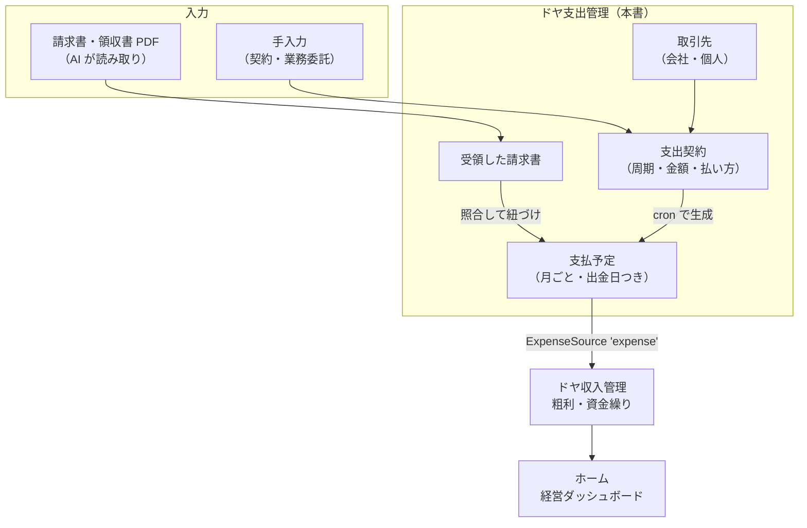
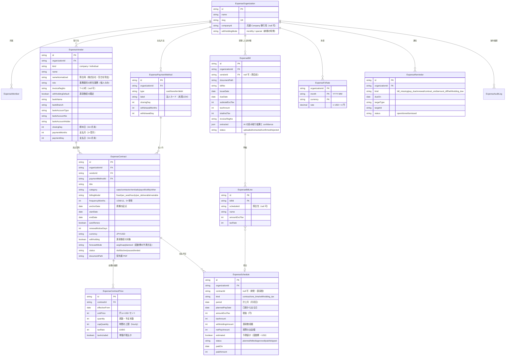
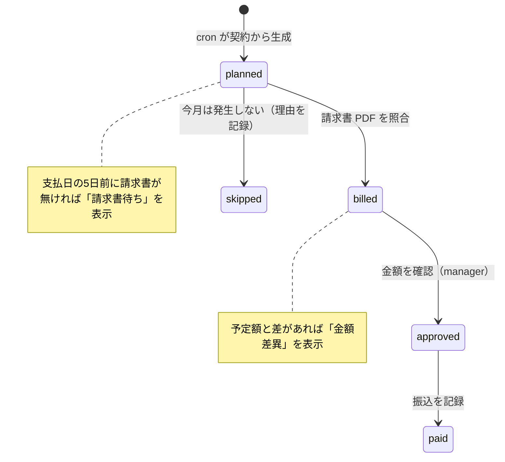

# ドヤ支出管理 設計書（初版）

- 作成日: 2026-10-18
- 対象: ドヤAI（`Code/09_Cursol`、origin/main `dc089b44` 時点）
- 状態: §12 は推奨案で決定（2026-10-18）。Phase1 を実装済み（ブランチ `feat/doya-expense`、本番 DB 未反映）
- 改訂: 2026-10-18 §12 を決定。Phase1 の実装範囲と設計からの差分を §13 に記録
- 関連: ドヤ収入管理 設計書 `docs/design/2026-10-18-doya-income/README.md`（`docs/doya-income-design` ブランチ）。特に §8.1「支出の暫定接続」は、本書の §8 で差し替える前提で書いている

---

## 1. 何を作るか（一言で）

**会社が「何に・いくらを・どの周期で・いつ払うか」を契約単位で台帳にし、今月と先 12 か月の出金を見えるようにするツール。**

会計ソフト（freee / マネーフォワード）の代わりではない。仕訳・申告はそちらに任せる。ドヤ支出管理は「毎月いくら出ていくか」「来月・再来月はいくらか」「業務委託の請求書は届いたか、払ったか」をシンプルに見る。ドヤ収入管理と合わせて、ホームで粗利と資金繰り（黒字倒産の兆候）が分かる状態をつくる。

### 1.1 ゴールと非ゴール

| ゴール | 非ゴール（やらない） |
|---|---|
| SaaS・業務委託・家賃などの「払う約束」を契約として登録し、月ごとの支払予定を自動で作る | 仕訳・勘定科目・決算書 |
| **業務委託を人ごとに管理する**（契約の形、単価、請求書の受領、支払、源泉徴収） | 支払調書・マイナンバーの管理 |
| 請求書・領収書の PDF を AI が読み取り、契約と照合して登録する | 銀行・カードの API 連携（Phase3 以降で検討） |
| **実際に口座からお金が出る日**（カードの引落日など）で出金予定を出す | 社員の経費精算（立替の申請・承認） |
| 源泉所得税の納付を出金予定に自動で載せる | 給与計算（給与は総額だけを支出として持つ。§12 Q4） |
| 請求書の未着・契約の更新期限・予定外の請求額を通知する | 多通貨の会計処理（USD は円換算の目安のみ） |
| ドヤ収入管理の `ExpenseSource` の実装として、プロマネ暫定接続と差し替えられる | |

### 1.2 支出で起きる「見落とし」と塞ぎ方


| 見落とし | 塞ぎ方 |
|---|---|
| ① 契約しているのに台帳に無い | 請求書 PDF を取り込んだとき、どの契約にも一致しなければ「新しい支出契約として登録しますか」と出す |
| ② 年払い・半年払い・源泉税の納付を忘れる | 契約から `ExpenseSchedule`（支払予定）を cron で自動生成。源泉税の納付も自動で予定に入れる |
| ③ 業務委託の請求書が来ない・金額が違う | 支払日の 5 日前に請求書が無ければ「請求書待ち」で通知。予定額と差があれば差額を出す |
| ④ 払い忘れ・二重払い | 支払予定ごとに「支払済み」を付ける。同じ請求書番号・同じ月の二重登録を止める |

---

## 2. 現状の確認（コードから分かったこと）

| 項目 | 事実 | 出典 |
|---|---|---|
| 構成 | Next 15.5 App Router、next-auth、Prisma 5 + Supabase | 収入設計書 §2 |
| サービス追加の型 | `src/app/{svc}`、`src/app/api/{svc}`、`src/components/{svc}`、`src/lib/{svc}`、表は `@@map("{svc}_xxx")` | `CLAUDE.md` |
| サービス登録 | `src/lib/services.ts` に 1 件足す（`expense` は未使用） | `src/lib/services.ts` |
| 既存の支出データ | `PromaneExpense`（プロジェクト経費。`category` / `amount Int` / `date`）と `PromaneTimeEntry`（工数×時給） | `prisma/schema.prisma` |
| AI | Gemini（`geminiGenerateJson`）。利用回数の予約・確定は `src/lib/sfa/ai-limit.ts` の型 | `src/lib/sfa/ai.ts:5` |
| 定期処理 | Vercel Cron（`src/app/api/cron/*`） | — |
| 金額 | 収入・見積と同じく `Int`（円） | `src/lib/quote/money.ts` |
| 収入側の差し替え口 | `ExpenseSource`（`id: 'promane' \| 'expense'`、`monthly(range)`）。`'expense'` は本書のために予約済み | 収入設計書 §8.1 |

---

## 3. 全体像



- サービス ID: **`expense`**（表示名「ドヤ支出管理」、ステージ `operate`）
- URL: `/expense`（LP）、`/expense/[orgSlug]/...`（本体）、`/api/expense/...`
- 表のプレフィックス: `expense_`

---

## 4. ER 図

### 4.1 全体



`ExpenseMember` と `ExpenseAuditLog` は収入側（`IncomeMember` / `IncomeAuditLog`）と同じ形なので省略。Prisma の下書きは [`schema-draft.prisma`](./schema-draft.prisma)。

### 4.2 設計の要点（なぜこの形か）

1. **出ていくお金はすべて `ExpenseSchedule` の 1 行にする**。契約の月額、単発の支出、源泉税の納付を同じ表に入れる。こうすると「今月の出金」「請求書待ち」「来月以降の予測」がすべてこの表への 1 本のクエリで出せる。収入側の `IncomeRevenueSchedule` と対になる形。
   - 一意制約 `@@unique([contractId, period])` で cron の二重生成を防ぐ（`contractId` が null の行は対象外）。
   - 生成範囲は「今月から 12 か月先まで」を毎日ずらして補完する。終了日の無い契約でも行が無限に増えない。
   - 契約を変更したら、**`planned` の未来分だけ**作り直す。`billed` 以降は触らない。
2. **計上月（`period`）と出金日（`plannedPayDate`）を分けて持つ**。粗利は計上月・税抜で、資金繰りは出金日・税込（源泉控除後）で見るため。10 月に使った SaaS をカードで払うと、出金は 11 月や 12 月になる。
3. **金額は履歴（`ExpenseContractPrice`）で持つ**。「来月から値上げ」「席数を 5 から 8 に増やす」を、過去の予定を壊さずに表す。予定は `period` 時点で有効な行で計算する。
4. **「請求書待ち」「支払遅延」は保存せず、読むときに計算する**（収入側 §4.2-3 と同じ方針）。例: `status = planned かつ plannedPayDate - 5日 <= 今日` なら請求書待ち。
5. **業務委託は「取引先が個人で、カテゴリが `contractor` の契約」**。専用の表は作らず、`ExpenseVendor.kind = individual` に担当業務・振込先・源泉の既定を持たせる。画面は専用ページを用意する（§5.3）。
6. **源泉税は報酬の行とは別の `withholding_tax` 行**として出金日に置く。報酬の行は `netPayAmount`（源泉控除後）だけを出金にする。こうしないと源泉分を二重に数えるか、納付月の出金が消える。
7. **USD は契約側に USD で持ち、予定を作るときに `ExpenseFxRate` で円に換算**する。換算した行は `estimated = true`。請求書が来たら実額で上書きする。
8. **金額はすべて `Int`**（円。USD はセント）。他ツールへの参照は FK を張らない文字列（収入側 §4.2-6 と同じ）。

---

## 5. 画面と機能

### 5.1 画面一覧

| # | 画面 | パス | 主な機能 |
|---|---|---|---|
| 1 | ダッシュボード | `/expense/[orgSlug]` | 今月の出金予定・支払済・固定費の月額・SaaS 合計の 4 指標、要対応、12 か月の推移（カテゴリ別の積み上げ） |
| 2 | 支出契約 | `/expense/[orgSlug]/contracts`、`/new`、`/[id]` | 一覧（カテゴリ・周期・月額換算・次回支払日・終了日）。詳細で金額の履歴・支払予定・紐づく請求書 |
| 3 | **業務委託** | `/expense/[orgSlug]/contractors`、`/[vendorId]` | 人ごとの一覧と今月の状態。詳細で契約条件・振込先・請求書・支払履歴・源泉の累計（§5.3） |
| 4 | 支払予定 | `/expense/[orgSlug]/payables?month=2026-11` | その月に払う一覧。状態（予定 / 請求書受領 / 承認済み / 支払済み）を更新。単発の支出もここから追加 |
| 5 | 予測 | `/expense/[orgSlug]/forecast` | 月×カテゴリの表と積み上げ棒グラフ（6 / 12 か月）。確定額と予測額を区別して表示 |
| 6 | 取り込み | `/expense/[orgSlug]/inbox` | PDF のドラッグ＆ドロップ → 読み取り結果の確認 → 契約と照合して登録 |
| 7 | 設定 | `/expense/[orgSlug]/settings` | 支払方法（カードの締め日・引落日）、為替レート、源泉税の納付方法、カテゴリ、メンバー、収入管理との接続 |

### 5.2 ダッシュボード（画面 1）

```
┌────────────────────────────────────────────────────────────┐
│ 2026年11月                                    [月を切替 ▼] │
├──────────────┬──────────────┬──────────────┬──────────────┤
│ 今月の出金予定 │ 支払済        │ 固定費（月額） │ SaaS 合計     │
│ ¥2,140,000   │ ¥1,320,000   │ ¥1,850,000   │ ¥186,000     │
│ 24 件         │ 15 件 / 24 件 │               │ 18 サービス    │
├──────────────┴──────────────┴──────────────┴──────────────┤
│ 要対応                                                     │
│  ● 請求書待ち  デザイナーAさん 11月分（支払日 11/30 まで 5 日）│
│  ● 金額差異    エンジニアBさん 予定 48万円 → 請求 56万円     │
│  ● 更新期限    Notion 年払い 12/1 自動更新（14 日前）        │
│  ● 源泉税      7〜12月分 ¥183,780 の納付期限 1/20           │
├────────────────────────────────────────────────────────────┤
│ 12 か月の出金（カテゴリ別の積み上げ。予測分は薄い色）         │
└────────────────────────────────────────────────────────────┘
```

UI 規約: 日本語、絵文字アイコンは使わない（`src/components/icons.tsx` の `UiIcon` か lucide）、サイドバーは `src/components/sidebar/` の共通部品で作る。

### 5.3 業務委託（画面 3）

業務委託は金額が大きく、人ごとに条件が違うので専用ページにする。

**一覧**

```
業務委託                                     11月の支払予定 合計 1,019,370円
───────────────────────────────────────────────────────────────
名前            担当      契約の形      11月の支払   状態         契約終了
デザイナーAさん   デザイン   月額固定      269,370円   請求書待ち    2027/03
エンジニアBさん   開発      時給×稼働     480,000円   金額差異あり   自動更新
ライターCさん    記事制作   成果物ごと     90,000円   支払済み      2027/09
動画Dさん       動画編集   半年まとめ    180,000円   承認済み      2026/11 ←
───────────────────────────────────────────────────────────────
```

**1 人ごとに持つ情報**

| 項目 | 持つ場所 | 用途 |
|---|---|---|
| 名前・担当業務 | `ExpenseVendor.name / role` | 誰に何を頼んでいるか |
| 契約の形・単価 | `ExpenseContract.billingModel`、`ExpenseContractPrice` | 予定額の計算 |
| 支払条件（締め・支払サイト） | `ExpenseVendor.closingDay / paymentMonths / paymentDay` | 出金日の計算 |
| 契約期間・自動更新 | `ExpenseContract.startDate / endDate / autoRenew` | 終了・更新の通知 |
| 源泉徴収の有無 | `ExpenseVendor.withholdingDefault`（契約ごとに上書き可） | 振込額と納付額 |
| インボイス登録番号 | `ExpenseVendor.invoiceRegNo` | 経理処理用。請求書から読み取って照合 |
| 振込先 | `ExpenseVendor.bank*` | 支払作業。**manager 以上のみ閲覧** |
| 契約書 | `ExpenseContract.documentPath` | 条件の確認 |

**契約の形（`billingModel`）と予定額の出し方**

| 形 | 例 | 予定額 |
|---|---|---|
| `fixed` 月額固定 | 月 30 万円 | 単価そのまま |
| `hourly` 時給×稼働 | 時給 4,000 円、上限 120 時間 | `forecastMode` で選ぶ: `avg3`（直近 3 か月の実績平均）／`cap`（上限×時給。資金繰りを安全側で見る） |
| `per_deliverable` 成果物ごと | 記事 1 本 3 万円 | 単価 × 予定本数（`quantity`） |
| `fixed` + `frequencyMonths=6` 半年まとめ | 半年ごとに 180 万円 | 支払月にだけ立つ |

**毎月の状態の流れ**



### 5.4 出金日の決め方

| 支払方法 | 出金日 |
|---|---|
| 振込（`transfer`） | 取引先の締め日・支払サイトで計算（例: 月末締め翌月末払い）。業務委託はほぼこれ |
| カード（`card`） | 利用日（契約の `anchorDate` の日）→ カードの締め日 → `withdrawalMonths` か月後の `withdrawalDay`。例: 15 日締め翌月 10 日引落で 10/20 利用なら 12/10 |
| 口座振替（`debit`） | 支払方法の `withdrawalDay` |

- 31 は「その月の末日」と解釈する（収入側 §5.3 と同じ）。土日祝の調整は Phase1 ではしない。
- 日付計算は収入側の `src/lib/income/dates.ts` と同じ規則なので、収入側がマージされたら共通化する（§12 Q6）。

### 5.5 源泉所得税

- 対象: 契約の `withholding = true` の報酬。どの業務が対象になるかは人が判断して設定する（画面に「判断に迷うものは税理士に確認」と注記）。
- 計算: 支払額 100 万円以下の部分は 10.21%、100 万円を超える部分は 20.42%。円未満切り捨て。請求書で消費税額が区分されていれば税抜額を基準にする。
- 納付の予定: 組織の `withholdingMode` で決める。
  - `monthly`: 支払った月の翌月 10 日
  - `special`（納期の特例）: 1〜6 月の支払分を 7 月 10 日、7〜12 月の支払分を翌年 1 月 20 日
- cron が対象期間の源泉額を合計し、`kind = withholding_tax` の予定を 1 行作る（期間ごとに 1 行。支払が確定するたびに金額を更新する）。

---

## 6. AI 機能

| 機能 | 何をするか | 方式 | 費用の扱い |
|---|---|---|---|
| 請求書・領収書の読み取り | PDF から 取引先名・登録番号・請求番号・発行日・支払期日・明細・税率ごとの金額・通貨・対象期間・周期の推定・カテゴリの推定 を抽出 | Gemini（`geminiGenerateJson`）。PDF をそのまま渡せるかは実装時に確認し、だめなら PDF からテキストを抜いて渡す。**必ず人が確認して確定** | 組織ごとの月間回数上限（`ai-limit` の型） |
| 契約との照合 | 読み取った請求書が、どの契約の何月分かを推定 | **まずルール**（登録番号の一致 → 取引先名の正規化一致 → 金額の近さ ±10%）。決まらないときだけ候補を最大 3 件出して人が選ぶ。AI は使わない | 無料 |
| 契約書の読み取り | 業務委託契約書から 単価・期間・支払条件・自動更新 を抽出して契約の下書きにする | Gemini。人が確認して確定 | 上限内 |
| 今月のまとめ | 「請求書待ち 2 件・来月は年払いが 3 件重なり +42 万円」 | **ルールで作る**（LLM 不要） | 無料 |
| 経営エージェントの道具 | `expense.summary`、`expense.listActionItems` を read ツールとして公開 | 収入側と同じ型 | read のみ |

**読み取り結果の確認画面**では、抽出した各項目の横に confidence を出し、低いものは強調する。照合候補と「新しい支出契約として登録」「単発の支出として登録」の 3 択を並べる。

---

## 7. 通知

| 種類 | 条件 | 時期 |
|---|---|---|
| 請求書待ち | `planned` のまま `plannedPayDate` の 5 日前を過ぎた | Phase1 |
| 金額差異 | 照合した請求額が予定額と 10% 以上違う | Phase1 |
| 更新期限 | `autoRenew` の契約で、更新日の `renewalNoticeDays` 日前 | Phase1 |
| 契約終了 | 終了日の 30 日前（業務委託は「更新するか決める」） | Phase1 |
| 源泉税の納付 | 納付期限の 7 日前 | Phase1 |
| 支払日 | 承認済みで、支払日の前日 | Phase1 |

アプリ内の要対応に出し、Slack Webhook・メールにも送れるようにする。カレンダー連携は収入側の ICS 方式（収入設計書 §7）を共通化して Phase2 で載せる。

---

## 8. ドヤ収入管理との接続（プロマネ暫定接続の差し替え）

### 8.1 差し替えの仕組み

収入側は `ExpenseSource` を 1 つ選んで支出を読む（収入設計書 §8.1）。本書は `id: 'expense'` の実装を足す。収入側の画面は変えない。

```ts
// src/lib/income/expense-source.ts（収入側。追加分のみ）
export type MonthlyExpense = {
  month: string                       // 'YYYY-MM'（JST）
  expense: number                     // 経費（円・税抜）
  laborCost: number                   // 人件費（円）
  total: number
  byCategory: Record<string, number>
  // ↓ 追加（任意。promane 実装は返さない）
  planned?: number                    // うち予測・未確定分
  confirmed?: number                  // うち請求書受領以降の確定分
}

export type CashOutEvent = {
  date: string                        // 'YYYY-MM-DD'（JST）出金日
  amount: number                      // 実際の出金額（税込・源泉控除後）
  category: string
  label: string                       // 'Slack' / 'デザイナーAさん 11月分' / '源泉所得税 7〜12月分'
  status: 'planned' | 'paid'
}

export interface ExpenseSource {
  id: 'promane' | 'expense'
  monthly(range: { from: string; to: string }): Promise<MonthlyExpense[]>
  // ↓ 追加（任意）。資金繰り（キャッシュベース）に使う
  cashOut?(range: { from: string; to: string }): Promise<CashOutEvent[]>
}
```

追加はすべて任意項目なので、プロマネ実装はそのまま動く。

### 8.2 `'expense'` 実装の中身

| 項目 | 読むもの | 計算 |
|---|---|---|
| `monthly` の月 | `ExpenseSchedule.period` | 計上月で集計（発生ベースの粗利用） |
| `expense` | `kind = contract / one_time` で、カテゴリが `payroll`・`contractor` 以外 | `amountExclTax` の合計（税抜） |
| `laborCost` | カテゴリ `payroll` と `contractor` | `amountExclTax` の合計。**源泉税の行（`withholding_tax`）は含めない**（報酬の額面にすでに含まれるため） |
| `byCategory` | 全カテゴリ | 同上 |
| `planned` / `confirmed` | `status` | `planned` を予測、`billed` 以降を確定 |
| `cashOut` | `ExpenseSchedule.plannedPayDate`（支払済みなら `paidOn`） | `netPayAmount`（支払済みなら `paidAmount`）。**源泉税の行も含める** |

### 8.3 組織の結び方

- 収入側に `IncomeOrganization.expenseOrganizationId`（null 可）を足す。プロマネの `promaneWorkspaceId` と同じ扱い。
- 設定画面の「支出の取り込み元」で `プロマネ` / `ドヤ支出管理` を選ぶ。**両方を足し合わせない**（業務委託がプロマネの工数にも入っていると二重に数えるため）。
- 選べるのは、操作者が支出側の ACTIVE メンバーで、収入側で admin 以上のときだけ。

### 8.4 差し替えで変わること

| 項目 | プロマネ暫定 | ドヤ支出管理 |
|---|---|---|
| 対象 | プロジェクトに紐づく経費と工数 | 家賃・SaaS・広告・業務委託を含む会社全体 |
| 税 | 税込・税抜が混在しうる | 税抜で集計（`amountExclTax`） |
| 未来 | 実績のみ | 12 か月先までの予測（`planned`） |
| 資金繰り | 出せない | `cashOut` で出金日ベースの残高推移が出せる |
| 画面の表記 | 「支出（プロマネ記録ベース）」 | 「支出」 |

### 8.5 資金繰り（Phase3）

収入側が入金予定（請求書の支払期日・残高）を `CashInEvent` として出せば、ホームで

> 日ごとの残高 = 今日の残高（手入力） + 入金予定 − 出金予定（`cashOut`）

を 90 日先まで描ける。残高がマイナスになる日を「資金ショートの恐れ」として出す。これが黒字倒産の防止機能になる。

---

## 9. API とファイル配置

```
src/app/expense/page.tsx                         LP
src/app/expense/[orgSlug]/page.tsx               ダッシュボード
src/app/expense/[orgSlug]/{contracts,contractors,payables,forecast,inbox,settings}/...
src/app/api/expense/
  organization/route.ts
  vendors/route.ts, vendors/[id]/route.ts
  contracts/route.ts, contracts/[id]/route.ts, contracts/[id]/prices/route.ts
  payment-methods/route.ts
  schedules/route.ts                  GET ?month=  支払予定の一覧
  schedules/[id]/route.ts             状態の更新（billed/approved/paid/skipped）
  schedules/one-time/route.ts         単発の支出の追加
  bills/route.ts                      PDF アップロード
  bills/[id]/extract/route.ts         AI 読み取り
  bills/[id]/confirm/route.ts         照合して確定
  forecast/route.ts                   月×カテゴリの集計
  summary/route.ts                    ダッシュボード・収入側・ホーム用
  fx-rates/route.ts
src/app/api/cron/expense-schedule/route.ts   毎朝: 予定の補完（12 か月先まで）・源泉税の集計・通知
src/components/expense/*                     ExpenseSidebar ほか
src/lib/expense/
  access.ts        getExpenseContext / hasMinRole（sfa/access.ts と同じ型）
  schedule.ts      契約 → 支払予定の生成（純粋関数）
  dates.ts         出金日の計算（振込・カード・口座振替。純粋関数）
  amount.ts        単価×数量・税・USD 換算・変動費の予測（純粋関数）
  withholding.ts   源泉徴収額と納付予定（純粋関数）
  matching.ts      請求書と契約の照合ルール
  normalize.ts     取引先名の正規化
  ai.ts, ai-limit.ts
  expense-source.ts  収入側 ExpenseSource の 'expense' 実装（§8.2）
```

- API ルートの先頭は `runtime='nodejs'` / `dynamic='force-dynamic'`、`ctx.params` は await する（Next 15）。
- すべての書き込みは `getExpenseContext` で組織と権限を確認し、`organizationId` を条件に入れる（IDOR 対策）。
- 権限: member = 閲覧（振込先を除く）・請求書のアップロード、manager = 承認・支払済みの記録・振込先の閲覧、admin/owner = 設定・メンバー・契約の削除。
- アップロードした PDF は Supabase Storage の非公開バケットに置き、署名付き URL で短時間だけ見せる。

---

## 10. 開発の進め方

### 10.1 フェーズ

| フェーズ | 中身 | できるようになること |
|---|---|---|
| **0. 準備** | §12 の未決事項を決める。`services.ts` に `expense`（非公開）を追加 | — |
| **1. MVP（出ていくお金が見える）** | 組織・メンバー、取引先、支払方法、支出契約（手入力・金額の履歴）、**業務委託ページ（4 つの契約の形・状態の流れ・振込先）**、支払予定の自動生成と cron、**源泉税の予定**、支払予定画面、予測画面、ダッシュボード、通知（アプリ内・Slack）、請求書 PDF の保存（読み取りなし・手で紐づけ）、収入側への `ExpenseSource 'expense'` | 「毎月いくら、何に出ていくか」「来月・再来月はいくらか」「業務委託の請求・支払の状態」が分かる |
| **2. 入力を楽にする** | 請求書 PDF の AI 読み取りとルール照合、契約書の読み取り、カード明細 CSV の取り込み、ICS 購読 | PDF を入れるだけで登録できる |
| **3. 資金繰り** | `cashOut` と収入側の入金予定を合わせた残高推移、資金ショートの警告、ホームのウィジェット、経営エージェントの read ツール、プロマネ経費の取り込み、会計ソフト向け CSV | 黒字倒産の兆候が事前に分かる |

### 10.2 Phase1 の作業順（1 つずつ完了させる）

1. Prisma スキーマ追加 → **本番 Supabase へ手動で反映**（Vercel ビルドは db push をしない。`doya-db-push` の手順。実行前に利用者の確認を取る）
2. `dates.ts`・`amount.ts`・`schedule.ts`・`withholding.ts` を純粋関数で作り、`scripts/verify-expense-calc.ts`（`npx tsx`）で §10.3 のケースを全部確かめる
3. `access.ts` と組織・メンバー API
4. 取引先・支払方法・支出契約の CRUD と画面
5. 支払予定の生成（契約保存時＋cron）と支払予定画面
6. 業務委託ページ
7. 源泉税の予定生成
8. 予測画面・ダッシュボード・集計 API
9. 通知（cron）
10. 収入側の `ExpenseSource 'expense'`（収入側がマージ済みなら。未マージなら `summary` API までで止める）
11. 検証: `npx tsc --noEmit`、`npm run build`、ステージングで「契約登録 → 予定生成 → 請求書の紐づけ → 承認 → 支払済み → 源泉税の予定」を通しで確認

### 10.3 検証スクリプトで必ず押さえる計算

| 項目 | ケース |
|---|---|
| 出金日 | 月末締め翌月末払い／20 日締め翌月 10 日払い／カード 15 日締め翌月 10 日引落で締め日前後の利用／2 月末・うるう年／31 日指定で 30 日の月 |
| 支払予定 | 月額・四半期・半年・年払い／月途中の開始／終了日あり／自動更新／値上げ（`effectiveFrom`）／席数の変更／契約変更で未来分だけ作り直す／cron の二重実行 |
| 変動費 | `hourly` の `avg3`（実績 0〜2 か月のとき）と `cap`／`per_deliverable` |
| 為替 | USD 契約の円換算と、請求書受領後の実額上書き |
| 源泉 | 30 万円（30,630 円）／100 万円ちょうど／150 万円（100 万円超の部分 20.42%）／税抜基準／納期の特例で 6 月分と 7 月分の境目／年をまたぐ 1 月 20 日 |
| 集計 | `monthly` で源泉税を二重に数えない／`cashOut` には源泉税を含める |

---

## 11. リスクと対策

| リスク | 対策 |
|---|---|
| 金額計算のずれ（周期・出金日・源泉） | `Int` 円、純粋関数＋検証スクリプト |
| 源泉税の二重計上・計上漏れ | 報酬は `netPayAmount`、納付は別行。§8.2 の集計規則を検証スクリプトで確認 |
| 振込先口座など個人の機微情報 | 閲覧を manager 以上に、操作履歴、API の返却項目を権限で絞る |
| 他社データの閲覧（IDOR） | すべての API で組織確認 |
| 請求書 PDF の流出 | 非公開バケット・署名付き URL・組織確認 |
| AI の読み取りミス | AI は下書きのみ。確定は人。照合はルール優先 |
| AI の従量課金 | 組織ごとの月間上限、照合に AI を使わない |
| プロマネとの二重計上 | 取り込み元は 1 つだけ選ぶ（§8.3） |
| スキーマ反映忘れで本番 500 | 手順に db push を明記（§10.2-1） |

---

## 12. 決定事項（2026-10-18、推奨案で決定）

| # | 論点 | 決定 |
|---|---|---|
| Q1 | 組織を `ExpenseOrganization` で作るか、`IncomeOrganization` と共有するか | **独立して作る**。`companyId` を null 可で持つ。収入側からは `expenseOrganizationId` で結ぶ。共通 `Company` がマージされたら乗せ替える |
| Q2 | 支出の基準を税抜にするか税込にするか | **両方持つ**。粗利は税抜（収入側と合わせる）、資金繰りは税込・源泉控除後（実際の出金） |
| Q3 | 為替レートの取り方 | **月ごとの手入力**。その月が未入力なら、それ以前で一番新しい月のレートを使う。1 件も無ければ USD 契約の保存を止めて設定を促す。自動取得は Phase3 |
| Q4 | 給与・社会保険を入れるか | **個人ごとの給与は持たない**。`payroll` カテゴリの「給与総額」「社会保険料」を月額の契約として入れる |
| Q5 | 業務委託の請求書が来ないまま支払日を迎えたとき | **予定額のまま出金予定に残す**。支払日の 5 日前から「請求書待ち」、過ぎたら「支払日超過」を出し続ける |
| Q6 | 出金日の計算を収入側と共通化するか | 収入側がマージされたら `src/lib/money/dates.ts` に切り出す。それまでは `src/lib/expense/dates.ts` に置く（31 = 月末の規則は同じ） |
| Q7 | 料金プラン | **開発中は制限なし**（`UNLISTED`）。公開時に 無料: 契約 10 件・AI 10 回/月、Pro: 無制限・AI 300 回/月 を `plan-limit.ts` に入れる |
| Q8 | サービス ID と URL | `expense` / `/expense` |

---

## 13. Phase1 の実装メモ（2026-10-18）

### 13.1 入ったもの

| 項目 | 場所 |
|---|---|
| スキーマ（11 表） | `prisma/schema.prisma` の「ドヤ支出管理」。**正本はこちら**（`schema-draft.prisma` は初版の下書き） |
| 計算（純粋関数） | `src/lib/expense/{dates,plan,withholding,aggregate}.ts`。検証は `src/lib/expense/calc.test.ts`（§10.3 のケース） |
| 組織・権限・IDOR | `src/lib/expense/access.ts`（`withExpense`）。`src/lib/expense/scope.test.ts` で全ルートを静的に検査 |
| 支払予定の生成 | `src/lib/expense/sync.ts`（契約保存時＋cron。今月から 12 か月先まで。源泉税の行も集計） |
| API | `src/app/api/expense/**`（組織・メンバー・取引先・支払方法・契約・単価・支払予定・予測・集計・業務委託・為替） |
| cron | `/api/cron/expense-schedule`（毎朝 7:00 JST。予定の補完 → 源泉税 → 要対応の通知） |
| 収入側への受け渡し | `src/lib/expense/income-source.ts`（`expenseMonthly` / `expenseCashOut` / `canReadExpenseOrganization`）。**収入側のファイルは編集していない** |
| 画面 | `src/app/expense/**`、`src/components/expense/**` |
| サービス登録 | `services.ts`（`UNLISTED`・`coming_soon`・BETA・noindex）、ToolSwitcherMenu、サイドバーのテーマ |
| テスト | `npm run test:expense` をビルドに追加。サービス数を数える回帰テスト 2 本の期待値を 19 → 20 に更新 |

### 13.2 設計からの差分

| 設計 | 実装 | 理由 |
|---|---|---|
| Phase1 で請求書 PDF を保存 | **Phase2 に移す**（表 `expense_bills` は作成済み） | Storage のバケット作成は本番作業になるため、AI 読み取りと一緒に入れる。Phase1 は実額を手入力 |
| メンバーの招待 | **ドヤAI 登録済みのユーザーをメールアドレスで追加** | 招待 URL の仕組みは SFA 側の作りが大きいため。必要になったら招待トークンを足す |
| `ExpenseSchedule` | `plannedAmountExclTax`（予定額）と `note` を追加 | 請求額との差異を出すため |
| `ExpenseOrganization` | `slackWebhookUrl` を追加（`hooks.slack.com` のみ受け付ける） | 通知先 |
| `ExpenseReminder` | `notifiedAt` を追加。一意制約に `organizationId` を含める | 同じ通知を 2 回送らない |
| 権限 | member = 閲覧のみ、manager = 契約・取引先・支払状態の更新と振込先の閲覧、admin = 設定・支払方法・為替・メンバー・削除 | §9 をそのまま具体化 |

### 13.3 統合仕様（ADDON-SERVICES-2026-10-18）への対応

レイアウト・トークン・画像の決まりは `feat/ui-renewal-sample` の `docs/architecture/management-agent/ADDON-SERVICES-2026-10-18.md` が正本。本書には書き写さない。対応した箇所だけ記録する。

| 項目 | 対応 |
|---|---|
| R-1 ナビをデータで | `src/lib/expense/nav.ts` の `expenseNav(orgSlug, role)` が `ShellNavItem[]` を返し、ToolFrame の `nav` に渡す |
| R-2 独自サイドバーを作らない | 段 0（`feat/ds-shell`）を取り込み、最初から AppShell＋ToolFrame で包む（フラグなし）。専用のサイドバーとテーマは無い |
| R-3 ds トークン | `src/components/ds` の部品とトークンを使う。`src/app/expense` と `src/components/expense` に色の直書きを置かない |
| R-4 読み取り関数 | `src/lib/expense/expense-read.ts`（`getExpenseSummary` / `listUpcomingPayments` / `listCalendarEvents`）。API（`summary` / `upcoming` / `calendar`）も同じ関数を呼ぶ |
| R-5 自社プロフィール | `ExpenseOrganization.companyProfileId`（予約列）を追加 |
| R-8 マニフェスト草案 | `reference/services/expense.md` の末尾 |
| §5 エージェントの道具 | `expense.summary`（read）、`expense.listUpcomingPayments`（read・sensitive。振込先は `includeBank` のときだけ） |
| §6 #12 展示会の予算 → 支出 | `ExpenseSchedule.sourceType / sourceId`（`@@unique([organizationId, sourceType, sourceId])`）と `src/lib/expense/import.ts`（作成のみ・上書きしない・取り消しはリンクを外す） |
| §7 ウィザード | `src/lib/expense/setup.ts`（`initExpenseForCompany`。冪等キー `companyId` を一意に）。`ExpenseOrganization.fiscalYearEndMonth`（決算月）を追加。**締め日は組織に持たない**（取引先・カードごとに違うため。取引先の既定は月末締め翌月末払い） |
| §12 画像 | Codex の内蔵画像生成（`auth_mode=chatgpt`、API キーなし）で作成。`docs/design/images/expense/PROMPTS.md` |

### 13.4 本番に出す前にやること（未実施）

1. `doya-db-push` の手順で `expense_*` の 11 表を本番 Supabase に反映（**実行前に利用者の確認を取る**）
2. Vercel の環境変数 `CRON_SECRET` が設定済みであることを確認（既存 cron と共通）
3. 収入側（`feat/doya-income` 系）で `ExpenseSource` の `'expense'` 実装を `income-source.ts` につなぐ（§8.1・§8.3）
