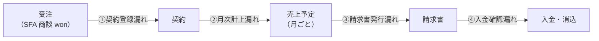
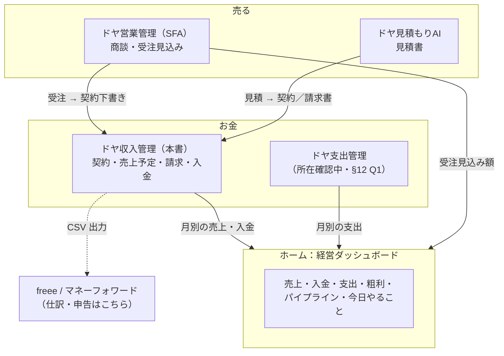
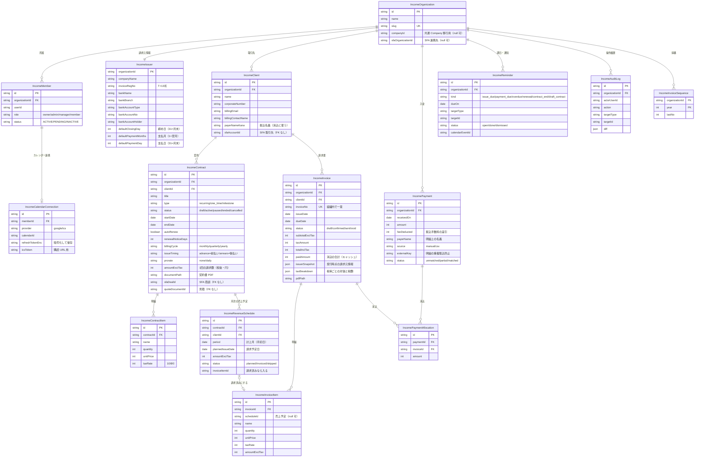
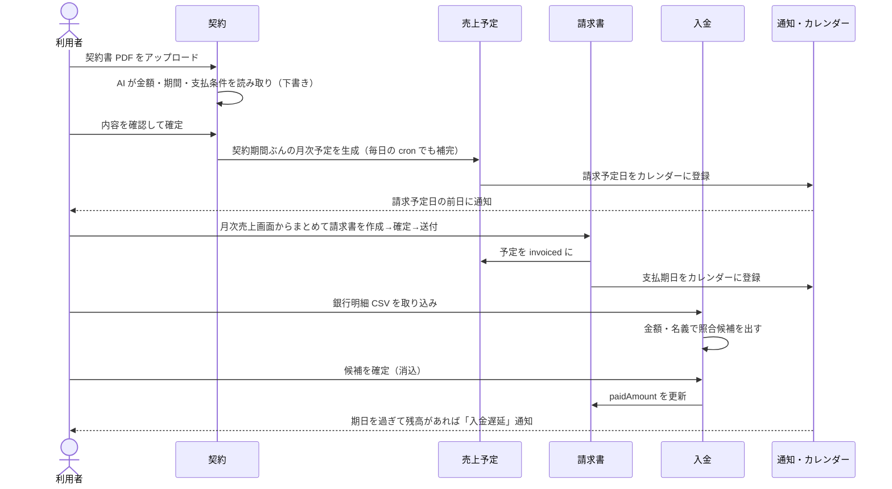

# ドヤ収入管理 設計書（初版）

- 作成日: 2026-10-18
- 対象: ドヤAI（`Code/09_Cursol`、main `5ac27bd2` 時点）
- 状態: 設計案。実装前にこのファイルの §12 の未決事項を決める
- 関連: `docs/architecture/management-agent/README.md`（ui-renewal ブランチ。§16 サービス契約・§18 オールインワン化）

---

## 1. 何を作るか（一言で）

**B2B の「契約 → 毎月の売上 → 請求書 → 入金」を一本の線で管理し、請求漏れ・入金漏れをゼロにするツール。**

会計ソフト（freee / マネーフォワード）の代わりではない。仕訳・税務申告はそちらに任せ、ドヤ収入管理は「今月いくら売上が立つのか」「請求書は出したか」「振り込まれたか」をシンプルに見る。ドヤ営業管理（SFA）・支出側と合わせて、ホームで「売上・支出・粗利・営業進捗」が一目で分かる状態をつくる。

### 1.1 ゴールと非ゴール

| ゴール | 非ゴール（やらない） |
|---|---|
| 契約から毎月の売上予定を自動で作る | 仕訳・勘定科目・決算書の作成 |
| 請求すべきなのに請求書が無い月を自動で検知する（請求漏れ） | 確定申告・消費税申告 |
| 適格請求書（インボイス制度）に沿った請求書 PDF を発行する | 銀行 API による自動入金取得（Phase3 以降で検討） |
| 入金を請求書に紐づけ（消込）、未入金・遅延を出す | B2C の注文単位の売上管理 |
| 請求日・支払期日・契約更新日をカレンダーに載せ、事前に通知する | 給与・経費精算 |
| SFA の受注 → 契約、見積 → 請求書 をワンクリックでつなぐ | 多通貨（JPY のみ） |
| 収入と支出から粗利（黒字・赤字）を月別に出す | |

### 1.2 「漏れ」が起きる 4 か所と、この設計での塞ぎ方



| 漏れ | 塞ぎ方 |
|---|---|
| ① 受注したのに契約が登録されない | SFA の商談が won になったら「契約の下書き」を自動作成し、ダッシュボードに「未確定の契約」として出す |
| ② 契約があるのに今月の売上が立っていない | 契約から `IncomeRevenueSchedule`（月次の売上予定）を cron で自動生成。手入力に頼らない |
| ③ 売上予定があるのに請求書が無い | 請求予定日を過ぎても `invoiceId` が空の予定を「請求漏れ」として赤で出し、前日・当日に通知 |
| ④ 請求したのに入金を確認していない | 支払期日を過ぎて残高がある請求書を「入金遅延」として出す。督促文面は AI が下書き |

---

## 2. 現状の確認（コードから分かったこと）

| 項目 | 事実 | 出典 |
|---|---|---|
| 構成 | Next 15.5 App Router、next-auth（Google のみ）、Prisma 5 + Supabase | `package.json`、`src/lib/auth.ts:15` |
| サービス追加の型 | `src/app/{svc}`、`src/app/api/{svc}`、`src/components/{svc}`、`src/lib/{svc}`、表は `@@map("{svc}_xxx")` | `CLAUDE.md` |
| サービス登録 | `src/lib/services.ts` の配列に 1 件足す（SFA は L1269 が手本） | `src/lib/services.ts` |
| テナント | 今はサービスごとに組織モデルを持つ（`SfaOrganization` など）。共通の `Company` は設計中で未マージ | ui-renewal `schema-draft.prisma:281` |
| 取引先 | `SfaAccount`（SFA）、`PromaneClient`（プロマネ）、`QuoteDocument.clientCompany`（文字列）の 3 系統 | `prisma/schema.prisma` |
| 請求書 | **無い**。近いのは見積（`QuoteDocument` の採番・税計算・確定フロー・`QuoteIssuer` の登録番号/印影/ロゴ・PDF） | `src/lib/quote/pdf.ts` |
| PDF | `puppeteer-core` + `@sparticuz/chromium` で HTML → PDF、日本語フォントは `src/lib/pdf/japanese-font.ts` | `src/lib/quote/pdf.ts:234-253` |
| AI | Gemini（`@seo/lib/gemini` の `geminiGenerateJson`）。利用回数の予約・確定は `src/lib/sfa/ai-limit.ts` の型 | `src/lib/sfa/ai.ts:5` |
| カレンダー | **無い**。Google のカレンダー権限も取っていない | — |
| 定期処理 | Vercel Cron（`src/app/api/cron/*`） | — |
| 金額 | Quote / Promane は `Int`（円）、SFA は `BigInt`。見積は「浮動小数は丸め誤差が実害」の方針 | `src/lib/quote/money.ts` |
| **支出管理** | **コード上で見つからない**。main・各クローン・全ブランチ・履歴で「支出管理」を検索して 0 件。支出のデータは `PromaneExpense`（プロマネのプロジェクト経費）のみ | §12 Q1 |

---

## 3. 全体像（ドヤAI エコシステムの中での位置）



- サービス ID: **`income`**（表示名「ドヤ収入管理」、ステージ `operate`）
- URL: `/income`（LP）、`/income/[orgSlug]/...`（本体）、`/api/income/...`
- 表のプレフィックス: `income_`

---

## 4. ER 図

### 4.1 全体



### 4.2 設計の要点（なぜこの形か）

1. **「売上予定（`IncomeRevenueSchedule`）」を独立させたのが要**。契約は「条件」、請求書は「書類」、その間の「この月にこの額の売上が立つ」という事実を 1 行で持つ。請求漏れは「`plannedIssueDate` を過ぎた `status=planned`」という 1 本のクエリで出せる。
   - 一意制約 `@@unique([contractId, period])` で、cron が何度走っても二重に作らない。
   - 契約を変更したら、**`planned` の未来分だけ**作り直す。請求済み（`invoiced`）の行は触らない。
2. **請求書と入金は多対多（`IncomePaymentAllocation`）**。B2B では「2 か月分まとめて振込」「振込手数料を引いて振込」「分割入金」が普通にあるため、1 対 1 にすると消込が破綻する。
3. **「入金遅延」は保存せず、読むときに計算する**（`dueDate < 今日 かつ totalInclTax - paidAmount > 0`）。状態を cron で書き換えると、入金を登録したのに「遅延」のまま残るずれが起きる。
4. **適格請求書の要件を満たす**: 登録番号、税率ごとに区分した対価の合計と税額、**税額の端数処理は請求書 1 枚につき税率ごとに 1 回**（明細ごとに丸めない）。発行時点の請求元情報は `issuerSnapshot` に固定し、後から住所や登録番号を変えても過去の請求書は変わらない。
5. **金額はすべて `Int`（円）**。見積（Quote）と同じ方針。SFA の `BigInt` から取り込むときは変換時に範囲を確認する。
6. **他ツールへの参照（`sfaAccountId` / `sfaDealId` / `quoteDocumentId`）は FK を張らない文字列**。§18.2 の方針（ツール間に削除の連鎖を持ち込まない。書き込み時に所有確認する）に合わせる。
7. **テナントは今の型（`IncomeOrganization`）で作り、`companyId` を最初から null 可で持つ**。共通 `Company` がマージされたら §16 のマニフェストに乗せ替える（§12 Q2）。
8. **確定済みの請求書は編集不可**。直すときは「取消（void）→ 再発行」。番号は欠番として残し、操作履歴（`IncomeAuditLog`）に残す。

Prisma の下書きは同じフォルダの [`schema-draft.prisma`](./schema-draft.prisma)。

---

## 5. 画面と機能

### 5.1 画面一覧

| # | 画面 | パス | 主な機能 |
|---|---|---|---|
| 1 | ダッシュボード | `/income/[orgSlug]` | 今月の売上予定・請求済・入金済・未入金の 4 指標、要対応（請求漏れ・入金遅延・未確定契約・更新期限）、12 か月の推移（売上予定／入金／支出）、粗利 |
| 2 | 取引先 | `/income/[orgSlug]/clients`、`/[id]` | 一覧・登録・SFA 取引先から取り込み。詳細で契約・請求・入金・未入金残高をまとめて表示 |
| 3 | 契約 | `/income/[orgSlug]/contracts`、`/new`、`/[id]` | 一覧（状態・月額・終了日）。新規は「契約書 PDF をアップロード → AI が条件を読み取り → 人が確認して確定」または手入力。詳細で売上予定の一覧 |
| 4 | 月次売上 | `/income/[orgSlug]/revenue?month=2026-11` | **その月に請求すべき一覧**。チェックして「請求書をまとめて作成」。スキップ（今月は請求しない）も理由付きで記録 |
| 5 | 請求書 | `/income/[orgSlug]/invoices`、`/[id]` | 一覧（状態・期日・残高）、編集、確定、PDF、メール送付（文面は AI 下書き）、取消・再発行 |
| 6 | 入金・消込 | `/income/[orgSlug]/payments` | 入金の手入力、銀行明細 CSV の取り込み、自動で照合候補を出して人が確定、未消込の一覧 |
| 7 | カレンダー | `/income/[orgSlug]/calendar` | 月表示で請求予定日・支払期日・契約更新期限・契約終了日。Google カレンダー連携 / ICS 購読 URL の発行 |
| 8 | 設定 | `/income/[orgSlug]/settings` | 請求元情報（見積の `QuoteIssuer` から取り込み可）、振込先、採番ルール、締め日・支払サイトの既定、メンバー、通知先 |
| 9 | ホームのウィジェット | ホーム（`/home` 予定） | 「今月の売上・入金・支出・粗利」と「要対応 3 件」。詳細はドヤ収入管理へ遷移 |

### 5.2 ダッシュボードの中身（画面 1）

```
┌────────────────────────────────────────────────────────────┐
│ 2026年11月                                    [月を切替 ▼] │
├──────────────┬──────────────┬──────────────┬──────────────┤
│ 売上予定      │ 請求済        │ 入金済        │ 未入金        │
│ ¥3,200,000   │ ¥2,400,000   │ ¥1,800,000   │ ¥600,000     │
│ 契約 12 件    │ 9 件 / 12 件  │               │ うち遅延 1 件 │
├──────────────┴──────────────┴──────────────┴──────────────┤
│ 要対応                                                     │
│  ● 請求漏れ  A社 11月分 ¥300,000（請求予定日 11/1 を経過） │
│  ● 入金遅延  B社 10月分 ¥200,000（期日 10/31・18日経過）   │
│  ● 未確定    C社 受注（SFA）→ 契約の下書きを確認           │
│  ● 更新期限  D社 自動更新の通知期限まで 14 日              │
├────────────────────────────────────────────────────────────┤
│ 月別推移（売上予定・入金・支出・粗利）   12か月の棒＋折れ線 │
├────────────────────────────────────────────────────────────┤
│ 今後 14 日の予定（請求日・支払期日）                         │
└────────────────────────────────────────────────────────────┘
```

UI 規約: 日本語、絵文字アイコンは使わない（`src/components/icons.tsx` の `UiIcon` か lucide）、サイドバーは `src/components/sidebar/` の共通部品で作る。

### 5.3 主要な流れ

**契約登録から入金まで**



**請求予定日・支払期日の決め方**

- 請求予定日: 前払い（`advance`）なら計上月の前月末、後払い（`arrears`）なら計上月の月末（締め日で調整）。
- 支払期日: 請求日の締め日から `paymentMonths` か月後の `paymentDay`（例: 月末締め翌月末払い = 締め 31・1 か月後・31 日）。31 は「その月の末日」と解釈する。
- 土日祝の扱いは Phase1 では調整しない（表示で曜日を出す）。§12 Q5。

**月の途中から始まる契約**: 契約ごとに `prorate`（`none` = 初月から満額、`daily` = 日割り）を選ぶ。日割りは円未満切り捨て。

---

## 6. AI 機能

| 機能 | 何をするか | 方式 | 費用の扱い |
|---|---|---|---|
| 契約書の読み取り | PDF から 取引先名・金額・開始日・終了日・自動更新・解約予告・支払条件 を抽出して契約の下書きを作る | Gemini（`geminiGenerateJson`）。**必ず人が確認して確定**（見積の確定フローと同じ） | 組織ごとの月間回数上限（`ai-limit` の型）。無料枠・有料枠で回数を分ける |
| 一言で契約登録 | 「A社と月30万、来月から1年、月末締め翌月末払い」→ 契約下書き | Gemini | 同上 |
| 入金の照合 | 銀行明細の 1 行を、どの請求書の入金か推定する | **まずルール**（金額一致・振込名義のカナ正規化一致・手数料差引の許容）。ルールで決まらない行だけ AI に候補を出させる | ルールで大半を処理し、AI 呼び出しを最小にする |
| 請求書送付メール | 送付状の文面を下書き | Gemini。**丁寧な敬語、絵文字なし**。送信は人が押す | 同上 |
| 督促文面 | 遅延日数に応じて 3 段階（確認のお願い → 再度のお願い → 最終のお願い）で下書き | Gemini。送信は人が押す | 同上 |
| 今月のまとめ | 「請求漏れ 2 件・入金遅延 1 件・来月の売上予定は前月比 +8%」 | **ルールで作る**（LLM 不要）。§18.1 の方針 | 無料 |
| 経営エージェントの道具 | `income.summary`（月別の売上・入金・未入金）、`income.listActionItems` を read ツールとして公開 | §8.2 の道具の型 | read のみ |

**外に出る操作（メール送信・カレンダーへの書き込み・請求書の確定）は AI が自動で行わない。** 下書きまでを AI、確定・送信は人。

---

## 7. カレンダー連携

| 方式 | 内容 | 長所 | 短所 | 時期 |
|---|---|---|---|---|
| A. ICS 購読 URL | `/api/income/calendar/[token].ics` を発行し、Google カレンダー等に「URL で追加」してもらう | OAuth 不要、すぐ作れる、Outlook/Apple でも使える | 反映が数時間遅れる（購読側の更新間隔） | **Phase1** |
| B. Google カレンダー API | 担当者のカレンダーに予定を直接作成・更新・削除 | 即時、通知も Google 側で出る | カレンダー書き込み権限の追加同意が要る。トークンを暗号化保存し、失効対応が要る | Phase2 |
| C. アプリ内通知 | ダッシュボードの要対応、Slack Webhook、メール | 既存の仕組み（cron・Drip メール）で作れる | — | Phase1 |

- B の権限はログイン時ではなく、カレンダー連携ボタンを押したときに追加で求める（`calendar.events` のみ。読み取り権限は取らない）。
- ICS の token は推測できない長さ（32 バイト以上）で発行し、再発行で無効化できるようにする。予定のタイトルには金額を入れない設定も用意する（共有カレンダーで金額が見えないように）。

---

## 8. 他ツールとの連携

| 連携 | 内容 | 時期 |
|---|---|---|
| SFA → 収入 | 商談が won になったら契約の下書きを作る（`SfaDeal.amount` / `SfaLineItem` / `SfaAccount` を写す）。取引先は `IncomeClient.sfaAccountId` で結ぶ | Phase2 |
| 見積 → 収入 | 確定済みの見積から「契約にする」「請求書にする」。請求元情報は `QuoteIssuer` から初期値を取る | Phase1（請求元情報）／Phase2（変換） |
| 収入 → ホーム | 月別の売上予定・請求・入金を集計 API で返す | Phase1（API）／Phase3（ホーム） |
| 支出 → ホーム | 月別の支出。**支出管理の所在が確認でき次第つなぐ**。それまでは `PromaneExpense` ＋ 人件費（`src/lib/promane/labor-cost.ts`）を暫定の支出として読む | §12 Q1 |
| 収入 → 会計ソフト | 請求書・入金を freee / マネーフォワードの取込 CSV 形式で出力 | Phase3 |

**粗利の定義（ホームで出す数字）**

- 発生ベース: その月の売上予定（請求済＋未請求）− その月の支出
- キャッシュベース: その月の入金 − その月の出金
- 画面では切替で両方見せる。既定は発生ベース。税抜で計算する。

---

## 9. API とファイル配置

```
src/app/income/page.tsx                        LP
src/app/income/[orgSlug]/page.tsx              ダッシュボード
src/app/income/[orgSlug]/{clients,contracts,revenue,invoices,payments,calendar,settings}/...
src/app/api/income/
  organization/route.ts
  clients/route.ts, clients/[id]/route.ts, clients/import-sfa/route.ts
  contracts/route.ts, contracts/[id]/route.ts, contracts/extract/route.ts (AI)
  revenue/route.ts                     GET ?month=  月次の予定一覧
  invoices/route.ts, invoices/[id]/route.ts
  invoices/[id]/confirm/route.ts, invoices/[id]/void/route.ts
  invoices/[id]/pdf/route.ts, invoices/[id]/send/route.ts
  invoices/bulk-create/route.ts        月次予定からまとめて作成
  payments/route.ts, payments/import/route.ts, payments/[id]/allocate/route.ts
  calendar/[token]/route.ts            ICS（token-param）
  summary/route.ts                     ダッシュボード・ホーム用の集計
  ai/draft-email/route.ts
src/app/api/cron/income-schedule/route.ts   毎朝: 売上予定の補完・期日通知・遅延検知
src/components/income/*                     IncomeSidebar ほか
src/lib/income/
  access.ts      getIncomeContext / hasMinRole（sfa/access.ts と同じ型）
  schedule.ts    契約 → 売上予定の生成（純粋関数。テストを書く）
  dates.ts       締め日・支払期日の計算（純粋関数。テストを書く）
  tax.ts         適格請求書の税計算（税率ごとに 1 回丸め）
  matching.ts    入金照合のルール
  pdf.ts         quote/pdf.ts を手本に
  ai.ts, ai-limit.ts
  ics.ts
```

- API ルートの先頭は `runtime='nodejs'` / `dynamic='force-dynamic'`、`ctx.params` は await する（Next 15）。
- すべての書き込みは `getIncomeContext` で組織と権限を確認し、`organizationId` を条件に入れる（IDOR を防ぐ。プロマネで 6 件出た前例あり）。
- 権限: member = 閲覧・下書き、manager = 請求書の確定・送付・消込、admin/owner = 設定・メンバー・取消（void）。
- 外向きのルートは ICS のみ（token-param）。

---

## 10. 開発の進め方

### 10.1 フェーズ

| フェーズ | 中身 | できるようになること |
|---|---|---|
| **0. 準備** | §12 の未決事項を決める。支出管理の所在確認。`services.ts` に `income`（`status` は非公開）を追加 | — |
| **1. MVP（漏れをなくす）** | 組織・メンバー、取引先、契約（手入力）、売上予定の自動生成と cron、月次売上画面、請求書（作成・確定・PDF・取消）、入金の手入力と消込、ダッシュボード、請求漏れ・入金遅延の通知（アプリ内・Slack）、ICS 購読 | 「今月いくら売上が立ち、請求したか、入金されたか」が漏れなく分かる |
| **2. AI と連携** | 契約書 PDF の AI 読み取り、一言登録、銀行明細 CSV 取込とルール＋AI 照合、送付・督促メールの下書きと送信、Google カレンダー API、SFA 受注 → 契約、見積 → 契約/請求書 | 入力の手間が大きく減る |
| **3. 経営ダッシュボード** | ホームのウィジェット（収入×支出×営業）、経営エージェントの read ツール、会計ソフト向け CSV、共通 `Company` への乗せ替え | ホームで黒字・赤字と営業の進み具合が一目で分かる |

### 10.2 Phase1 の作業順（1 つずつ完了させる）

1. Prisma スキーマ追加 → **本番 Supabase へ手動で反映**（Vercel ビルドは db push をしない。`doya-db-push` の手順）
2. `src/lib/income/dates.ts`・`schedule.ts`・`tax.ts` を純粋関数で作り、テストを書く（ここが間違うと金額がずれる）
3. `access.ts` と組織・メンバー API
4. 取引先・契約の CRUD と画面
5. 売上予定の生成（契約保存時＋cron）と月次売上画面
6. 請求書（作成・確定・採番・PDF・取消）
7. 入金と消込
8. ダッシュボードと集計 API
9. 通知（cron）と ICS
10. 検証: `npx tsc --noEmit`、`npm run build`、ステージングで「契約 → 予定 → 請求 → 入金 → 遅延検知」を通しで確認

### 10.3 テストで必ず押さえる計算

| 項目 | ケース |
|---|---|
| 支払期日 | 月末締め翌月末払い／20日締め翌月10日払い／2 月末・うるう年／31 日指定で 30 日の月 |
| 売上予定 | 月途中開始の日割り／終了日のある契約／自動更新／四半期・年払い／契約変更で未来分だけ作り直す／cron 二重実行 |
| 税 | 10% と 8% 混在の明細で、税率ごとに 1 回だけ端数処理／内税表示しない（外税のみ・§12 Q4） |
| 消込 | 2 か月分まとめて入金／手数料差引／一部入金／入金の取消 |

---

## 11. リスクと対策

| リスク | 対策 |
|---|---|
| 金額計算のずれ（丸め・日割り・期日） | `Int` 円、純粋関数＋テスト、税は請求書単位で丸める |
| 確定した請求書の改ざん・誤修正 | 確定後は編集不可、取消→再発行、操作履歴 |
| 他社データの閲覧（IDOR） | すべての API で組織確認、他ツール ID は書き込み時に所有確認 |
| 振込先口座・取引先メールなどの機微情報 | 閲覧権限を manager 以上に、ICS には金額を出さない設定、監査ログ |
| スキーマ反映忘れで本番 500 | 手順に db push を明記（§10.2-1） |
| AI の読み取りミスで誤った契約額 | AI は下書きのみ、確定は人。抽出元の箇所を画面で並べて見せる |
| AI の従量課金 | 組織ごとの月間上限、照合はルール優先 |

---

## 12. 未決事項（決めてほしいこと）と推奨案

| # | 論点 | 推奨案 |
|---|---|---|
| Q1 | **「ドヤ支出管理」はどこにあるか**（このリポジトリでは見つからない） | 別リポジトリ・別名ならその場所を教えてほしい。未実装なら、収入と同じ型で「支出管理」を後から作る前提で、ホームの集計は「支出の読み取りインターフェース」を挟んで作る |
| Q2 | テナントを `IncomeOrganization` で作るか、共通 `Company` のマージを待つか | 今の型で作り、`companyId` を null 可で持つ（待たない） |
| Q3 | 取引先を SFA の `SfaAccount` と共有するか、収入側に持つか | 収入側に `IncomeClient` を持ち、`sfaAccountId` で結ぶ（請求先メール・振込名義など請求固有の項目があるため） |
| Q4 | 内税（税込価格）の契約に対応するか | Phase1 は外税のみ。必要になったら追加 |
| Q5 | 支払期日が土日祝のときの扱い | Phase1 は調整しない（曜日を表示）。Phase2 で「前営業日／翌営業日」を設定可能に |
| Q6 | 料金プラン（無料枠の契約数・請求書数、AI 回数） | 無料: 契約 5 件・AI 10 回/月、Pro: 無制限・AI 300 回/月（SFA の価格帯に合わせて調整） |
| Q7 | サービス ID と URL | `income` / `/income` |
