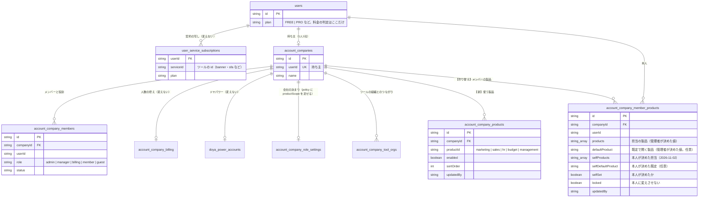

# ドヤバディを部門ごとの製品に分ける設計（2026-11-01）

三森さんの依頼（司令塔経由）を受けて作った設計です。いまは設計だけで、実装は三森さんの OK のあとに始めます。

> 依頼の要点（音声入力を整えたもの）: 課金の形とサービスの中身はそのままにする。使う人から見て分かりやすいように、ドヤバディ セールス、ドヤバディ マーケティング、ドヤバディ 経営管理、ドヤバディ 予実管理のように分ける。HubSpot のように、中のツールを切り替えて使い、部門の担当者が自分に合った画面で仕事を進められるようにする。

要点の図: `docs/design/buddy-products-2026-11-01.html`（ブラウザで開く）。

---

## 0. 結論

- 5つの製品に分けます。**セールス・マーケティング・人事・予実管理・経営管理**です。
- おすすめは **A案「見せ方だけ分ける」** です。ツールの URL・課金・データは変えません。左上の切り替えで製品を選ぶと、サイドバーとホームがその製品の分だけになります。
- 経営管理の製品のホームは、いまの経営ホーム（`/home`）です。社長と管理者は、ここから全部の製品を見渡せます。
- DB は、課金の表を変えません。足すのは「会社が使う製品」の表1つと、「メンバーの製品と既定の製品」の表1つです。後者は、まだ本番に無い部署の表（`account_company_member_departments`）を作り替えて使います。
- 段階は4つ（任意の5つ目あり）です。段1は DB を変えずに、旗（`PRODUCT_HUBS_ROLLOUT`、既定 off）の中で画面だけを作ります。

---

## 1. いまの形（調べた結果）

### 1.1 ツール

ログインしたあとに使えるツールは22個です（正本は `src/lib/services.ts`。カンニングはベータとして隠しているので数えていません）。

| 区分（今のメニュー） | ツール |
|---|---|
| マーケティング | AIO・記事作成・バナー・広告画像・ペルソナ・インタビュー・AI質問リンク・ポップアップ・展示会 |
| 営業（セールス） | 営業管理・商談準備・AI商談・リスト・スライド |
| 採用・人材管理 | HR・面接官・社内インタビュー・勤怠 |
| 経理・バックオフィス | 見積もり・プロマネ・収入管理・支出管理 |

### 1.2 部署の入口（main にある。旗は off）

10-26 の三森さんの決定で、すでに「部署ごとの入口」の仕組みが main に入っています。旗 `DEPARTMENTS_ROLLOUT` が off なので、本番では誰にも出ていません。

- 部署の表: `src/lib/departments.ts`。ドヤマーケAI・ドヤセールスAI・ドヤ人事AI・ドヤ管理AI の4つ。
- 経営ホームの部署のチップ（すべて・マーケ・セールス・人事・管理）: `src/app/(shell)/home/HomeDashboard.tsx`。
- 主に使う部署は cookie `doya_departments` に残します。
- 社員ごとの部署の表 `account_company_member_departments` は schema にありますが、本番 DB にはまだありません。画面にもつながっていません。

### 1.3 下書きの PR #75・#77（この設計の前提）

- #75（サイドバー）: 左に「経営ホーム」「動いているタスク」を置き、ツールを部署ごとのまとまりで畳めるようにしました。開閉は cookie `doya_shell_groups` に覚えます。
- #77（経営ホーム）: ゴールと ToDo から完成までの流れ、ドヤくんが進めた仕事の一覧（`/home/work`）を作りました。

この設計は、2つが main に入ったあとの形を前提にします。実装も、2つが入ってから始めます。

### 1.4 課金と会社

- 料金は無料とプロ（月9,980円）の2つです。判定は `User.plan` だけを見ます。サービスごとの行（`UserServiceSubscription`、全サービスの一覧は `ALL_SERVICE_IDS`）は、契約を全ツールにそろえて書く写しです。
- 会社は1アカウントに1つです（`account_companies`）。メンバー・役割・ドヤパワーの表は schema にありますが、旗の中で、本番 DB にはまだありません。
- 会社の役割は owner・admin・manager・billing・member・guest の6つです（`src/lib/company-roles/roles.ts`）。

### 1.5 ほかの製品の分け方（調べた結果の要約）

| 会社 | 分け方 | 切り替え | ホーム | 権限 |
|---|---|---|---|---|
| HubSpot | 共通の CRM の上に、Marketing・Sales・Service などの Hub を並べる | 2024年4月から左の縦のサイドバー。Hub は切り替える物ではなく、サイドバーの区分として並ぶ。上に全体の検索 | 個人が「既定のホーム」を選ぶ。管理者はチームごとに既定を決められ、個人が上書きできる | 座席が「使えるツール」を、権限が「できる操作」を決める |
| マネーフォワード クラウド | 会計・請求書・経費・給与・勤怠など、サービスごと | 右上の事業者名から切り替える | サービスごと | 権限はサービス×事業者ごと（給与担当者・従業員など） |
| freee | 会計・人事労務など、製品ごとに入口がある | 右上の事業所名から切り替える | 未確認 | 未確認 |
| SmartHR | 人事労務を核に、機能を足す（アプリストア SmartHR Plus） | 未確認 | 未確認 | ロールで、見られる従業員と項目を決める |
| Salesforce・Zoho One | 契約は1つで、入口はアプリごと | 左上の9つの点（App Launcher）、共通のサイドバー | アプリごと | アプリごと |

設計に使う教訓は5つです。

1. 共通の物（履歴・ファイル・会社の設定）は、どの製品にも入れず、別の区分に置く。
2. 切り替えを大きな画面にしない。サイドバーの上の切り替えと、全体の検索（⌘K）で足りる。
3. 既定のホームは、管理者の決めた既定と、個人の選択の2段で持つ。個人が上書きできる。
4. 「何が見えるか」と「何ができるか」を分ける。契約が1つなので、製品は見え方の絞り込みとして扱える。
5. 1つのツールを複数の製品に載せてよい。ただしツールの実体と URL は1つにする。課金・権限・履歴が分かれないようにするため。

出典は HubSpot のナビの案内（knowledge.hubspot.com/help-and-resources/a-guide-to-hubspots-navigation）、座席の案内（knowledge.hubspot.com/account-management/manage-seats）、マネーフォワードの事業者の切り替えの案内（biz.moneyforward.com/support/mypage/guide/selector.html）などです。

---

## 2. 製品の分け方

### 2.1 5つの製品

| 製品 | id | 誰が使うか | 入るツール |
|---|---|---|---|
| ドヤバディ マーケティング | `marketing` | マーケの担当者 | AIO・記事作成・バナー・広告画像・ペルソナ・インタビュー・AI質問リンク・ポップアップ・展示会 |
| ドヤバディ セールス | `sales` | 営業の担当者 | 営業管理・商談準備・AI商談・リスト・スライド・見積もり |
| ドヤバディ 人事 | `hr` | 人事・総務の担当者 | HR・面接官・社内インタビュー・勤怠 |
| ドヤバディ 予実管理 | `budget` | 経理の担当者 | 収入管理・支出管理・見積もり（共有）・プロマネ（共有） |
| ドヤバディ 経営管理 | `management` | 社長・管理者 | 経営ホーム・ドヤくんが進めた仕事・プロマネ・会社とメンバーと権限・ドヤパワー・全製品の数字 |

- 人事は依頼の例に無かったのですが、人事のツールが4つあるため、製品として立てます。
- 複数の製品に入るツールは2つです。見積もり（セールスと予実管理）とプロマネ（予実管理と経営管理）です。ツールの実体と URL は1つのままです。
- カンニングは、ベータとして隠す決定のとおり、どの製品にも入れません。
- 依頼の「経営管理」と「予実管理」は、次のように分けました。
  - 経営管理: 会社全体を見て判断する所。全部の製品の数字、判断が要ること、各部門の報告、メンバーと権限を置きます。今の経営ホームがそのまま中心になります。
  - 予実管理: お金の計画と実績を比べる所。収入管理の「売上の予定」と「請求・入金」、支出管理の「支払いの予定」と「支払い」を、月ごとに並べます。

### 2.2 予実管理の「予算」について

今のツールには、予算を入れる場所がありません。段1〜4では、今あるデータだけで予実を出します。

| 見るもの | 予（計画） | 実（実績） | 元のデータ |
|---|---|---|---|
| 売上 | 売上の予定（`income_revenue_schedules`） | 請求書・入金（`income_invoices`・`income_payments`） | 収入管理 |
| 支出 | 支払いの予定（`expense_schedules`） | 支払い（`expense_bills`） | 支出管理 |
| 案件 | 案件の予算（プロマネ） | 工数・経費（プロマネ） | プロマネ |

月ごとの予算を自分で入れる機能は、サービスの中身を足すことになります。そのため任意の段5に分け、三森さんの判断で決めます。

### 2.3 名前の付け方

- 正式名: 「ドヤバディ セールス」のように、ドヤバディと部門名の間に半角の空白を入れます。英語は DOYA BUDDY Sales・Marketing・HR・Budget・Management。
- 画面の中では、切り替えに「ドヤバディ」のロゴと部門名だけを出します（例: ロゴ＋「セールス」）。
- 今の「ドヤマーケAI」などの名前は使わなくなります。旗の中だけで使っていた名前なので、外への影響はありません。
- ツールの名前（ドヤ営業管理など）は変えません（10-30 の決定「ツールの名前は変えない」のとおり）。
- ブランド名の旗（`NEXT_PUBLIC_BRAND_RENAME_ROLLOUT`）が all でないあいだは、「ドヤAI セールス」と出します。名前は `brandName()` から作ります。

---

## 3. 3つの案と、おすすめ

| | A案 見せ方だけ分ける（おすすめ） | B案 URL も製品ごとに分ける | C案 製品ごとに別の入口のサイト |
|---|---|---|---|
| 中身 | 左上の切り替えで製品を選ぶ。サイドバーとホームが変わる。ツールの URL は今のまま（`/sfa` など） | `/sales/sfa`・`/marketing/banner` のように、URL の頭に製品を付ける | `sales.doya-ai.surisuta.jp` のように、製品ごとに入口と LP を分ける |
| ブックマーク・メールのリンク | そのまま開ける | 古い URL から新しい URL へ転送が要る | 転送とログインの共有が要る |
| 複数の製品に入るツール | 1つの URL のまま、どちらの製品でも開ける | URL が2つになる。どちらが正か決めにくい | 2つのサイトに分かれる |
| 課金・権限・データ | 変えない | 変えない | ログインの cookie をドメインをまたいで共有する作業が要る |
| 作る量 | 小さい（ナビとホームと設定） | 中くらい（全ツールのリンクを直す） | 大きい（ドメイン・ログイン・LP） |
| 戻しやすさ | 旗を off にすれば今の画面に戻る | 戻すと URL がまた変わる | 戻しにくい |

**おすすめは A案です。** 理由は3つです。

1. 依頼の「課金の形とサービスの中身はそのまま」に一番合います。ツールの URL も中身も変えずに、見え方だけを部門ごとにできます。
2. HubSpot も同じ形です。Hub を別のサイトにせず、1つの画面の中の区分として並べ、既定のホームで部門の担当者の入口を変えています。
3. 旗で出し分けられるので、三森さんのアカウントだけで先に試し、合わなければすぐ戻せます。

B案は「URL を見ればどの製品か分かる」良さがあります。ただ、見積もりとプロマネが2つの製品に入るため、URL が2つになります。C案は、製品ごとに広告や LP を出したくなったときに検討します。A案のあとからでも、LP だけを製品ごとに作ることはできます（段4）。

---

## 4. 画面（A案）

### 4.1 全体の形

```
┌──────────────┬─────────────────────────────┐
│ [ドヤバディ ▼] │  ← 製品の切り替え                │
│  セールス      │                             │
│──────────────│   製品のホーム（/hub/sales）      │
│ ホーム         │   ・部門の数字                    │
│ 動いているタスク │   ・ドヤくんに頼む（例は部門向け）  │
│──────────────│   ・判断が要ること                 │
│ ツール         │   ・最近つくったもの               │
│  営業管理      │                             │
│  商談準備      │                             │
│  AI商談        │                             │
│  リスト        │                             │
│  スライド      │                             │
│  見積もり      │                             │
│──────────────│                             │
│ すべてのツール   │                             │
│ 設定           │                             │
└──────────────┴─────────────────────────────┘
```

### 4.2 製品の切り替え

- 場所: サイドバーのいちばん上（今のロゴの位置）。ロゴ・製品名・下向きの矢印を出します。
- 押すと、製品の一覧が開きます。各行は、製品のアイコン・名前・一言の説明・ツールの数です。今の製品に印を付けます。
- 一覧の下に「この製品を既定にする」を置きます（4.6）。
- 会社が使っていない製品は、一覧の下に「ほかの製品」として薄く出します。管理者が押すと、会社の製品の設定（5.1）を開きます。メンバーには「管理者に頼んでください」と出します。
- スマホ: 上の帯の製品名を押すと、下からシートで同じ一覧が出ます（10-29 の決定「画面を移らずに、横・下から出す」のとおり）。
- キーボード: ⌘K の検索に製品の名前も載せます。「セールス」で製品とそのツールが出ます。

### 4.3 製品ごとのホーム

- URL は `/hub/<製品の id>` にします（例 `/hub/sales`）。`/sales` にしないのは、`/hr` がすでに HR のツールの URL だからです。
- 経営管理のホームだけは、今の経営ホーム `/home` です。新しい URL は作りません。
- ホームの中身は、#77 の経営ホームと同じ部品を、製品の分に絞って使います。
  1. 部門の数字（例 セールス: 今月の商談の数・見積の金額・受注の見込み。予実管理: 今月の売上の予と実・支払いの予と実）
  2. ドヤくんに頼む（例の文を部門向けにする。今の `HomeAgent` の `dept` を製品の id に置き換える）
  3. 判断が要ること・動いているタスク（その製品のツールの分だけ）
  4. 部員のツールのカードと、最近つくったもの
- 数字は各ツールの API から読みます。作り物の数字は出しません。読めないときは「まだデータがありません」と、ツールを始めるボタンを出します。

### 4.4 製品ごとのサイドバー

- 上から、製品の切り替え／その製品のホーム／動いているタスク（#75）／その製品のツール／すべてのツール／設定、の順です。
- 「動いているタスク」の件数は、その製品のツールの分だけを数えます。経営管理では全部を数えます。
- 「すべてのツール」を押すと、全22ツールを製品ごとに並べた一覧が開きます（#75 の部署のまとまりの部品を、そのまま使う）。ほかの製品のツールも、ここと ⌘K から開けます。
- ツールを開いているあいだも、サイドバーは今の製品のままにします。開いたツールが今の製品に無いとき（ほかの製品のツールをリンクで開いたとき）は、そのツールの主な製品に切り替えます。見積もりは、今の製品がセールスか予実管理ならそのまま、それ以外ならセールスにします。
- ツールの中のメニュー（各ツールの `nav.ts`）は変えません。

### 4.5 経営ホームとの関係

- 経営ホーム（`/home`）は「ドヤバディ 経営管理」のホームになります。
- 経営ホームの部署のチップ（すべて・マーケ・セールス・人事・管理）は、各製品のホームへのリンクに替えます。経営管理のホームでは、5つの製品の数字を1枚ずつのカードで並べ、押すとその製品のホームへ移ります。
- 社長と管理者が最初に開くのは、経営管理です。メンバーが最初に開くのは、その人の既定の製品です（4.6）。

### 4.6 最初に開く製品の決め方

ログインした直後と、ロゴを押したときに開く製品は、次の順で決めます。

1. 本人が「この製品を既定にする」で選んだ製品
2. 管理者がそのメンバーに決めた既定の製品
3. 最後に開いた製品（cookie）
4. 社長・管理者なら経営管理。メンバーなら、担当の製品の最初の1つ
5. どれも無ければ経営管理

会社に入っていない個人の利用者は、1・3・5だけを使います（表には書かず cookie に残します）。

---

## 5. 設定

### 5.1 会社ごとに、どの製品を使うか

- 画面: 設定の中の「製品」（`/home/products`。管理者以上だけ）。5つの製品をスイッチで並べます。
- 初めは全部を使う状態です（表に行が無いときは、全部を使うとみなします）。
- 使わない製品は、切り替えの一覧の「ほかの製品」に下げるだけです。ツールそのものは、すべてのツールと ⌘K から開けます。課金はプロ1つで全部のままなので、止める理由がないためです。
- 経営管理は止められません（設定と権限の入口なので）。

### 5.2 メンバーごとに、どの製品を担当し、どれを既定で開くか

- 画面: 今の役割の画面（`/home/roles`）に「担当の製品」と「既定の製品」の列を足します。
- 担当の製品は複数を選べます。切り替えの一覧で、担当の製品を上に出します。
- 既定の製品は1つです。担当の製品の中から選びます。
- 社長と管理者は、担当に関係なく全部の製品を見ます（今の部署の決まりと同じ）。

> **2026-11-01 実装で変えた点**: 画面は役割の画面（`/home/roles`）ではなく、製品の設定の画面（`/home/products`）の下半分にしました。

#### 5.2.1 本人が自分の担当を決める（2026-11-02 の決定。三森さんの指示）

- 画面: 「自分の担当」（`/home/my-products`）。会社の人なら誰でも開けます。切り替えの一覧の下の「自分の担当を決める」から入ります。
- 本人は、担当の製品をチップで選び、最初に開く製品を1つ選びます。
- 管理者が決めた担当があるときは、それを初期値にします。本人が変えたら、本人の値を先に使います。「管理者が決めた担当に戻す」で戻せます。
- 管理者は、メンバーごとに「本人に変えさせない」を選べます（`/home/products`）。このときは管理者の値だけを使い、本人の画面は見るだけになります。切り替えの一覧の「既定にする」も出さず、cookie の既定も使いません。
- 本人が変えた人には、管理者の画面で「本人が変えています」と出します。管理者が値を変えても、本人の値は消しません（ロックを外せば、また本人の値を使います）。
- 会社で使っていない製品は、本人の選択肢では薄く出します（選べます。ツールも開けます）。
- 本人が最初に開く製品を決めたときは、cookie（`doya_product_default`）も同じ値にそろえます。cookie が表より先に使われるためです。
- 表は増やしません。`account_company_member_products` に本人の値の列（`selfProducts`・`selfDefaultProduct`・`selfSet`）とロックの列（`locked`）を足しました。`selfSet` は「本人が担当を空にした」と「まだ決めていない」を分けるためにあります。

### 5.3 部門の担当者の権限

- 「何ができるか」は、今の会社の役割（owner・admin・manager・billing・member・guest）と、各ツールの役割のままです。製品では変えません。
- 製品が決めるのは「何が先に見えるか」だけです。担当でない製品のツールも、すべてのツールから開けます。10-26 の決定「部署で使えなくすることはしません（表示の順番を変えるだけ）」に合わせました。
- 会社によっては「担当の外は見せたくない」という要望が出ると思います。そのときのために、会社の決まり（`account_company_role_settings.policy`、JSON）に `productScope: 'order' | 'restrict'` を足せる形にしておきます。restrict では、担当の外の製品とツールを一覧から外し、ツールの入口でも断ります。作るのは要望が出てから（段5以降）にします。
- 製品の責任者（例: マーケの責任者が、マーケのメンバーの作業を見られる）は、今回は作りません。manager の役割で足りるかを、使ってもらってから決めます。

---

## 6. ER 図

### 6.1 今の表と、足す表

課金の表（`users.plan`・`user_service_subscriptions`・`subscriptions`・`account_company_billing`・ドヤパワーの表）は変えません。製品とツールの対応は、DB ではなくコードの表（`src/lib/products.ts`）に持ちます。ツールの id は課金の `serviceId` と同じなので、つなぎ目はコードの中だけです。



### 6.2 足す表・作り替える表

1. `account_company_products`（新）
   - 会社ごとに、製品を使うかと並び順を持ちます。行が無い製品は「使う」とみなします。
   - `@@unique([companyId, productId])`。`productId` は CHECK で5つに絞ります。
2. `account_company_member_products`（`account_company_member_departments` を作り替える）
   - 今の部署の表は、本番にまだありません（schema のコメントによる。流す前に統括で確かめる）。そこで、本番に流す前に、表の名前と列を製品の形に直します。
   - 列: `products TEXT[]`（担当の製品）、`defaultProduct TEXT NULL`（既定の製品）、`defaultSetBy TEXT NULL`（本人が選んだか、管理者が決めたか）。
   - もし部署の表が本番にすでにあったら、表は残し、`defaultProduct` と `defaultSetBy` の列を足し、値の CHECK を5つに広げる SQL に替えます。部署の id は `admin` → `budget` と読み替えます。
3. 会社に入っていない個人の利用者は、cookie（`doya_product`・`doya_product_default`）だけで持ちます。`users` の表には列を足しません。
4. 段5（任意）の予算の表 `budget_plan_lines`（companyId・月・区分・金額）は、三森さんが予算の入力を作ると決めたときだけ足します。

> **2026-11-01 実装で変えた点（段2）**: 部署の表（`account_company_member_departments`）は作り替えず、残したまま新しい表 `account_company_member_products` を足しました。部署の表を使う権限の画面とテストを変えずに済むためです。部署の表は、段4で製品を全員に出したあとに片付けます（本番に流していなければ、流さずに schema から消す）。
> - 並び順の列（`sortOrder`）と、既定を誰が決めたかの列（`defaultSetBy`）は作りませんでした。並びは製品の表の順で足りるためです。
> - 2026-11-02: 本人も担当を決められるようにしたため、本人の値の列と「本人に変えさせない」の列を足しました（§5.2.1）。表は増やしていません。
> - 表は `account_companies` に外部キーを張りません（部署の表と同じ形）。会社を消したときの片付けは、会社の削除の処理で行います（段4までに足す）。
> - 製品の設定の変更は、役割の変更の記録（`account_company_role_events`）に書きません。製品は見え方だけで、権限を変えないためです。

### 6.4 本番に流す SQL（段2。三森さんの OK のあと、統括が `apply-sql.cjs` で流す）

```sql
-- 部門ごとの製品の設定（docs/design/buddy-products-2026-11-01.md §5・§6）。既存の表には触らない
CREATE TABLE IF NOT EXISTS "account_company_products" (
    "id" TEXT NOT NULL,
    "companyId" TEXT NOT NULL,
    "productId" TEXT NOT NULL,
    "enabled" BOOLEAN NOT NULL DEFAULT true,
    "updatedBy" TEXT NOT NULL,
    "createdAt" TIMESTAMP(3) NOT NULL DEFAULT CURRENT_TIMESTAMP,
    "updatedAt" TIMESTAMP(3) NOT NULL,
    CONSTRAINT "account_company_products_pkey" PRIMARY KEY ("id"),
    CONSTRAINT "account_company_products_product_check"
        CHECK ("productId" IN ('marketing', 'sales', 'hr', 'budget', 'management'))
);
CREATE UNIQUE INDEX IF NOT EXISTS "account_company_products_companyId_productId_key"
    ON "account_company_products" ("companyId", "productId");

CREATE TABLE IF NOT EXISTS "account_company_member_products" (
    "id" TEXT NOT NULL,
    "companyId" TEXT NOT NULL,
    "userId" TEXT NOT NULL,
    "products" TEXT[],
    "defaultProduct" TEXT,
    "selfProducts" TEXT[] DEFAULT ARRAY[]::TEXT[],
    "selfDefaultProduct" TEXT,
    "selfSet" BOOLEAN NOT NULL DEFAULT false,
    "locked" BOOLEAN NOT NULL DEFAULT false,
    "updatedBy" TEXT NOT NULL,
    "createdAt" TIMESTAMP(3) NOT NULL DEFAULT CURRENT_TIMESTAMP,
    "updatedAt" TIMESTAMP(3) NOT NULL,
    CONSTRAINT "account_company_member_products_pkey" PRIMARY KEY ("id"),
    CONSTRAINT "account_company_member_products_values_check"
        CHECK ("products" <@ ARRAY['marketing', 'sales', 'hr', 'budget', 'management']::TEXT[]),
    CONSTRAINT "account_company_member_products_default_check"
        CHECK ("defaultProduct" IS NULL OR "defaultProduct" IN ('marketing', 'sales', 'hr', 'budget', 'management')),
    CONSTRAINT "account_company_member_products_self_values_check"
        CHECK ("selfProducts" <@ ARRAY['marketing', 'sales', 'hr', 'budget', 'management']::TEXT[]),
    CONSTRAINT "account_company_member_products_self_default_check"
        CHECK ("selfDefaultProduct" IS NULL OR "selfDefaultProduct" IN ('marketing', 'sales', 'hr', 'budget', 'management'))
);
CREATE UNIQUE INDEX IF NOT EXISTS "account_company_member_products_companyId_userId_key"
    ON "account_company_member_products" ("companyId", "userId");

-- 2026-10-28 の決まりに合わせて RLS を有効にする（アプリの接続は RLS を通り抜けるので、読み書きは変わらない）
ALTER TABLE "account_company_products" ENABLE ROW LEVEL SECURITY;
ALTER TABLE "account_company_member_products" ENABLE ROW LEVEL SECURITY;
```

戻すときの SQL（表を消す。旗が off なら読まないので、消さなくても動きます）:

```sql
DROP TABLE IF EXISTS "account_company_member_products";
DROP TABLE IF EXISTS "account_company_products";
```

- 前提: 会社の役割の旗（`COMPANY_ROLES_ROLLOUT`）が off でないこと。段2の画面と表は、会社の役割の仕組み（`/api/company/*`）の中で動くためです。会社の役割の表（ROLES §8.2）と、新しい料金の会社のメンバーの表（PRICING-NEW-MIGRATION.md）が本番に無いあいだは、段2の画面は 404 のままで、段1の画面だけが動きます。

### 6.3 コードの表（DB ではない）

```ts
// src/lib/products.ts（今の src/lib/departments.ts を置き換える）
export type ProductId = 'marketing' | 'sales' | 'hr' | 'budget' | 'management'
export const PRODUCTS = [
  { id: 'marketing', name: 'マーケティング', home: '/hub/marketing', toolIds: ['aio','seo','banner','adimage','persona','interview','asklink','popup','tenjikai'] },
  { id: 'sales', name: 'セールス', home: '/hub/sales', toolIds: ['sfa','shodan','aishodan','doyalist','doyaslide','quote'] },
  { id: 'hr', name: '人事', home: '/hub/hr', toolIds: ['hr','mensetsu','shanai','kintai'] },
  { id: 'budget', name: '予実管理', home: '/hub/budget', toolIds: ['income','expense','quote','promane'] },
  { id: 'management', name: '経営管理', home: '/home', toolIds: ['promane'] },
]
// ツールの主な製品（複数に入るツールを、ほかの製品から開いたときの行き先）
export const PRIMARY_PRODUCT: Record<string, ProductId> = { quote: 'sales', promane: 'budget' }
```

- `src/lib/company-roles/departments.ts` に重ねて持っている部署の id の表は、この表から import する形にそろえます（今は2か所にあります）。
- `services.ts` には製品を持たせません（今の部署の決まりと同じ。正本を1つにするため）。

---

## 7. 段階と移行

| 段 | 中身 | DB | 本番への影響 |
|---|---|---|---|
| 1 | 製品の表（`products.ts`）、旗 `PRODUCT_HUBS_ROLLOUT`、左上の切り替え、製品ごとのサイドバー、製品のホーム4つ（`/hub/*`）、最初に開く製品の決め方（cookie だけ） | 変えない | 旗が off なら今のまま |
| 2 | 会社の製品の設定（`/home/products`）、メンバーの担当と既定（`/home/roles`）、上の2つの表 | 表を足す（三森さんの OK のあと統括が流す） | 旗が off なら読まない |
| 3 | 製品のホームの数字（各ツールの API から）、予実管理の月ごとの予と実、ドヤくんの例と動いているタスクを製品で絞る | 変えない | 旗の中だけ |
| 4 | 旗を preview（三森さんだけ）→ all。初めの1回だけ「製品ごとに分かれました」の案内を出す。LP と料金の画面に「プロ1つで5つの製品が全部使えます」と書く | 変えない | 全員の画面が変わる |
| 5（任意） | 予算の入力（`budget_plan_lines`）、担当の外を隠す設定（`productScope: restrict`） | 表を足す | 三森さんが決めたときだけ |

### 7.1 今の利用者への影響

- ツールの URL・ブックマーク・送ったメールのリンクは、そのまま開けます。
- 料金・契約・ドヤパワー・作ったデータは変わりません。
- 変わるのは、ログインしたあとのサイドバーとホームの見え方です。段4で旗を all にした日から変わります。
- 部署の旗（`DEPARTMENTS_ROLLOUT`）を preview で見ていた人（三森さん）の cookie `doya_departments` は、読み替えて引き継ぎます（`admin` → `budget`）。引き継いだあと、部署の旗と cookie は使わなくなります。片付けは段4のあとの別の PR で行います。
- #75 のサイドバーの開閉の cookie（`doya_shell_groups`）は、「すべてのツール」の一覧の開閉に使い続けます。

### 7.2 戻し方

- 旗 `PRODUCT_HUBS_ROLLOUT` を off にして再デプロイすれば、今のサイドバーと経営ホームに戻ります。
- 段2の表は、旗が off なら読みません。表を消す必要はありません。

### 7.3 実装するときの PR の分け方

1. PR-1（段1）: `src/lib/products.ts`・旗・切り替え・サイドバー・`/hub/*` の骨組み。触るファイルは `src/components/shell/*`・`src/app/(shell)/layout.tsx`・`src/app/(shell)/hub/*`（新）・`src/lib/products*`。
2. PR-2（段2）: schema と SQL（本番には流さない）、`/home/products`、`/home/roles` の列、API 2本（`GET/PUT /api/company/products`、`PUT /api/company/members/[id]/products`）。
3. PR-3（段3）: 製品のホームの数字と予実の表、ドヤくんの例。
4. PR-4（段4）: 案内と LP・料金の文言。旗の値を変えるのは、統括で三森さんの OK のあと。

どの PR も下書きで出し、`heavy-slot.sh` を通して `npx tsc --noEmit` と `npx next build` を確かめ、画面は 375px と 1280px の写真で前後を比べます。

### 7.4 本番に出す日の手順（2026-11-02 作成。三森さんが統括で OK するときに見る1ページ）

どの手順も、三森さんが統括のセッションで直接 OK を出してから行います。main への push は、そのまま本番のデプロイになります。

**0. 前日まで（本番に触らない）**
- #80・#81 の GitHub の build と check が通っていることを確かめる。
- 三森さんが Vercel にログインしたブラウザで、プレビューの見本ページを見る（`/hub/preview`・`/hub/preview/my-products`・`/hub/preview/settings`）。見本ページは本番では 404 です。
- 統括で、本番 DB に会社の役割の表（ROLES §8.2）と新しい料金の会社のメンバーの表があるかを確かめる。無ければ、段2の画面は 404 のままです（段1だけが動きます）。

**1. PR を入れる順番（旗は off のまま）**
1. #80（段1）を main に merge する。Vercel の本番のデプロイが Ready になるのを待つ（いまは25分ほど）。
2. 本番で、今までと画面が変わらないことを確かめる。左のメニューが今の区分のまま、`/hub/sales` と `/hub/preview` が 404、`/home` に製品の帯が出ない、の3つです。
3. #81（段2）の差分が段2の分だけになったことを確かめてから merge する。同じように Ready を待ち、画面が変わらないことを確かめる。

旗が off のあいだは、セッションも段2の表も読みません。この2つの merge だけでは、利用者の画面は変わりません（回帰チェック `verify-departments-flag` で確かめています）。

**2. 表を足す（§6.4 の SQL）**
1. 統括が `apply-sql.cjs` で §6.4 の SQL を流す。新しい表を2つ足すだけで、既存の表には触りません。
2. 流したあと、表が2つあり、列（`selfProducts`・`selfDefaultProduct`・`selfSet`・`locked`）がそろっていることを確かめる。

**3. 旗を切り替える順番**
1. `UI_PREVIEW_EMAILS` に三森さんのメールが入っていることを確かめる。
2. `PRODUCT_HUBS_ROLLOUT=preview` を本番に足し、空のコミットを push して再デプロイする（環境変数は再デプロイするまで効きません）。
3. 三森さんのアカウントで、次を確かめる。
   - ログインしたあと、経営管理（`/home`）が開く。左上の切り替えで5つの製品を行き来できる。
   - `/hub/sales`・`/hub/budget`・`/hub/hr` に、作り物ではない数字か「まだデータがありません」が出る。
   - 会社の役割の旗も on なら、`/home/products` で使う製品のスイッチ、`/home/my-products` で自分の担当を保存できる。
   - 375px と 1280px の写真を撮り、見本と比べる。
4. 全員に出す（`all`）のは段4です。案内の文と LP・料金の文言を入れてから、別の日に OK をもらって行います。

**4. 戻し方**
- 画面を戻す: `PRODUCT_HUBS_ROLLOUT` を消すか `off` にして、空のコミットで再デプロイする。今のサイドバーと経営ホームに戻ります。
- 表は消さなくても動きます（旗が off なら読みません）。消すときは §6.4 の戻す SQL を流します。
- コードの不具合で戻すときは、merge のコミットを `git revert -m 1 <コミット>` で打ち消して push する（force push はしない）。#81 を先に、#80 をあとに戻します。

---

## 8. 三森さんに決めてほしいこと

> **2026-11-01 決定**（司令塔での質問「おすすめどおり（A案、5製品、予算の入力はあとで）で進めてよいですか？」への返事「おすすめで進める」）:
> 1. A案で進める。2. 製品は5つ。3. 見積もりとプロマネは2つの製品に入れてよい。4. 予算の入力（段5）は、あとで決める。今は作らない。5. 担当でない製品のツールも開けるままにする。
> 段1から始め、最初は三森さんのアカウントだけに出す（旗 `PRODUCT_HUBS_ROLLOUT=preview`）。

以下は決める前の問いです（記録として残します）。

1. 案: A案（見せ方だけ分ける）で進めてよいか。
2. 製品の数と名前: セールス・マーケティング・人事・予実管理・経営管理の5つでよいか。
3. 見積もりとプロマネを、2つの製品に入れてよいか。
4. 予算の入力（段5）を作るか。作らない場合、予実管理は「売上と支払いの予定」と「実績」を比べる形になります。
5. 担当でない製品を、隠さずに「すべてのツール」から開けるままにしてよいか（今の決定のまま）。

## 9. まだ確かめていないこと

- 会社のメンバー・役割・部署の表が本番 DB にあるか（schema のコメントでは無い。統括で確かめる）。
- 製品のホームに出す数字を、各ツールの API から、どこまで速く読めるか（段3で測る）。
- freee・SmartHR の製品の切り替えの画面の細かい形（公開の案内では分からなかった）。
