# ドヤAI UIリニューアル 制作ログ（動画用）

AIに依頼しながらドヤAIの画面を作り直していく過程を、そのまま動画にするための記録です。
進捗のたびに、下に「ラウンド」を足していきます。

- 見本の場所: `/ui-renewal`（アプリ画面）・`/ui-renewal/lp`（LP）
- 作業ブランチ: `feat/ui-renewal-sample`（worktree `~/Code/09_Cursol-ui-renewal`）
- **本番には反映していません。** main にマージしない限り、doya-ai.surisuta.jp は変わりません。
- 数値・画像はすべて見本です。実際の利用者データは使っていません。
- 画像の生成は Codex 内蔵の画像生成（定額枠）だけを使用。従量課金のAPIは使っていません。

## 動画の構成案（撮影メモ）

1. つかみ：現行の画面 → 新しい画面を並べて見せる（`shots/00-before-*` と最新版）
2. どう頼んだか：下の「依頼」欄の言葉をそのまま字幕に
3. 参考にしたもの：あにまる製薬メディアの動き → Linear / Stripe / Attio / Raycast / Vercel の手法
4. 見どころ実演（画面収録）
   - ホームの数字が回って止まる・マス目が埋まる
   - 「AIに頼む」に文字を打つと、合うAIへ飛ぶ
   - ⌘K のパレットを矢印キーで操作
   - 業務マップの点を押すと線が伸びてAIが並ぶ
   - ドヤバナーAIで「見本を選ぶ → 作る → 採点つきで比べる」
   - 右下のボタンでデザイン案を4つ切り替える／カーソル演出
5. 安全なgit運用の解説：ブランチ・worktree・push と マージの違い（ラウンド2）
6. しめ：まだ本番に出していない理由と、次にやること

---

## ラウンド0｜現状と調査

**依頼**
> どやAIのサービスのUIをめっちゃ使いやすく見やすいUIにリニューアルを考えています、仮のリニューアルデザインを考えてください、インフォグラフィックアニメーションを用いたりして … https://media.animal-seiyaku.co.jp/ このサイトもAIでclaudeが作ったはずなので、ちゃんと作れるようにリサーチ含めて進めて

**やったこと**
- 現行のドヤAI（トップ・ドヤバナーAI）を確認。ログイン前はLPが出る作り。
- あにまる製薬メディアのHTML/CSSを読んで、動きの作り方を分解。
  - 画面に入った要素に印を付けて、CSSでふわっと出す（data-reveal）
  - 写真が角丸の枠から広がって現れる（clip-path）
  - 見出しが1文字ずつ下からせり上がる
  - 「からだマップ」：点に触れると線が伸びて記事カードが出る
  - ボタンに触れると中から円が広がって色が変わる
  - 動きのテンポ（イージング）を1種類に統一、動きを減らす設定の人には止める

**撮影ポイント**: 参考サイトの「からだマップ」→ 後で作る「業務マップ」の元ネタとして並べる

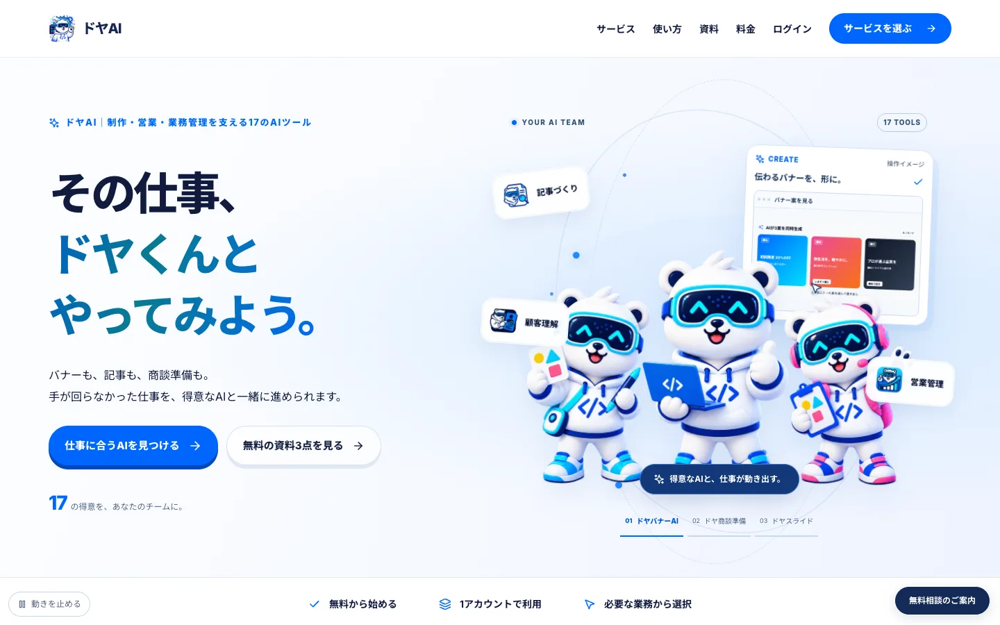
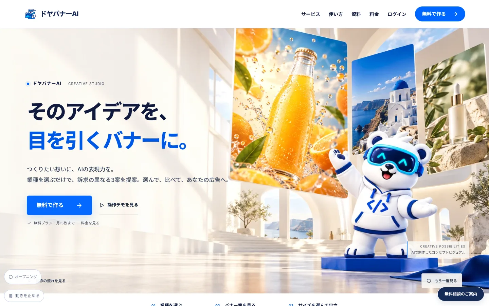

---

## ラウンド1｜初版の見本

**やったこと**
- ログイン後の画面を想定した見本 `/ui-renewal` を新しく作成（既存ファイルは変更なし）。
- 共通の枠：18のAIを「集める・売る・雇う/育てる・回す」の4色で分けたサイドバー、⌘K検索、スマホ下部タブ。
- ホーム：今月AIに任せた時間を「1マス＝1時間」で見せるマス目、KPI、週ごとのグラフ（棒が伸びて線がなぞる）、内訳ドーナツ。
- 業務マップ：参考サイトのからだマップを会社の仕事に置き換えた図。

**以前との違い**
| 以前 | 初版 |
|---|---|
| サービスごとに入口がばらばら | 4つの仕事の段階で18のAIを整理 |
| 数字は文字だけ | マス目・グラフ・ドーナツで「どれだけ任せたか」が一目で分かる |

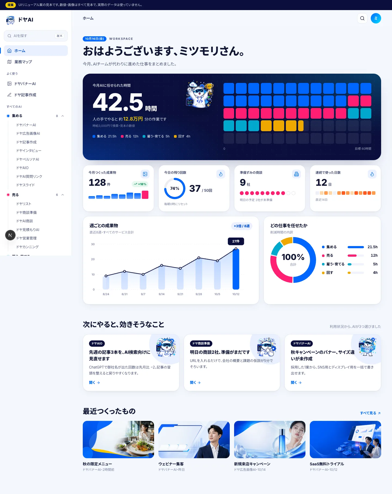
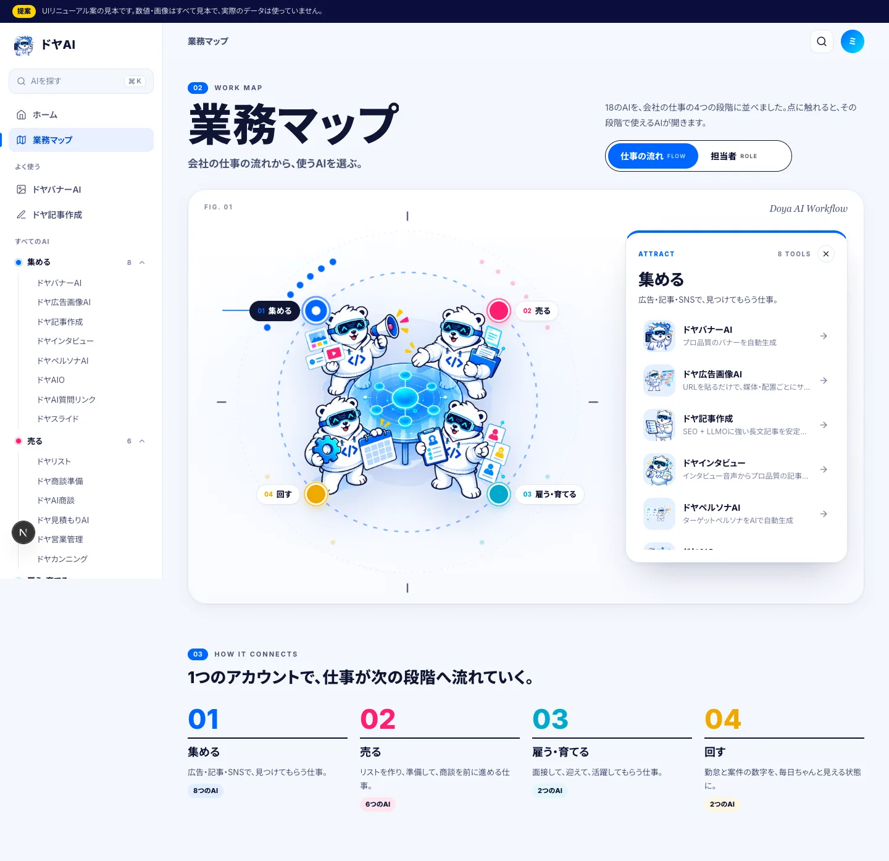

---

## ラウンド2｜進め方の指示（git・Obsidian・画像）

**依頼**
> ちゃんとドヤマーケAIのgitでしか操作せず、僕の勉強のためにもちゃんとした安全なgit運用してください、obsidianをちゃんと読み込んだりしてください、そして画像もcodexの内蔵画像生成ならOKです
> ドヤマーケのもの以外には絶対影響は与えないでください

**やったこと**
- 本体フォルダには別作業の未保存の変更があったので触らず、**worktree（同じリポジトリの別作業フォルダ）＋専用ブランチ**で作業。
- 追加するのは `src/app/ui-renewal/`・`public/ui-renewal/`・`docs/ui-renewal/` だけ。
- `git add` はフォルダ名を指定、コミット前に差分を確認、push は作業ブランチだけ（main には入れない）。
- Obsidian の「キャラクター」ノートを読み、サービス紹介には **SaaSクマ（サービス別15種）** を使う決まりに合わせた。
- 足りない画像2枚（業務マップ中央・ツールの待ち画面）を Codex 内蔵の画像生成で作成。

**撮影ポイント（git解説）**
- git＝手元で変更の記録を取る道具／GitHub＝その記録を預けるネット上の置き場所
- ブランチ＝本線から分けた作業用の線。マージ＝本線へ合流。ドヤAIは main に合流した瞬間に本番へ出る
- だから「ブランチで作って、見てから、合流させる」

---

## ラウンド3｜ツールの作業画面

**依頼**
> サービス紹介だけでなくツールのUIも考えてください

**やったこと**
- ツール画面の「型」を2本作成。
  - ドヤバナーAI：入力 → 4工程が順に点灯してログが流れる → 4案が開いて点数リング → 内訳を比べて書き出し
  - ドヤ記事作成：構成が組み上がる → 本文が埋まる → 右側で採点とチェックを見ながら仕上げ
- どのツールでも同じ位置に「工程バー」「残り回数」「見本である旨」を出す共通の枠。

**以前との違い**
| 以前 | 新しい型 |
|---|---|
| 生成中は待つだけ | 何をしているかを工程とログで見せる |
| 結果を並べるだけ | 点数と内訳で「どれを選ぶべきか」が分かる |

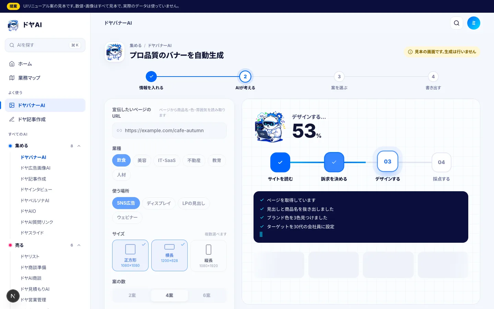
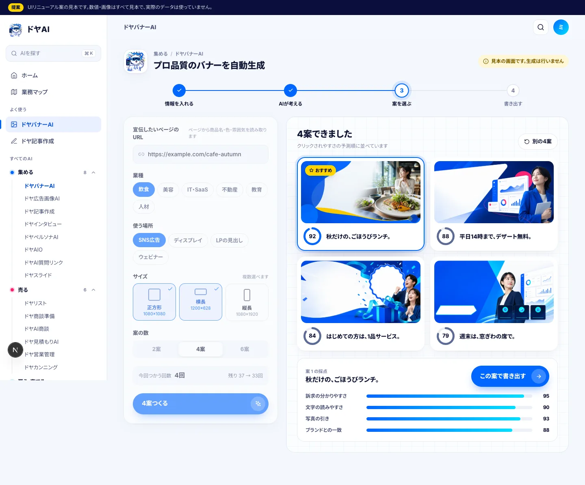
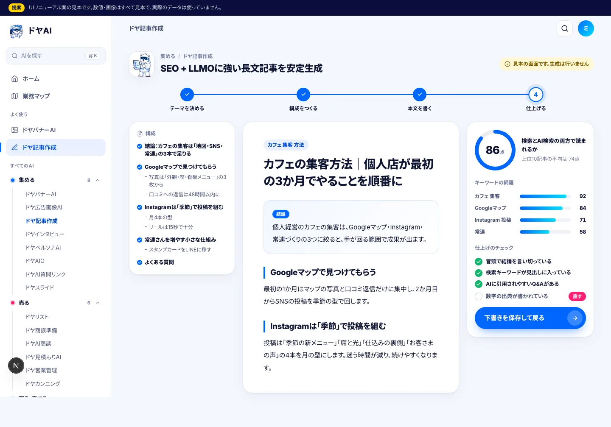

---

## ラウンド4｜有名SaaSを参考に磨き込み

**依頼**
> 他にもSaaSの有名サイトやオシャレなサイトを参考にデザインを最高のクオリティにしてください

**参考にしたもの（実際に見て拾った手法）**
| サイト | 取り入れた手法 |
|---|---|
| Linear / Vercel | 2トーン見出し（言い切り＋薄い補足）、等幅の小さな英字ラベル、細い罫線と四隅の十字 |
| Attio | ホームの主役を「AIに頼む」入力欄に。下に「よく使う操作」 |
| Stripe | ゆっくり流れるグラデーションの光、数字が1桁ずつ回って止まる |
| Raycast | 矢印キーで選んで Enter で開くパレット、粒子ノイズの質感 |
| 共通 | カーソルに追従して光るカードの縁 |

**やったこと**
- 「AIに頼む」入力：例文が自動で打たれては消える。「バナー」「記事」「商談」などの言葉で合うAIへ振り分け。
- ⌘K パレットを「操作」と「AI」の2段にし、キーボードで操作できるように。
- サイドバーの選択中の背景が、次の項目へ滑って移る。

---

## ラウンド5｜デザイン4案・カーソル演出・バナーの見本選び・LP（進行中）

**依頼**
> ドヤバナーAIはいろんなバナーからちゃんと選ぶような使いやすさを持たせてください … カラーやグラデーションなど徹底的にモダンな仕様モリモリで、カーソルとかもモリモリで、すんごい楽しい仕様にしてください、数パターンのデザイン提案してください
> LPのデザインも数パターン作って確認させてください

**やったこと（ここまで）**
- デザイン案を4つ用意し、右下のボタンでその場で切り替えられるように。
  - クリア：清潔な青と細い線（今の延長）
  - オーロラ：流れる色とすりガラスの面、グラデーション文字
  - ミッドナイト：暗い面に発光（Linear / Raycast 型）
  - ポップ：太い線とずらした影、触ると少し傾く
- カーソル演出：点＋遅れてついてくる輪／押せる物の上で輪が膨らみラベル（「開く」「頼む」）／ボタンが吸い付く／クリックで粒が弾ける／光の尾。マウスの端末だけで動き、右下のボタンで止められる。

- ドヤバナーAIの最初に「見本を選ぶ」工程を追加（工程は 見本を選ぶ → 情報を入れる → AIが考える → 案を選んで書き出す）。
  - 39枚の見本を「テイスト20／業種12／用途7」で絞り込み。タブの下地が滑って移る
  - 検索（例：やわらか、飲食、SNS）、「よく使われる順／新着順」の並び替え
  - 7枚に1枚を大きく見せて、一覧に強弱を付ける
  - クリックで選ぶと番号付きの輪が付き、下のトレイに選んだ順で並ぶ（最大3枚。4枚目はトレイが揺れて知らせる）
  - ハートでお気に入り、お気に入りだけの表示
  - 拡大プレビュー：左右キーで送れる・似ている見本・その場で選ぶ
  - 次の入力画面の一番上に「参考にする見本」が並び、いつでも選び直せる

**以前との違い**
| 以前 | 今回 |
|---|---|
| 条件を入れて、出てきたものを受け取る | 先に「好きな雰囲気」を目で選んでから作る |
| 見た目は1種類 | 4つのデザイン案をその場で切り替えて比べられる |
| カーソルは普通の矢印 | 触る物に合わせて輪・ラベル・吸い付き・粒が反応する |

**撮影ポイント**
- 右端のデザイン案ボタンを順に押して、同じ画面が4通りに変わる様子（色が流れ込む演出つき）
- ギャラリーで「テイスト」タブ → 「やわらか」 → 3枚選ぶ → 4枚目でトレイが揺れる
- 見本を拡大 → 矢印キーで送る → 「この見本を選ぶ」
- カーソルをボタンに近づけると吸い付く、クリックで粒が弾ける

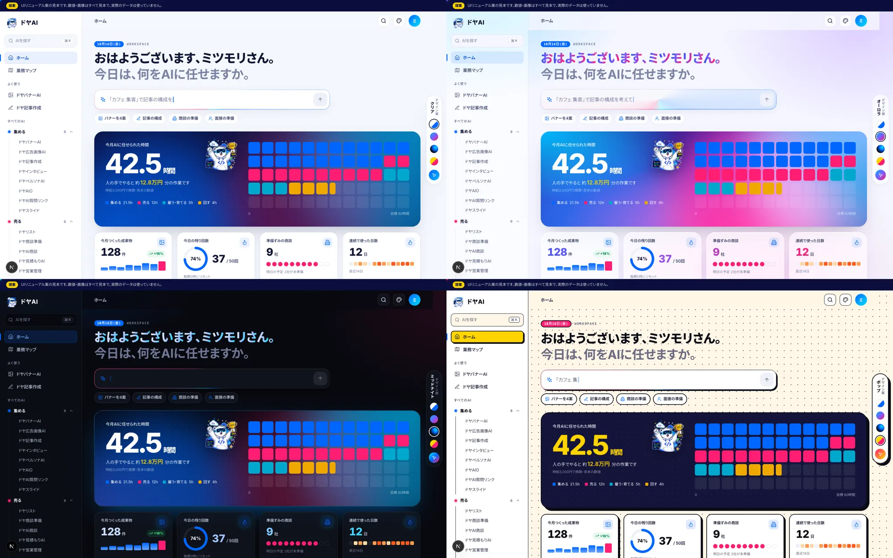
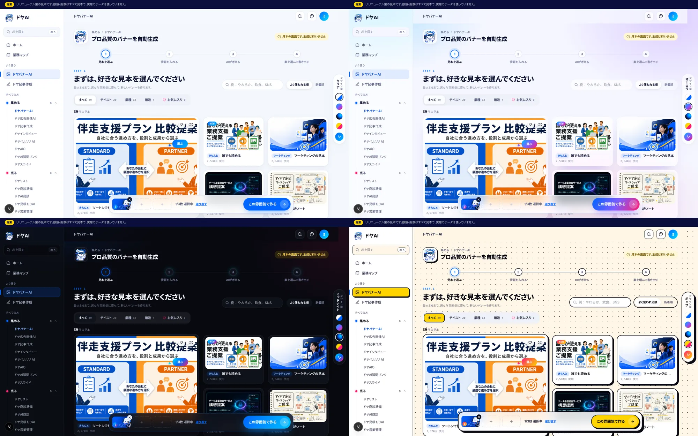
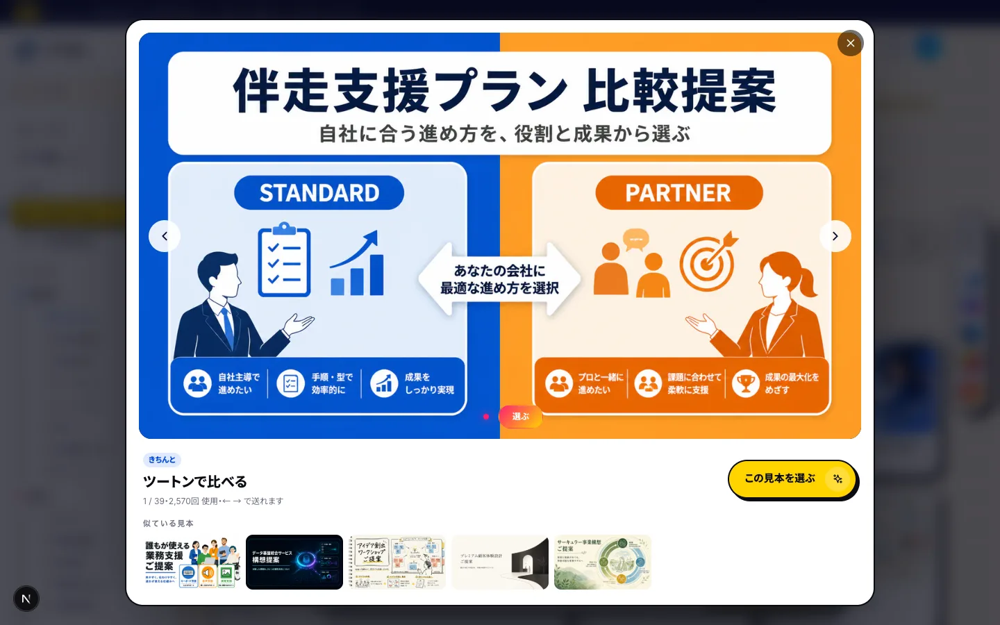
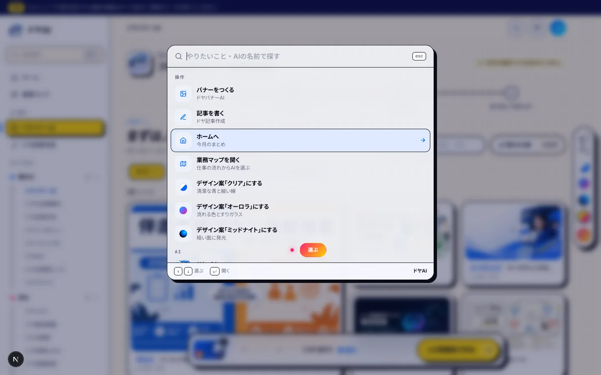

**直した不具合（撮影の裏話に使える）**
- 拡大プレビューが表示されなかった：画面切り替えの動きが終わった後も「変形中」の扱いが残り、画面に固定する部品の基準がずれていた。動きの終わりに状態を残さない書き方に変更。
- ポップ案で青いマス目が青い背景に溶けていた：ヒーローを黒系に変更。

**このあと**
- LPを4パターン（別の担当エージェントが並行で作成中）
